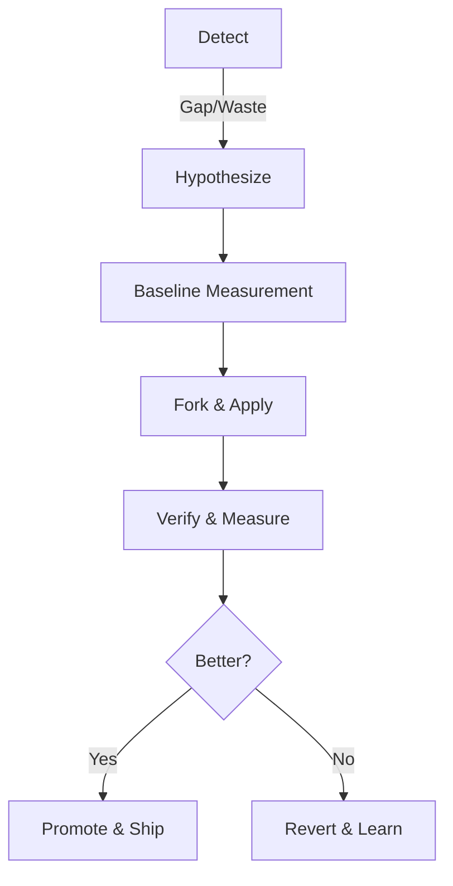

# Agent Evolution System Architecture

**Status**: Design (2026-03-24)
**Owner**: Bob
**Drivers**: Coach (Behavior), Optimizer (Efficiency)
**Sensor**: Evaluator

## 1. Vision: The Self-Correcting Team

The Agent Evolution System is the machinery that ensures agents get smarter, faster, and cheaper over time without constant human intervention. It transforms "improvement" from an ad-hoc event into a systematic process.

**Core Principle**: Every change to an agent must be **measured against a baseline**. If we can't measure it, we don't change it.

## 2. The Metric: Agent Health Index (AHI)

We define a composite metric to track agent health. Improvement means increasing this score.

### AHI Components
1.  **Reliability (R)**: Gym Pass Rate (Last N runs).
    *   *Source*: `test/gym/stats.db`
    *   *Target*: > 90%
2.  **Quality (Q)**: Average Evaluator Score (Last N sessions).
    *   *Source*: `.state/requests.db` (evaluations table)
    *   *Target*: > 4.5/5
3.  **Efficiency (E)**: Ops per Success (Inverse cost).
    *   *Source*: `.state/ops-receipts.jsonl`
    *   *Target*: Role-dependent (e.g., Coder < 30 ops, Scout < 20 ops)

### The Dashboard
The "Benchmarks" tab in the UI serves as the visualization of AHI. It must show the trend line for each agent.

## 3. The Unified Evolution Loop

All improvements—whether adding a skill or cutting a prompt—follow the **Standard Evolution Loop**.

### Modes of Evolution

| Mode | Driver | Trigger | Action | Success Metric |
|------|--------|---------|--------|----------------|
| **Behavioral Growth** | **Coach** | High Failure Rate (R < 80%), Low Quality (Q < 4.0), Missing Skill | Add Skill, Update SOUL, Add Scenario | Higher Pass Rate, Higher Eval Score |
| **Structural Optimization** | **Optimizer** | High Cost (E low), Prompt Bloat (> 5KB) | Prune SOUL, Tune Config, Slim Prompts | Lower Token Cost, Same/Higher Pass Rate |

## 4. The Standard: Gym as CI

The Gym is the **Continuous Integration (CI)** system for agents.
*   **Gate**: No change is promoted to a live agent without a passing Gym run.
*   **Baseline**: Before touching an agent, we run its "Regression Suite".
*   **Verification**: After changing an agent, we re-run the suite.
    *   *Green*: Improvement confirmed.
    *   *Red*: Regression detected. Abort.

### Scenario Suites
1.  **Universal Suite**: Core competencies (Task adherence, File safety, Convention checks). Runs on ALL agents.
2.  **Role Suite**: Role-specific tasks (e.g., Coder: Refactoring; Scout: Deep research).
3.  **Regression Suite**: Accumulated test cases from past failures.

## 5. Prompt Governance: The Living Document

The Prompt (SOUL, DOMAIN, TOOLS) is the agent's mind. It tends to rot (accumulate bloat).

### Policy: Conservation of Prompt Mass
*   **Soft Limit**: 3KB per SOUL.md.
*   **Pruning Cycle**: Optimizer periodically runs a "Slimming Cycle" to remove unused rules.
*   **Migration**: Validated skills move from `SOUL.md` (active memory) to `knowledge/` (reference) or `common-sense.md` (infra).

## 6. Roles & Responsibilities

### Coach: The Teacher
*   **Focus**: Effectiveness.
*   **Input**: Eval failures, Gym failures.
*   **Output**: New Skills, Updated SOUL (additions), New Scenarios.
*   **Workflow**: The Growth Cycle (Fork -> Train -> Verify -> Promote).

### Optimizer: The Engineer
*   **Focus**: Efficiency.
*   **Input**: Cost data, Prompt size, Redundant patterns.
*   **Output**: Slimmer SOUL (subtractions), Tuned Configs, Faster Handlers.
*   **Workflow**: The Optimization Cycle (Baseline -> Prune -> Verify -> Ship).

### Evaluator: The Judge
*   **Focus**: Truth.
*   **Input**: Sessions logs.
*   **Output**: Scores (Q), Failure Signals.
*   **Workflow**: Cron job `analyze-failures`.

## 7. Coordination Protocol

To prevent collisions (Coach adding while Optimizer prunes):
1.  **Locking**: An agent under active evolution (Forked) is locked.
2.  **Sequence**:
    *   *Phase 1*: Coach fixes behavior (Add mass).
    *   *Phase 2*: Optimizer stabilizes and prunes (Reduce mass).
3.  **Handoff**: Coach marks a skill as "Stable". Optimizer later reviews it for compression.

## 8. Implementation Strategy

1.  **Establish Baselines**: Run the Universal Suite on all agents to get initial R-scores.
2.  **Activate Optimizer**: Enable the "Prompt Slimming" job for the heaviest agents (currently Coder, Scout).
3.  **Activate Coach**: Focus Coach on the lowest R-score agents.
