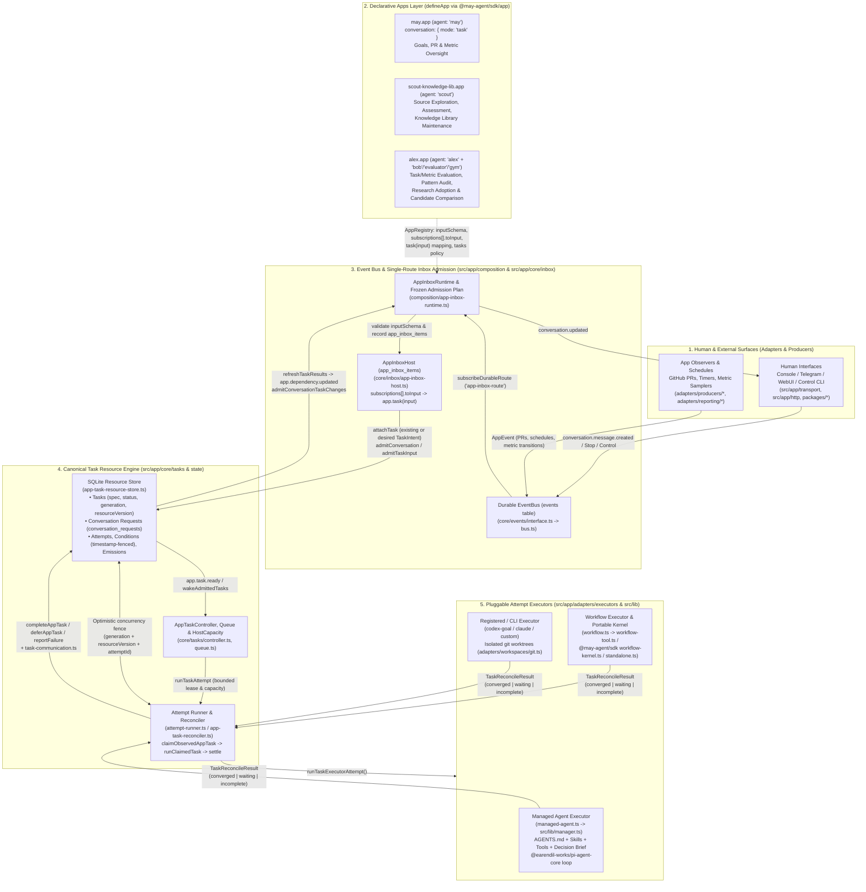

# Architecture

**Supports:** [System Model](system-model.md#reuse-the-foundation-at-an-acceptable-cost). Makes shared execution and coordination reusable with clear component owners.

**Choice basis:** [Core Principles](../1-principles/core-principles.md#stable-core-replaceable-capabilities).

**Design status:** Accepted.
**Implementation status:** The four responsibilities below are implemented.
Conversation, ordinary work and maintenance share Task execution; the inbox
admits and correlates input. Task activation and recovery work independently
of optional schedules. The [source reading guide](../2b-manual/source-reading-guide.md)
maps these boundaries to current code; source status does not identify deployment.

Read [System Model](system-model.md) for the product vocabulary and a complete
example. This page owns component boundaries, dependencies and code placement.

## Core responsibilities

| Component | Purpose and owned state | Input and output |
| --- | --- | --- |
| App registration and input admission | Keep one validated App generation and its declared routes; validate addressed input and apply the App's pure mapping | Definitions and typed input become published routes and an accepted handling/Task identity, or a rejection |
| Events | Record meaningful input and changes; route admitted events and expose observations | Publication becomes a durable receipt, exact routed work, and passive notifications |
| State and storage | Keep authoritative records and enforce consistent, version-checked changes | Typed reads and atomic operations return canonical state and committed dispositions |
| Work runtime | Run bounded Task attempts, including Conversation Turns; enforce waits, scoped Stop, explicit closure and recovery | Durable input or an identity wake leads to a fenced attempt and accepted outcome; an authorized close prevents further execution |

The boundaries cooperate: admission uses event and state transactions; runtime
uses the stored identities and registered execution contracts. Storage enforces
atomicity, while Apps define meaning and acceptance. No component gets a second
copy of authoritative work state.

Shared timing is core machinery used by runtime waits/recovery and optional
producers. Default failure handling belongs at admission and execution
boundaries: retain evidence, fence stale work, release resources, contain failure,
and expose what needs a decision. Neither needs a new service. Apps and LLMs
judge uncertain diagnosis, repair and scope changes. Existing metrics observe
these facts; reporting cannot veto accepted state or decide Task completion.

## How they work together

```text
Replaceable interfaces / producers
                 |
                 v
       Events + App admission <---- validated App definitions
                 |
        persist accepted identity
                 v
          State and storage <----> Work runtime
                 ^                    |
                 |              bounded attempt
                 |                    v
                 |              selected executor
                 |                    |
                 +---- validate proposed result
                 |
          committed change -> Events -> exact wakes / observers / interfaces
```

### Shared execution, not a Host-specific agent

Standalone callers and Host orchestration supply definitions, context, tools and
controls to the [same agent runtime](agent-runtime.md). Host adds durable Tasks,
scheduling, persistence and worker supervision around the invocation. The agent
receives ordinary work context; it does not assemble claims, leases or Task
settlement. Explicit work-management tools/results remain caller contracts.

```text
Standalone caller ─┐
                   ├─ shared agent invocation ─ model/tools ─ contribution
Host orchestration ┘
       └─ retain work, prepare environment, admit result, schedule/recover
```

**Source status:** SDK preparation, skills and the model/workflow kernels are
portable. Root execution authoring is separate from `/app` bindings, and external
Task reads use one human-facing contract. Manager invocation and mode-specific
composition are not fully
converged. The graph below maps current Host code; it does not certify parity.
[Source convergence](agent-runtime.md#source-convergence) owns those gaps, and
[worker supervision](runtime.md#worker-supervision) owns long-running containment.

### Top-down component graph



### End-to-end execution walkthrough

1. **Ingress and durable Event (`core/events/bus.ts`, `composition/app-inbox-runtime.ts`):**
   A human message from Console/Telegram/WebUI or an external fact from an `AppObserver`/`AppSchedule` is persisted in the SQLite `events` table (`app_admission_pending = 1`). `AppInboxRuntime` records a frozen `AppEventAdmissionPlan` bound to the current `AppRegistry` generation.
2. **Single-route App translation and inbox admission (`core/inbox/app-inbox-host.ts`):**
   Every App uses one canonical admission path: `subscriptions[].toInput(event)` produces an `AppInput` validated against `inputSchema`, `AppInboxHost.admit()` persists an `app_inbox_items` row (`inboxId`, caller correlation, channel coordinates), and `app.task(input)` attaches the input to either the Conversation's stable Task (`conversation: { mode: "task" }`) or an existing/desired `TaskIntent`.
3. **Task claim and workspace preparation (`core/tasks/controller.ts`, `attempt-runner.ts`):**
   `AppTaskController` schedules ready Tasks within `HostCapacity` limits and calls `runTaskAttempt()`. `recoverTaskConditions()` checks whether timestamp-fenced `Conditions` or awaited child results have already arrived; `claimObservedAppTask()` atomically claims an execution lease fenced by `(generation, resourceVersion, attemptId)` (recording `assigned` attempt inputs distinct from `pending` unclaimed inputs) and prepares an isolated Git worktree (`worktrees/<appId>/<taskId>`) when required.
4. **Bounded attempt execution (`attempt-execution.ts`):**
   `runClaimedTask()` opens `runTaskExecutorAttempt()` (managing lease renewal, live event observation, and confirmed descendant cleanup via `session-cleanup.ts`) and dispatches to the selected executor:
   - **Managed agent (`agent:<name>`):** assembles system instructions (`shared/` + `agents/<name>/AGENTS.md` + skills + Host `execution-instructions.md`), injects a fresh `TaskDecisionContext` brief, and runs the `@earendil-works/pi-agent-core` model/tool loop.
   - **Workflow (`workflow:<name>`):** runs a bounded TypeScript procedure built on the portable invocation kernel (`packages/sdk/src/workflow-kernel.ts` and `src/lib/workflow-tool.ts`, also runnable Host-free via `@may-agent/sdk/standalone`).
   - **Registered executor (`codex-goal`, etc.):** invokes a native CLI coding adapter in the prepared worktree.
5. **Fenced settlement and loop closure (`app-task-reconciler.ts`, `task-communication.ts`):**
   `runClaimedTask()` validates the returned `TaskReconcileResult` (`converged` | `waiting` | `incomplete`) against the claim fence. `task-communication.ts` applies human-facing replies, updates or closes `conversation_requests` (rejecting convergence if covered `inputKeys` leave an associated human Request open without a wait), submits delegated `requests` to target Apps, and commits atomically in SQLite before calling `refreshTaskResults()` (`app.dependency.updated`) to wake waiting callers or Conversations.

This is a flow of responsibility, not a service deployment or an instruction
to wrap every arrow in an event. Events carry meaningful inputs and changes;
local reads, executor invocation and atomic transitions use typed calls.
Event persistence is the Events boundary's use of storage, not another database.

Admission chooses the accountable resource and records input or observations;
Task reconciliation chooses the domain response from current state. Existing
typed writers may complete bounded deterministic updates or authorized controls
directly. Messages, metrics and receipts need no separate reconciler. The
[Event/resource boundary](events.md#resource-responsibility-and-reconciliation)
owns these rules, including recovery before Task creation and passive notifications.

A schedule only produces due input or facts. The work runtime decides when an
eligible Task attempt runs. The executor performs that bounded attempt. A Task
can run from admitted input, a relevant event or recovery with schedules disabled.

## One reconciliation model

The work runtime uses one claim, execution, result admission and recovery path
for Conversation, ordinary Tasks and maintenance. Conversation operations join
the same settlement transaction; generic Tasks need no Conversation records.
Source and authority determine capacity and control scope.

[System Model](system-model.md#one-reconciliation-model) explains the flow.
[Task Resource Engine](task-resource-engine.md) owns lifetime, continuation and
closure; [Conversation execution](conversation-execution.md) owns turn-specific
input and control. Their shared runtime has no separate executing inbox or
conversation supervisor. The [unification record](../archive/reviews/conversation-input-unification.md)
retains the implementation comparison and cutover evidence.

## Composition and lifecycle

`src/app/app-runtime.ts` constructs the Host and wires ordinary modules:

```text
open stores and event admission
  -> load and validate one App/agent generation; publish routes
  -> open ingress and reads; activate selected adapters with owned cleanup
  -> start input handling and isolated Task recovery
  -> start Task controllers after the initial recovery pass settles
```

[Runtime](runtime.md#startup) owns the exact startup sequence and readiness gates.
Composition selects executor adapters and supplies narrow functions to the
runtime. Each expensive Task attempt runs in an isolated worker; the worker
rereads and claims current state, executes, and admits its fenced result.
Worker Events are persisted once and relayed by identity to the parent.
Conversational turns execute as bounded attempts of the stable Task lineage described above.

One `HostCapacity` limit governs execution with App limits and an interactive
reserve. Pending human Conversation input selects foreground capacity; trusted
coordination may share that reserve under explicit installed policy. Ordinary
background reviews use the normal lane. [Runtime](runtime.md#capacity) owns the
eligibility and pause rules. Reads and admission need no execution slot. Durable
input ordering remains with the common Task controller.

Reload publishes one validated definition generation. A rejected reload retains
the previous generation; running attempts keep their captured definitions.
Activation and Host deployment are separate operations. See
[Runtime](runtime.md) and [Operations and Recovery](../2b-manual/app-operations-recovery.md).

## Conversation core and capability boundary

Classify the guarantee, not the whole feature or its current folder. Conversation
uses the existing four core responsibilities; it is not a fifth core component.

| Core guarantee | Replaceable capability using it |
| --- | --- |
| Durable input admission, ordering, claims and caller correlation | The App's selected agent and tools |
| Bounded execution, cancellation and failure containment | The agent/model, tools and conversational prompt |
| Conversation/Request/Topic reads and consistent writes in State and storage | Context selection, Topic choice and presentation |
| Version-checked Request acceptance/closure with evidence and exact Task links | May's judgment of scope, fulfillment, repair and stopping |
| Task execution and declared event routing | Linked Task facts admitted to the Conversation Task; May judges the response |

Core owns the stored fact that an ask is open and rejects a stale closure; May
judges whether the ask has been addressed. State operations validate a proposed
decision without reading chat text to infer intent or calling a model.

The execution boundary keeps three responsibilities separate:

- Core reads exact admitted input, derives reply destinations and control
  authority, prepares exact Task targets and commits accepted effects.
- Context preparation selects bounded evidence, including current records named
  by a rejected result. It supplies information, never authorization.
- The model adapter consumes the supplied result schema and scoped read/write
  capabilities, then returns a decision. It receives no database or Task store.

Common `TaskAttempt`, `TaskCommunication` and Task result contracts carry
execution and effects. `core/tasks/attempt-execution.ts` prepares input and
context; `core/tasks/task-communication.ts` derives communication authority
from saved admission and composes it with result settlement. Ordinary Task
requests and actions carry delegation/control. There is no Conversation-only
runner, result schema or prepared handoff contract.

Changing context projection, the selected agent or its tools does not change
input identity, Request ownership, revisions or settlement. An App changes its
input mapping through its own captured declaration. Accepted state rules belong
in core; domain judgment remains in the App. The [simplification record](../archive/implementation/task-owned-host-simplification-20261111.md)
retains source evidence and the separate deployment boundary.

Without a conversational frontend, new chat handling is unavailable but unrelated
Tasks and Events continue. Retained messages, Requests and Task links remain
readable; open asks do not silently disappear or close. Removing the Task-event
route makes automatic follow-through unavailable while preserving Task
correctness and the stored obligation.
Restoring a compatible capability can use the same state. Supported removal may
require draining active work; arbitrary live unloading is not a requirement.

Conversation-specific records and links are used only when present. Generic Task
admission must not require a Conversation, Topic or Request. A required store
failure remains a failure; optional capability does not mean optional integrity.

Conversation context projection and transports can live in the Host repository
without owning another execution contract. The App's selected agent runs through
common Task execution; core storage imports neither a concrete UI nor May policy. The
[storage contract](storage.md#conversation-state-api) owns the small local API,
and [Message Lifecycle](message-lifecycle.md) owns interactive behavior.

In the shared-input implementation, composition maps saved Task links to
system inputs; the same conversation handler handles human messages and those
facts. A scheduled signal performs a bounded pending-follow-up query before
admitting review. Inputs wake the Conversation's execution Task; reuse durable
input and state evidence without a separate execution authority.
No dedicated adapter service, supervisor lifecycle or database is needed.
A discovery query's result limit does not bound its synchronous historical work;
the [dated responsiveness investigation](../archive/reviews/responsive-host-recovery-20261002.md)
records the earlier query and background-execution findings. Current performance
questions remain in the [Host follow-up](../proposals/host-contract-improvements-20261016.md#query-cost-and-control-responsiveness).
Generic Task mechanics remain independent of conversational policy. The
[unification review](../archive/reviews/conversation-input-unification.md)
records the code changes and retirement of the former separate consumer.

## Behavior when a capability is absent

Start with deliberate absence at startup and the supported reload behavior.
Arbitrary live unloading is not required. Timers, subscriptions and in-flight
resources must have an owner and cleanup path.

| Missing capability | Permitted degradation | What stays correct |
| --- | --- | --- |
| Interface | That access channel is unavailable | Other channels, Tasks and accepted results remain independent of delivery |
| Report or dashboard | Its extra presentation/analysis is unavailable | Canonical reads and execution remain available |
| Metric collection | Measurement is stale or unknown | Failure evidence remains; missing data is not healthy; settlement is unaffected |
| Optional schedules | No new timed input from those registrations | Submitted/event-woken Tasks and required recovery/review timing still run |
| Observer | Its external facts are not discovered | Waits stay unsatisfied until actual evidence arrives; unrelated work proceeds |
| Selected executor | Affected work cannot execute | Exact Task/evidence remain in visible attention; no false completion, silent substitution or retry storm |
| App | New work for its responsibility is unavailable | Reject newly addressed input; preserve existing obligations and identities |
| Conversation App agent or its Task-event route | Chat handling or automatic follow-through is unavailable | Retained asks and links remain visible; unrelated Tasks continue; no false closure |
| Optional conversation review schedule | Missed-event follow-up may wait for another relevant input | Normal event-driven responses and required Task/inbox recovery continue; no false closure |

App removal is currently rejected while unfinished Tasks exist. Drain those
obligations before removal; this contract does not authorize discarding them.
A fact may validly have no subscriber. Promised work requires a successful
admission route. Missing optional capability does not make a corrupt required
configuration or unavailable authoritative store an acceptable silent skip.

## Code organization

Paths are relative to `projects/may-agent`. This map follows the directory-layout
merge [#141](https://github.com/hao1939/may-agent/pull/141) (`48254267`) and
the adapter merge [#142](https://github.com/hao1939/may-agent/pull/142) (`427d4ea1`).
The moves preserve existing transitions and transaction boundaries;
its review and validation are tracked in the
[simplification proposal](../proposals/authority-boundary-simplification.md#directory-organization-for-code-review).

```text
src/app/
  core/
    apps/                 validated registry and generations
    events/               publication, admission and observation
    inbox/                input admission, exact Task attachment and caller results
    state/                durable stores and atomic Task/Conversation/Request operations
    tasks/                Task runtime, transitions, controller and recovery
    scheduling/           shared capacity and timer mechanics
    reads/                canonical Task/request/result reads
  adapters/
    discovery/            conventional App source loading
    executors/            agent, workflow and native backends
      codex/              Codex goal client, packet, progress and result handling
    producers/            App schedule and observer production
    workspaces/           worktree backends
    reporting/            optional projections
  composition/            inbox orchestration, capability selection and cleanup
    workers/              concrete admission, attempt and recovery process entry points
  app-runtime.ts          main composition, reload and shutdown
  conversations/         bounded context projection; common Task communication owns effects
  transport/, http/      existing interface adapter homes
src/lib/db/              shared schema and transaction primitives

packages/sdk/            public App/Task/executor contracts
packages/control/        client protocol
packages/terminal/       Console client
packages/webui/          browser client
projects/<id>.app/       App-owned policy, agents and workflows (workspace)
```

The [storage proposal](../proposals/storage-state-service.md#code-organization)
owns meaningful operations in `core/state/`; it does not require a separate API
server. Task snapshot/mutation helpers stay beside the Task runtime; canonical
SQLite persistence lives in `core/state/app-task-resource-store.ts`.
Its [conversation slice](../proposals/storage-state-service.md#conversation-state-and-handler-extraction)
landed in #129 and separates core state operations from replaceable frontend
handling. ESLint prevents core imports of concrete conversational handlers.

| Caller | Dependency rule |
| --- | --- |
| Core | Depends on core modules, foundational libraries and contract types; concrete implementations are supplied by composition |
| Adapter | Uses existing public contracts and narrowly supplied capabilities; does not own private Task stores or queues |
| Composition | Imports both sides and wires them; contains no domain decisions or duplicate transition logic |
| App | Imports the SDK and its own domain modules; never Host-private implementation |

Composition supplies the same conversational App identity to event admission
and inbox dispatch. Core enforces durable input handling without naming May.
Executors share persisted session identities through the small session-binding
contract; importing a lifecycle type does not grant state mutation authority.

Put an extension beside its existing capability family, use its typed contract,
and attach it through composition or an App declaration. Keep activation and
cleanup there; importing a module must not start timers or processes. App-owned
observers, schedules and policies stay in the App. Existing interface packages
need no move just to acquire an `adapters/` label.

Move a module and its tests when that move clarifies a verified dependency
boundary. Avoid empty directories, forwarding wrappers, a service locator or
a universal plugin base. Use [Host/App Boundary](system-boundary.md) for detailed
ownership rules. The [earlier core review](../archive/reviews/task-runtime-organization.md)
retains dated findings; recheck them against current source before choosing work.
