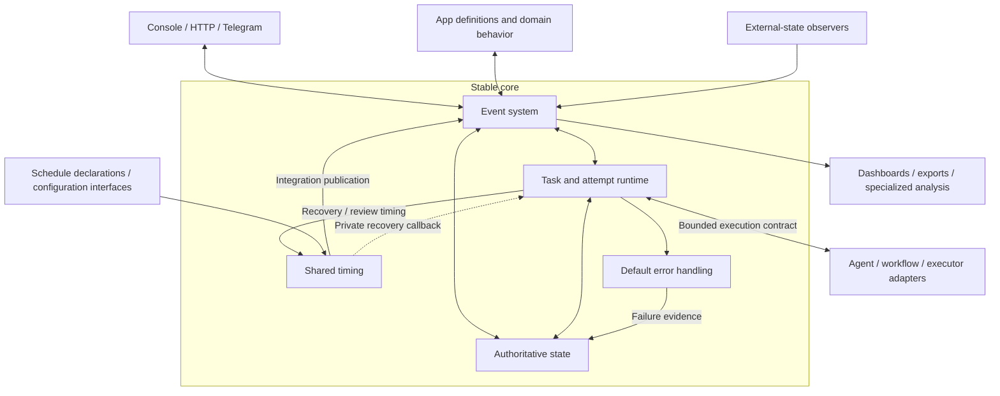

# Core separation and recovery review — September 10, 2026

**Historical context:** [Host And App Boundary](../../2a-design/system-boundary.md). Retained rationale and evidence; this record does not define the current contract.

**Status:** Historical snapshot, preserved during documentation consolidation.
It contains completed implementation, earlier findings, and then-open candidates;
its words “current”, “candidate”, and “next” refer to the recorded review.
They do not establish current implementation or deployment.

Use [Architecture](../../2a-design/architecture.md) for the accepted boundaries,
[the core review plan](../../proposals/task-runtime-organization.md) for remaining
work, and [the controller proposal](../reviews/task-controller-pattern.md#candidate-stop-without-claiming-success)
for the active non-success stop specification. Historical evidence below is unchanged
apart from link relocation.

# Stable core and replaceable capabilities

**Design status:** Stable core/extensible capabilities direction agreed; the
boundary contracts and full application plan are proposed for review.
**Implementation status:** All six separation steps have landed in Host `main`
at `88598a15` through [PR #98](https://github.com/hao1939/may-agent/pull/98),
including the continuation originally reviewed in PRs #99–#103. Earlier steps
landed through PRs #96 and #97. The records below retain their historical
implementation and validation evidence. The completion-recovery follow-up merged
as `d9e7597e` through PR #104. PRs #105–#108 further clarify execution boundaries,
share settlement, bound retries durably, and make request attachment atomic.
Owner-decision work remains proposed. No deployment is claimed.
**Date:** 2026-09-09.
**Source review baseline:** May Host `de2c1699a2df7d5391ffb277b7b490687a6c60e7`
(merged PR #95; local `main` matched fetched `origin/main` during the original
review). The findings below describe that historical baseline; implementation
records distinguish later fixes. The September 10 review verified merged Host `main` at `d9e7597e`.

The organizing rule is:

> Keep correctness rules stable; extend capabilities through explicit contracts.
> Adding or replacing a capability should not rewrite those correctness rules.

Keep a stable core consisting of events, shared scheduling, authoritative state,
the generic Task/attempt runtime and execution failure containment. Connect
replaceable Apps, executors, interfaces, observers, schedules and reporting
through existing typed contracts. Use conventions for discovery and defaults,
with explicit declarations for ownership and behavior. Prove that optional
components can be absent before reorganizing files.

Events are the natural integration point between these capabilities. The stable
boundary is the event contract, not a particular adapter or subscriber. Producers
and consumers may change independently only while preserving that contract.

This is a system-wide boundary change, not a Cron refactor or a file-splitting
exercise. It covers App discovery and registration, input/admission, Task
execution, scheduling, observation, interfaces, and reporting. Cron is one
mixed component through which to prove the split. Independent startup is an
initial implementation slice, not completion of the proposal.

Share timing mechanics, not a mandatory event for every timer. App schedules
publish integration events; private recovery and observer callbacks may remain
ordinary calls. Different interfaces must not create competing scheduling or
work authorities.

This supersedes the unimplemented file-extraction sequence in the earlier
proposal. Its context extraction remains useful completed source work, recorded
under PR #95 below. Visible core/adapter/composition ownership is part of this
proposal. Extract mixed responsibilities before moving them; a runtime-instance
rewrite is not required just to achieve that layout.

The governing contracts remain [System Boundary](../../2a-design/system-boundary.md),
[Task Resource Engine](../../2a-design/task-resource-engine.md),
[Runtime](../../2a-design/runtime.md), [Events](../../2a-design/events.md), and
[Scheduling And Observation](../../2a-design/cron.md).
The [convergence tracker](../../proposals/design-implementation-convergence.md) and
[authority proposal](../../proposals/authority-boundary-simplification.md) retain their existing
behavioral scope. Accepted subsystem documentation should change with the
corresponding implementation, rather than presenting these targets as current
behavior.

## Current focus: simple and robust core

**Updated:** 2026-09-10. The error/metric placement, App-consolidation and
conversation/background execution discussion is [archived and paused](../reviews/error-handling-and-conversation-discussion-20260910.md).
The earlier mandatory core-metrics expansion is not an active requirement;
existing error handling and metric services remain in place. Do not promote the
PoC collector, merge Apps or add a new recovery framework as part of this focus.

Review existing core behavior against a small set of concrete properties:

- One authority for work and accepted results; stale attempts cannot overwrite
  current state or bypass normal acceptance.
- Bounded execution, explicit waits/cancellation, released resources and contained
  failures; unrelated work can continue.
- Restart retains truthful state and uses the normal acceptance rules. Prefer
  safe, affordable redo when salvaging progress would add more complexity.
- Events connect meaningful inputs and observations; ordinary calls and
  transactions handle local ordering. Add no second work lifecycle.

Start from a reproduced defect or demonstrated maintenance cost. Make the
smallest worthwhile correction, verify its actual behavior, and stop when the
required outcome is met.

The [September 10 source review](../reviews/core-simplicity-review-20260910.md)
verified `d9e7597e` with 172 passing focused tests. Its first recommendation is a
small Task-controller correction: an error-reporting exception must not skip
retry scheduling, and synchronous execution throws must reach normal cleanup.
The latter is a controller contract gap; the current runtime wrapper is async.
Recovery query cost is a measured scaling concern to assess against real backlog,
not a reason to add another scheduler. No runtime patch was applied by the review.

The follow-up [PR #105](https://github.com/hao1939/may-agent/pull/105), merged as
Host `350552a4`, applies the small controller correction, places controller/queue
code under `core/tasks/`, separates Git worktree operations through composition,
and removes duplicate runner claim/intent/output inputs in favor of `TaskAttempt`.
It adds import-boundary checks and concrete extension routes in the Host source
guide. Local CI passed 2,498 tests with three existing deployment-dependent
skips; missing workspace support and restoration use the same Task identity.
This is merged source, not deployment evidence. It does not implement the whole
controller-pattern proposal below.

The [Task controller pattern proposal](../reviews/task-controller-pattern.md) joins minimal
Task authoring and ordinary reconciliation into one commitment lifecycle:
admission, bounded work, exact waits, checked settlement and owner decisions.
Recovery restores that same path. Settlement and durable retry slices are now
merged; owner-decision follow-through remains unproven. A major reduction
in implementation size remains to be demonstrated. Follow that proposal for the
focused slices rather than adding another recovery implementation plan here.
The separate [storage proposal](../../proposals/storage-state-service.md)
places meaningful Task/request operations inside core storage, with SQLite as
their implementation. Request attachment merged in PR #108; a narrow retry-exhaustion
readiness follow-up is in progress. A separate API-server process and combined
capacity/attempt claims remain open choices, not implemented requirements.

The completion findings below are retained history; their correction is merged.

## Next review: simpler completion after interruption

**Status:** Completion correction from `46ebccd1` merged as Host `d9e7597e` in
[PR #104](https://github.com/hao1939/may-agent/pull/104) on September 9.
Merge and source were verified on September 10; no deployment is claimed.
The original review and implementation reasoning below are retained history.
The owner-decision extension remains proposed, separate from this correction
and the six separation steps below.
The [core review](../reviews/core-design-review-20260909.md) reproduces
two completion defects on merged `389f1f61` and continuation `4d5b55ae`:
terminal-session recovery can skip a workflow's required verifier and discard
the structured result. Both defects were reproduced again on `88598a15` before
the candidate fix; the older review patch alone is not the current evidence.

The goal is to produce useful results, with less supervision and acceptable
total cost. After interruption or failure, work should reach a checked result,
an authorized revision or stop decision, or a visible reason it cannot proceed.
A Task records the current commitment; its original scope does not require
unlimited pursuit. Preserving every execution step is useful only when the saved
work justifies the machinery.

### Keep the outcome; relax unnecessary precision

Keep the Task's identity, accepted input and actual result. Keep the App's
applicable completion checks, protection against writes from obsolete attempts,
and cancellation. A missing executor or uncertain external action must remain
visible; neither is evidence that work succeeded.

Accept repeated cheap computation, some retry delay and occasional inspection
when these cost less than elaborate reconstruction. An App may simplify an
expensive verification contract when its real goal permits that change;
recovery must apply the declared rule consistently until then.

| Situation after interruption | Proposed default |
| --- | --- |
| The current Task generation already has an accepted result | Return that result; do not execute it again |
| Saved execution output can pass the normal completion checks without complex reconstruction | Check it and record the complete result under the current Task/attempt authority |
| No usable result remains, and repeating the attempt is safe and affordable | Start another attempt for the same Task through existing scheduling |
| An external action may already have happened | Read the provider using existing operation identity; repeat only when safe, otherwise expose the uncertainty |
| Repeated work is expensive | Use existing useful progress; add a checkpoint only when expected savings justify saving, validating and restoring it |
| The approach cannot meet the goal, or the remaining outcome no longer earns its cost | Stop unchanged automatic retries and let the owning App reconsider the approach, scope or continuation |

These are decisions using existing Task state and App/executor behavior. They
do not require new states, per-Task recovery options or a generic recovery
framework. The Host should not guess whether a domain action is safe to repeat.

### When finishing the original Task is no longer the right choice

A workflow can execute correctly and still discover that the assigned outcome
is infeasible, too expensive or no longer useful. The owning App should compare
the expected remaining value with the additional effort, delay, risk and
opportunity cost. Time already spent does not justify spending more. Partial
results and useful learning can retain value even if execution stops.

Use a small set of ordinary decisions:

| Decision | When it helps | Required meaning |
| --- | --- | --- |
| Retry or change approach | A transient fault, repaired prerequisite or plausible different method makes progress worthwhile | Continue the same outcome with bounded effort; no unchanged retry loop |
| Wait | A specific outside change would make progress possible | Record the existing exact wait and its wake/review; time passing is not progress |
| Revise scope | A smaller or different deliverable still serves the authorized project goal | Record what changed, why, the new acceptance criteria and what remains undelivered |
| Stop pursuing it | The outcome is infeasible, obsolete or costs more than its remaining value | End execution explicitly, retain useful evidence and tell callers the requested outcome was not delivered |

These are owner decisions, not a new Task-state taxonomy. A retry limit can
bound mechanical repetition, but reaching the limit does not establish that an
outcome should be abandoned. A clear permanent limitation can justify owner
review immediately. Budget, repeated failure without progress, and exhausted
in-scope moves should also end automatic repetition under the existing bounds.

The workflow reports what failed, useful work completed, known external effects
and the remaining obstacle through existing result/evidence handling. The Host
preserves that evidence and uses existing durable Task wakes or a declared route
for a bounded owner decision. The App's workflow, selected agent or accountable
parent can make that decision under its existing authority. There is no need
for a permanent recovery supervisor. Repeated scans of an unchanged blocker must
not repeatedly invoke the owner or create new Tasks. Without an available
authorized decision maker, leave visible attention with a concrete next action.

Allow automatic scope reduction or abandonment where the App already has
discretion, such as a disposable experiment or optional enhancement. A material
change to a promised outcome or action outside that discretion goes to the
accountable owner, including the human when needed. This does not require human
approval for every failed attempt. Express discretion in existing App policy
and task context, rather than a new permissions framework.

For scope changes serving the same outcome, reuse `update-task` and the existing
generation fence: persist the new scope and acceptance before executing it,
reject obsolete completion, and preserve the earlier scope and evidence in
history. Caller and parent expectations must change explicitly too. A child
cannot make a required parent outcome true merely by weakening its own goal.
Useful partial output may be offered as partial output without claiming that
the original request succeeded.

For dropping work, stop scheduling it and preserve a small durable decision
with the reason, useful output and any unresolved external effects. End linked
caller waits with that non-success outcome; let parents reconsider affected
dependencies. Cancellation alone does not undo an external action, and dropping
a required child does not satisfy its parent's acceptance. Ordinary restart or
a repeated wake must not resurrect deliberately stopped work.

The reviewed implementation needs a narrow contract check here:
[`close-task`](https://github.com/hao1939/may-agent/blob/4d5b55aed0d1197249fb53de600d4de9dfa29d2a/src/app/app-task-reconciler.ts#L3565)
writes a completed receipt and cannot represent abandonment honestly. The
[cancellation path](https://github.com/hao1939/may-agent/blob/4d5b55aed0d1197249fb53de600d4de9dfa29d2a/src/app/app-task-reconciler.ts#L2385)
records human cancellation and excludes maintained Tasks. Start by extending
that existing termination mechanism narrowly for an authorized App stop,
with truthful decision attribution and caller/dependency handling. Review
maintained obligations separately; ending an ongoing responsibility needs an
explicit App policy. This is proposed behavior, not a claim that Apps can
already return an abandonment result through the current SDK.

#### First stop slice: the current finite Task only

**Candidate status:** Host [PR #111](https://github.com/hao1939/may-agent/pull/111),
candidate `fc74eb46` on `feat/app-task-stop`, includes #110's reviewed proof atop
`4afaaafb`; not merged or deployed. Land #110 before #111. The source guide and regression tests travel
with the Host change. This proposal remains the canonical design; existing
App policies need no change unless they choose to use this result.

Add `state: "stopped"` to the existing handler result contract, with a non-empty
reason in `summary`, non-empty evidence, and optional caller response/partial
result. It means the requested outcome was **not** achieved. Do not combine it
with Task actions, Conditions or child App requests. This is a handler decision,
not a new stored Task phase or a general cancellation tool.

Use the existing cancellation record and fenced Task transaction. Record the
deciding App, selected agent and exact attempt; never attribute an App decision
to the human. Keep partial result/evidence in ordinary Task reads, finish linked
request handling with the non-success explanation, and persist the executable
parent wake in the same transaction. Do not write a completion receipt or
satisfy execution prerequisites. Normal execution and recovered direct-agent
results use the same operation. Newer unaccepted input makes an old stop decision
stale, just as it does other consequential decisions.

This first slice accepts only `achieve` Tasks without live direct children.
Maintained responsibilities, stopping other Tasks, recursive cancellation and
reopening stopped work stay out of scope. An unfinished parent still has to
resolve its missing outcome; stopping a required child does not accept the
parent. Retain the cancelled child's evidence and do not let ordinary actions
relabel its cancellation as successful completion. App policy determines when
the selected handler has discretion to stop; otherwise it requests an owner or
human decision through the existing route. No new permissions framework is
introduced. No live App policy is changed by this Host implementation slice.

Existing App reads retain `attention` with the explicit non-success explanation;
human reads show terminal cancellation. The cancellation record, not the display
phase, prevents execution. Re-admitting desired intent for a cancelled identity
is rejected rather than leaving a permanently pending revision. Referencing it
for its result remains valid; new work requires a new linked identity. This is
not automatic parent settlement: a parent with an undelivered required child
must obtain an appropriate decision, not close that child as successful.

Review correction: cancellation-backed children are terminal evidence, not live
work. Exclude them from child readiness and settlement guards while exposing
their non-success summaries separately in bounded parent context. The parent
can then judge its own outcome, revise it or stop; the child's cancellation
still does not satisfy `dependsOn` or write a success receipt. Check absence of
live children inside the stop transaction, not just its earlier snapshot, and
reject new/reparented child relations to an already cancelled parent. This
closes both race orderings using the existing relation index and transaction.
Human cancellation remains non-cascading: existing children can still be revised
and finish, without waking the terminal parent.

The focused proofs cover stop-result admission, stale decisions, attribution,
parent wakes, unsatisfied prerequisites, cancelled-identity protection and
transaction rollback. Runtime fixtures cover normal, startup and busy-session
recovery, linked caller response, database reopen without re-execution, and
retention of dirty and committed workspaces. These are isolated fixtures, not
model judgment or live deployment evidence.

At `fc74eb46`, combined local `bun run ci` passed 2,591 tests with three existing
installation-dependent skips and zero failures, including the browser fixture.
Design checks passed with zero errors and six pre-existing layout warnings.
The current-head [GitHub run](https://github.com/hao1939/may-agent/actions/runs/34438849946)
passed Quality and Container, including the image build and isolated smoke test
without publishing. All three review threads were addressed and resolved.
An intermediate focused run hit an intermittent SQLite lock
in an unchanged database-reopen fixture; isolated checks and subsequent full
runs passed, but that lock is not claimed fixed. Independent review, merge and
deployment remain separate.

For example, an experimental workflow cannot build an optional export feature
without an expensive dependency. Its owner can reduce the deliverable to a
manual export if that remains useful and within its discretion, or stop and
retain the feasibility findings. The report must name the reduced deliverable
or the stop decision. It must not say the originally requested feature shipped.
If the Task was to assess feasibility, evidence that the feature is impractical
may satisfy that Task. If the Task was to build the feature, the same finding
supports revising or stopping it. Judge completion against the actual goal.

### First change: correct the two completion defects

The candidate preserves the structured result when recovering a direct-agent
completion. For workflow Tasks, it declines the special recovery completion
and leaves the same Task to the existing retry path, where its required
verifier applies. Startup releases the previous runtime's attempt; the busy
path retains a fresh lease and requeues after expiry. Retry can rerun the whole
workflow, not just its verifier. Apps must observe existing external operations
using stable input identities before repeating effects; this change does not
make arbitrary workflows replay-safe.

Runtime tests also exposed rejected or missing verification entering the
execution-error retry path. The candidate uses existing `handlerBlocked`
attention for these failures, rather than repeatedly executing unchanged work.
No new lifecycle state, retry policy or completion event is introduced.

Eight isolated runtime regressions failed on the baseline and pass with the
correction: both recovery entry points preserve direct-agent output and retry
workflow handoffs with accepting, rejecting or missing verifiers. The workflow
fixture observes a stable external-operation identity, so repeating it creates
the operation once. This proves the runtime contract with a synthetic provider,
not live provider safety for every installed App. The older helper-only review
patch remains historical evidence.

Validation on this candidate: full Host `bun run ci` passed (2,487 tests passed,
3 deployment-specific catalog tests skipped, 0 failed). Workspace
`bun run check:may-design` passed with 0 errors and 6 existing root-layout
warnings. No live provider operation or deployment was used for validation.

Verify the first change against these outcomes:

- Normal and recovered completion preserve the same structured result.
- An interrupted workflow handoff cannot complete with a missing or rejecting
  verifier. An eventual accepted completion has actually passed its verifier.
- The fallback retains the Task identity and reaches another eligible attempt
  or a visible reason it cannot proceed; it does not leave work silently stuck.
- Existing stale-attempt and cancellation protections still hold. Where an
  affected workflow can make an external change, exercise interruption around
  that action and its existing observation/idempotency behavior.

Use the production runtime boundary and isolated fixtures for the missing
regressions. Reuse existing coverage for unchanged protections; run the
repository's normal checks before shipping. A passing helper probe alone is
insufficient evidence for the complete restart path.

Follow with one bounded App example that deliberately revises or stops work.
Verify that revised acceptance applies only to the recorded new scope, stopped
work remains stopped after restart, late results cannot overwrite the decision,
callers receive the actual outcome, and required parent work remains unmet until
its owner accepts a revised plan. Keep this separate from the two bug fixes;
add only the missing termination capability demonstrated by the example.

### Keep ownership clear in code

The App declares what counts as success. Executor adapters read their own
session/output formats and supply evidence. Task runtime enforces applicable
acceptance rules and selects retry or visible attention. The resource store
atomically records the authorized result. Timing only makes eligible work due.

Keep those responsibilities in the existing `core/`, `adapters/` and
`composition/` organization. Normal execution and recovered output must follow
the same acceptance rules. Share a small result-handling function where actual
callers justify it; declining a complex recovery shortcut is also sufficient.
Keep local validation and persistence as ordinary calls. Existing events
connect admission, wakes and observers. A new event for each completion step
would add coordination without helping this fix.

### Error handling feeds improvement

Core execution preserves failure evidence and truthful outcomes. Code handles
predictable responses; Apps and LLMs judge uncertain causes and whether further
work is worthwhile. Investigation and measurement must not roll back accepted
results or hide the original failure.

The [error/metric and conversation discussion](../reviews/error-handling-and-conversation-discussion-20260910.md) is archived.
Its simplest candidate is an `onError` hook that emits an existing-bus event,
with an ordinary App subscriber recording metrics and investigating. Placement,
activation and App consolidation remain undecided. The retained PoC and earlier
draft do not impose new core services or change the recorded completion-fix
validation.

### Decide further work by its value and total cost

The two defects justify a small correction now: false completion and lost
results defeat the project's goal, while the demonstrated correction adds
little machinery. Further recovery cleanup must identify branches or retained
state it can remove and the redo cost it accepts. For this long-lived core,
compare expected interruption frequency and repeated work with lifetime
maintenance, debugging and failure costs. Use existing evidence or a bounded
trial when estimates are uncertain; no numeric scorecard is needed.

Mandatory parent groups and overlapping request coordination remain separate
investigations. Allowing standalone Tasks is worthwhile only if simpler callers
and less graph machinery outweigh migration and compatibility costs. Continue
the [existing request audit](../../proposals/authority-boundary-simplification.md#remaining-work)
before removing coordination used by current callers or unfinished requests.
Neither investigation is a prerequisite for the completion correction.

The first slice is sufficient when results survive, required checks apply after
interruption, and the same Task can progress or expose a clear blocker without
new lifecycle machinery. The owner-decision slice is sufficient when authorized
scope changes and stops settle work honestly without repeated recovery attempts.
Further work needs a remaining need worth its cost. The completion correction
is a local source candidate as recorded above; the owner-decision extension is
not implemented, and neither is claimed as deployed behavior.

## What core and external mean

Core responsibilities provide stable guarantees and default capabilities across
Apps and execution backends. They should change less frequently than particular capabilities.
Stability is an intended outcome of the boundary, not a ban on fixing core code.
Shared or frequently used code is not automatically core: a common model runner
can still be a replaceable implementation. Being provided by default does not
by itself make a capability core. The error/metric placement decision is deferred.

An external component is an ordinary module outside that responsibility
boundary. It may run in the same process and repository. It can be replaced or
omitted without modifying core logic, subject to its declared capability and
retained-work contract. This does not imply a separate service or a plugin
framework.

This refines implementation boundaries within the existing Host/App model; it
does not introduce a third architectural owner. The Host includes both core
mechanics and concrete infrastructure adapters. Apps still own meaning and
acceptance. "External" means outside the stable core, not outside the Host,
repository, process, or trust boundary. It also does not mean third-party
executable code is safe to load without trust.

Individual implementations are replaceable even when a capability is needed.
Completing agent work still requires a suitable executor. Without one, the Host
can preserve and expose affected Tasks while continuing unrelated work; it
cannot claim to have performed the missing execution.

Use both tests of the boundary:

- **Extension:** another implementation of a supported capability requires its
  module/declaration, composition wiring, and tests—not changes to core
  admission, storage, or lifecycle rules.
- **Absence:** removal degrades capability while preserving remaining
  correctness and previously accepted obligations. Optional is not synonymous
  with external; a deployment may require a particular capability to be useful.

If a genuinely new capability needs a new core guarantee, review that guarantee
explicitly. Do not hide it in an adapter or build a universal abstraction in
anticipation of every future extension.

## The stable core

| Component | Stable responsibility |
| --- | --- |
| Event system | Envelope validation, durable identity, publication, declared routing and admission, caller correlation, and observation |
| Shared scheduling | Due-time calculation, owned registrations, and bounded dispatch to event producers or private callbacks; no domain work or result authority |
| Authoritative state | Events, requests and pending input, Tasks, attempts, accepted results, and atomic version-checked transitions |
| Task and attempt runtime | Work admission, readiness, capacity, bounded attempt control, result admission, exact waits, cancellation, and recovery |
| Default error handling | Preserve failure evidence, release execution resources, apply known bounded responses and expose decisions requiring App/LLM judgment |

The existing SDK, event interface, and executor types form the boundary around
these responsibilities. They do not require separate services or another contract framework. Core modules may
call each other directly where shared transactions and execution ordering matter.

Core recovery means retaining accepted obligations and making safe progress
after interruption. It does not require resuming every session or workflow step.
Prefer redoing affordable, retry-safe work over additional checkpoint machinery;
retain progress when the avoided cost justifies the complexity. Use the
[redo-versus-resume rule](../../1-principles/core-principles.md#prefer-redo-when-it-is-simpler-and-affordable)
when reviewing recovery extractions. Existing authority and side-effect
contracts still apply.

Keep SQLite persistence in the core for this work. Replacing its backend would
be a separate compatibility and migration decision. Specialized dashboards and
read projections are external; the basic authoritative resource reads remain
available even when those projections are absent.



The diagram shows responsibility boundaries. Apps declare routes and return
facts through Host-supplied capabilities; they do not receive the internal
EventBus. Readers use scoped resource APIs. Executors retain the existing
bounded call/result contract. Events connect input, state changes, feedback,
and observations without turning every local function call into a message.
Shared scheduling is a Host mechanic, not a new work owner or separate service.

## Events integrate capabilities; contracts make them dependable

> Producers and consumers depend on an event's meaning and guarantees, not on
> each other's implementation. Publishing an event is not proof that work ran.

Use the existing `publish(event)`, `get(eventId)`, and `subscribe(filter)`
interface. Apps contribute typed declarations and return facts through supplied
capabilities; they do not receive the raw EventBus. The detailed authority and
delivery rules remain in [Events](../../2a-design/events.md). This proposal adds no
second envelope, routing registry, or subscription framework.

For each integration, its existing type/schema, route declaration, and short
usage example must make these questions answerable:

| Contract | What must be clear |
| --- | --- |
| Meaning and owner | What happened or is requested, who defines that meaning, and what the event does **not** prove |
| Data and evidence | Required payload, exact resource identity, and relevant source revision/time; whether this is retained input/evidence or a notification to reread current state |
| Publication authority | Which producer may publish it; Host-assigned identity/source and validated targets cannot be supplied as authority by an untrusted payload |
| Routing and responsibility | `record` or `required`, declared selectors/targets, and whether a consumer observes, wakes existing work, or accepts a request |
| Acceptance and result | What must be durable before acknowledgement, where errors are visible, and which Task/request or control resource supplies the actual result |
| Repetition and recovery | Applicable idempotency/coalescing, ordering, stale-event handling, and how missed notifications or interrupted handling recover |

Keep these rules with their owners: public transport types in the existing
control package, App-facing contracts in the SDK, Host ingress validation in the
Host, and domain schemas/routes in the App. Do not centralize all domain events
in the Host or copy their definitions into another catalog. Add an example and
focused contract test beside an integration rather than a new metadata format.

### Expose events only at intentional boundaries

Before adding an event, name its independent consumer or supported diagnostic
use, the fact/request it represents, and why an existing event or resource read
is insufficient. No concrete integration need means no new event. Record-only
facts may have no active subscriber at a particular moment; that does not
justify publishing every internal step for hypothetical future consumers.

| Need | Preferred mechanism |
| --- | --- |
| Preserve a claim, lease, result fence, or multi-row invariant | Private typed call and transaction |
| Dispatch internal recovery, observer cadence, or deadline bookkeeping | Private bounded callback; publish a meaningful result only if another component needs it |
| Diagnose an execution detail | Logs/traces or an existing explicitly diagnostic event/read path |
| Notify an independent component of supported input or change | Declared integration event with its contract and tests |

Validate and commit a state transition before publishing its resulting change.
Do not split claim/result/cancellation transactions into subscriber chains or
let optional listeners veto accepted state. A later notification failure must
not roll it back; existing durable state and bounded recovery remain authority.

Visibility and publication permission are separate decisions. An event that a
UI may observe is not necessarily an event it may publish. A type on the
internal bus is not automatically a supported App/client API. Conversely, a
documented Host diagnostic may legitimately have reporting consumers without
being a domain work trigger. Raw operator diagnostics remain inspectable; they
must be clearly distinguished from the stable integration surface.

Enforce a demonstrated exposure boundary with existing adapters, type lists,
and projections. Do not add another bus, a dynamic policy engine, or a visibility
field to every event. Client-requested filters select interest, not authority.
When removing an event, inspect actual consumers first and change them together;
do not break health reporting or hide failures merely to reduce event count.

### Producer, admission, and consumer responsibilities

- A producer reports supported facts or explicit requested input. An adapter
  translates its external source into that contract; it does not invoke another
  adapter or mutate a Task behind admission. A timer reports that time is due,
  not that an external dependency completed. A Task-change notification points
  to accepted Task state; it cannot establish completion by itself.
- The Host validates authority and shape, persists the event, and records exact
  admission. `recorded` means the event exists; `accepted` means the required
  responsibility is durably linked. Neither means the requested work is done.
  Zero subscribers is valid for a fact. Required input cannot be accepted merely
  because a logger, UI, or metrics listener saw it.
- A work consumer uses a declared route and the existing recoverable Task,
  request, or control handling. Actual work runs asynchronously, outside the
  publication stack. Ordering belongs to the affected resource, not one global
  event-processing queue. Consumer failure must be observable without undoing
  acceptance or blocking unrelated consumers.
- A passive subscriber observes or renders. It does not gain a durable work
  obligation from `subscribe` alone. It may resynchronize from resource reads
  after missed notifications; work-critical input uses durable admission and
  checkpoints, not an in-memory callback as its sole delivery guarantee.

Do not promise global ordering or exactly-once execution. Preserve exact event
and Task identities through retries, and make repeated handling safe through
existing admission/transition checks. A notification may reread newer state;
input-bearing events must retain their ordered contents. Keep the existing
distinction between coalescible ticks and real new evidence.

Contracts connect components; they do not turn every local operation into an
event. Keep scoped resource reads and the bounded
`TaskExecutor(attempt) -> Promise<TaskReconcileResult>` call. The App decides
acceptance; the Host validates and atomically installs its result. Preserve
generations, current-attempt checks, atomic result/action admission, completion
receipts, event checkpoints, exact Conditions, cancellation, and the distinct
`achieve`/`maintain` completion rules. Events expose these outcomes; they do not
replace the authoritative Task state or require an event-sourcing rewrite.

## Classify the existing large components

| Existing area | Core portion | External portion |
| --- | --- | --- |
| Interfaces | Event and resource-access contracts | Console, HTTP adapter, browser UI, Telegram, terminal clients |
| App loading and admission | Registration validation, identity, accepted input, declared routing | App definitions, domain schemas and mappings, concrete discovery sources |
| Task runtime | Generic lifecycle coordination, dispatch, waits and recovery; shared state operations enforce transition authority | Domain planning, App-specific prompts, acceptance policy |
| Execution | Attempt identity, capability scope, cancellation, deadlines, result admission | Model/provider adapters, agents, workflows, tool implementations, native executors |
| State, storage and read models | Canonical records, result reads, transactions; proposed meaningful Task/request operations consolidate consistency rules | Specialized projections, dashboards, historical analysis |
| Error handling and metrics | Execution failure containment, cleanup, truthful outcomes and evidence | Domain diagnosis and improvement policy; default metric placement deferred |
| Observers and schedules | Shared timing/event publication, input admission, and Task recovery rules | External-state probes and domain schedule declarations |

Some responsibilities span several current files; classification is not a
directory rename. Generic context bounds and identity projection belong with
runtime mechanics, while domain prompt content belongs to its App or executor.
Mechanical deployment-receipt reads may stay in the Host; deployment-specific
instructions need a separate App-boundary review before moving.

The composition root may import concrete adapters and wire them to core
contracts. Core lifecycle and storage code should not import a particular
transport, App, provider, or reporting implementation. Adding an adapter should
normally require its module, a small registration change, and relevant tests.

### What may vary without changing core rules

| Extension | Stable boundary to use | What must not change for this extension |
| --- | --- | --- |
| Another App or definition source | SDK App definition; validated registration and atomic generation publication | Task identity, admission, and result authority |
| Another agent/workflow/backend | Existing bounded `TaskExecutor` contract and Host execution capabilities | Claim, cancellation, deadline, and accepted-result fences |
| Another schedule or observed source | Schedule/observer declaration; shared timing; returned facts and declared event routes | A second scheduler, work queue, or recovery owner |
| Another human interface | Existing event publication, observation, and scoped resource reads | Durable work acceptance and completion rules |
| Another report or projection | Supported observations and canonical resource reads | Required Task startup, storage commits, or completion acknowledgement |

The stable contract includes meaning, authority, failure, and lifecycle behavior,
not just a TypeScript shape. Its implementation remains ordinary modules and
typed calls. Events connect independent producers and consumers; executor calls,
resource reads, and atomic core transitions keep their own narrow contracts.
Do not force all extension points through one event or plugin interface.

## Convention over configuration

> Conventions determine location and defaults. Explicit declarations determine
> ownership and behavior.

| Concern | Convention or existing contract |
| --- | --- |
| App discovery | Discover `projects/<id>.app/app.ts` through the existing App registry; validate the declared identity |
| App declaration | Keep the existing manifest as the single declaration of inputs, mappings, routes, observers, schedules, and metrics |
| Agent selection | Use existing Task/inherited/App defaults; specify a different executor when the work requires one |
| Workflows | Keep agent-local workflow directories and existing resolution rules |
| Interfaces and executors | Use ordinary imports and explicit startup registration where the set is small |
| Optional activation | Use existing feature choices and App declarations; add a narrow option only when an actual independent deployment choice needs it |
| Runtime state | Keep Host-managed state at its established roots and access it through supplied capabilities |

Do not infer domain ownership from event names or silently substitute a missing
executor. Discovery locates a declaration; the declaration supplies behavior.
Do not add a second plugin manifest, configuration hierarchy, generic service
locator, dependency-injection container, or universal component base class.

Derive lifecycle choices in composition from the process role and existing
declarations. Do not pass an extra activation switch through discovery merely
to coordinate startup. Preparation must not activate resources; composition
owns their activation and cleanup. Prefer removing a redundant parameter or
wrapper over documenting another configuration combination.

Use the existing producer/consumer/executor shapes. An observer returns facts;
a schedule declares which event is due (an input declaration is shorthand for
`app.input.requested`); an interface publishes input and observes
resources; an executor returns a proposed result. Different responsibilities
do not need one universal extension interface.

## Shared timing, intentional events

> An App schedule says when to publish an event. Internal timers may call private
> mechanics. Neither is another work authority; the Task still owns its outcome.

```text
App declaration / operator configuration / Host recovery timing
  -> shared timing
     -> integration producer -> publish event -> declared route -> Task/observation
     -> private bounded callback -> recovery or observer mechanics
```

Reuse common registration, timing, and cleanup mechanics behind existing
interfaces. Compose small typed callbacks, not a new universal job/trigger
protocol. Apps do not receive scheduler handles. Timing code dispatches bounded
handling; it does not run model work or decide domain policy.

| Declaration | Dispatch boundary |
| --- | --- |
| App event schedule | Publish the declared fact; its existing route may wake the same standing Task |
| App input schedule | Publish `app.input.requested`; normal admission supplies caller correlation and Task mapping |
| Observer cadence | Private callback to the bounded observer runner; publish its returned external facts, not an extra observer-due event |
| Task review deadline or recovery cadence | Private callback to recovery/review handling; reread canonical state and make only eligible work ready, without an exported recovery-due event |
| Operator-facing schedule configuration | Configure those same registrations; do not create another dispatch or execution path |

Use an event schedule for a standing outcome. Do not manufacture a new request
or Task for every tick. Retain input schedules only where each admitted slot
genuinely needs its own correlated result; their syntax does not require a second
scheduler. Host recovery handlers own mechanics, not hidden Tasks or domain
decisions. A due review is not evidence that an external Condition was satisfied.

Shared timing owns registration/replacement, arming, and cleanup. The producer
owns what a due slot means and what counts as successful publication or handling.
Keep one registration per declared responsibility; reload replaces it rather
than adding another timer. Retain existing input catch-up, fact/observer
recollection, and indexed recovery policies; do not force unlike semantics into
one large scheduler policy object. Sharing does not require one physical timer
or routing execution timeouts and event-loop yields through durable events.

Keep authoritative Task deadlines in Task state. Timing registrations are
derived from the owning declarations or durable state and rebuilt on restart;
they are not another work ledger. Scheduled Task input uses existing durable
event admission and tick coalescing. A missed in-memory wake is repaired from
canonical state, not an unbounded replay queue. Publication failure must remain
visible and must not count as success; use process diagnostics when the event
store itself is unavailable.

### Disable registrations, not execution

Replace the ambiguous phrase "business schedules disabled" with "selected
optional schedule registrations disabled." The shared scheduler remains running
for the Host's required recovery/review registrations. Submitted work and
external-event wakes do not depend on any optional schedule being enabled.
Observers have independently selected registrations on the same mechanism.

This is a difference in ownership and activation, not separate business and
recovery schedulers. Disabling a registration stops future timed publication; it
does not cancel already admitted work, pause its Task, or erase its pending
events. Those are separate explicit controls. Starting the daemon's Task runtime
must not depend on whether optional registrations exist or `--cron` was passed.
The implementation must make the existing flag's scope explicit across both
agent Cron declarations and App schedules, without adding a configuration
framework or silently disabling required recovery.

## Behavior when a component is absent

Start with intentional absence at startup. Retain current supported reload
semantics, but do not make arbitrary live unload or hot swapping a prerequisite.
When stopping a running component, its timers, subscriptions, and in-flight
resources must have an explicit owner and cleanup path.

| Component omitted or unavailable | Permitted degradation | Correctness that must remain |
| --- | --- | --- |
| One interface | That access channel is unavailable | Tasks and other channels continue; accepted results do not depend on rendering or delivery |
| A dashboard, exporter or specialized projection | Its presentation, export or extra analysis is unavailable | Execution failure handling, canonical resource reads and accepted state remain correct |
| Metric collection fails | Measurements become stale or unknown | Unrelated work settles, failure evidence remains, and missing measurement is not presented as healthy |
| Optional schedule registrations | Those registrations publish no further timed events | Already admitted, submitted, and event-woken Tasks execute; shared timing still serves required recovery/review registrations |
| An observer | Its external facts are no longer discovered | Existing waits remain unsatisfied until real evidence arrives; unrelated work proceeds |
| A selected executor | Work requiring it cannot execute | Retain exact Task state and expose unavailability/attention; avoid retry storms, false completion, and silent substitution |
| An App | New work for that responsibility is unavailable | Reject input requiring the absent owner before acceptance; retain previous obligations and their identity |

For App removal, preserve the current rejection of removal while unfinished
Tasks exist until a focused change implements a defined disable/drain path.
This is a lifecycle precondition on removal, not permission to discard state.
This proposal introduces no new Task status for unavailable capabilities.

A permitted record-only fact may have no subscriber. Input promising work needs
an explicit successful admission route. Missing optional capability and corrupt
required configuration are different cases: do not turn all initialization
errors into silent optional-component skips. An unavailable core store or failed
authority check must remain an explicit error.

## Code organization and dependency direction

Use three visible code boundaries: core implementation, concrete adapters, and
the composition root that connects them. Retain the existing SDK/control
packages for public contracts and keep App policy in its owning App repository.
The layout must let a reader answer "what stays stable?", "where do I extend
it?", and "where is it enabled?" without first tracing the entire runtime.
Use `adapters/` for the external side: it names how these components connect,
without suggesting another process or a dynamic plugin system.

The verified candidate ownership layout is below. Transaction-critical state
modules retain their existing homes rather than undergoing a blanket move;
this is the explicit implementation disposition, not a second adapter tree.
The later metrics experiment does not change this layout; its placement decision
is archived pending further review:

```text
src/app/
  core/
    apps/                     validated registration and generations
    events/                   publication, admission, routing, observation
    scheduling/timer.ts       shared timer lifecycle; private callback dispatch
    tasks/                    executor and recovery contracts/policies
    reads/                    authoritative Task/request/result reads
  adapters/
    discovery/                conventional App/agent source loading
    executors/                managed agents, workflows, native/provider adapters
    producers/                schedule declarations and external-state observers
    maintenance/              explicit bounded Host-maintenance implementations
    reporting/                earlier metric wiring and specialized projections
  composition/
    task-execution.ts         select shipped execution backends
    maintenance*.ts           prepare and activate named Host duties
    reporting.ts              select optional reports
    background-startup.ts     start core recovery independently of producers
  app-runtime.ts              main composition, reload and shutdown
  app-task-*.ts               Task stores, transitions, attempts and dispatch
  app-inbox-*.ts              request state/admission and integration
  conversations/              canonical Conversation state, not delivery
  transport/, http/           concrete interfaces (already cohesive homes)
src/lib/db/                   shared schema/transaction implementation

packages/sdk/                 existing App and Task execution contracts
packages/control/             existing client/protocol boundary
packages/webui/                browser client; remains a separate package
packages/terminal/             terminal client; remains a separate package

projects/<id>.app/             App definitions, domain policy, agents, workflows
```

These three ownership directories describe responsibility, not decorative
labels or three new runtime layers. Move a coherent module and its tests when
its boundary is separated; do not postpone all organization until an undefined
cleanup. Do not create empty folders or do a blind whole-tree move first. A small
adapter can be one file, and an existing package need not move under `adapters/`
to be an adapter.

Keep resource-specific stores and basic reads with their owning subsystem.
The proposed [state-service destination](../../proposals/storage-state-service.md#code-organization)
is `core/state/` for coherent Task/request operations and their private storage
implementation. It refines the current layout above; it does not add another
authority or require moving every SQL-backed feature. Existing shared schema
remains in `src/lib/db/`. Extract one operation and remove its old coordination
before expanding the boundary.
Database utilities are not a catch-all for SQL, and `apps/` is generic registration,
not installed App policy. `scheduling/timer.ts` contains timing mechanics, not renamed
Cron execution. Generic recovery rules remain core; concrete maintenance duties
receive only the private capabilities they need.

Keep error handling beside admission/execution owners and reuse existing metric
services and tables. The [archived discussion](../reviews/error-handling-and-conversation-discussion-20260910.md) does not require
extracting a new `core/metrics/` service or relocating reporting now.

Existing execution helpers in `src/lib` can remain during staged separation,
but classify their ownership explicitly. Move capability-specific code with its
owning extraction instead of leaving a permanent second adapter tree in `lib/`.
Retain genuinely shared foundational utilities where appropriate; do not move
unrelated library code just to satisfy a folder count. Private types stay beside
their owners; only actual App/client contracts belong in SDK/control.

### Adding an extension should have an obvious path

1. Choose the existing capability family and read its contract. App-owned
   observers, schedules, and domain behavior still belong in the App, not the
   Host adapter directory merely because they extend the system.
2. Add the focused module beside similar implementations, with its tests. Use
   the existing event/declaration/executor/read shape; do not invent a manifest
   or universal plugin base.
3. Attach it explicitly in composition, or use the App's existing declaration.
   Keep its configuration, activation, and cleanup ownership discoverable.
4. Test the actual boundary, including failure/absence behavior. Adding the
   implementation must not change core lifecycle or persistence logic.
5. Document what it consumes, produces, and how to enable it beside the code;
   link the canonical design for authority and delivery rules.

Extend the existing `src/app/README.md` navigation guide with this ownership map,
dependency rule, and extension entrypoints. Do not duplicate the system design
or create a new skill/catalog for every directory. A small adapter needs only a
module comment/example and colocated tests; operationally involved adapters may
need a concise usage README.

| Caller | Allowed dependency | Dependency to remove |
| --- | --- | --- |
| Core lifecycle/state | Other core modules, foundational libraries, existing contract types | Concrete Apps, transports, providers, workflow implementations, reporting |
| Adapter | Existing public contracts and narrowly supplied Host capabilities | Private Task stores, controller maps, another concrete adapter's internals |
| Composition root | Core constructors, concrete adapter constructors, declarations | Domain decisions or duplicate lifecycle logic |
| App | Existing SDK and App-owned domain modules | Host-private core or adapter source imports |

The composition root is the explicit exception that imports both sides. It may
pass a registered executor function to the Task runtime or a publisher/reader
to an interface. A core module should not choose an adapter by importing it.
Use the existing typed function signatures rather than a universal registry or
passing the entire runtime options object to every helper. Contracts must not
import concrete implementations back through a barrel file.
Shared executor machinery can remain together until replacing a backend proves
a useful extraction. Adapters receive narrow capabilities, not private Task
databases, recovery loops, or queues.

Event producers and consumers are independently attached to the existing event
system. They do not call each other's concrete implementations. State reads and
execution still use their narrow typed calls. Each registration has one owner
for cleanup, using existing unsubscribe/close handles where available. Optional
constructors are invoked only when selected; importing a module must not start
its timers, database work, or processes. If an optional dependency can be absent
from a build, its import must also be isolated to the selected adapter path.

Map existing code by responsibility before moving it:

| Current source area | Treatment |
| --- | --- |
| `event-interface.ts`, `event-bus.ts`, generic admission persistence | Core event system; domain routes remain supplied declarations |
| `app-task-reconciler.ts`, controller, queue, Conditions, recovery scheduler | Core Task mechanics; retain transaction-critical transitions together |
| `app-task-resource-store.ts`, Task schema, authoritative portions of `app-read.ts` | Keep Task persistence/basic reads with Task mechanics; share only actual database primitives |
| `app-task-runtime.ts` | Split only the needed boundary: claim/result coordination and attempt control stay core; concrete executor/prompt integration moves toward adapters; installation wiring stays at composition |
| `daemon-agents.ts`, `cron-startup.ts`, `agent-loader.ts` | Composition owns core startup and adapter attachment; optional schedules and agent tools must not determine Task activation or required recovery |
| `transport/`, `http/`, browser and terminal packages | Interface adapters/clients; consume events and resource reads |
| `cron.ts`, `loader/handler-loader.ts`, `lib/cron-tool.ts` | Separate timing mechanics from declarations and maintenance adapters; retire the parallel App handler routing/execution path rather than move it into core |
| Timed portions of `app-inbox-runtime.ts`, `app-observer-runtime.ts`, `app-task-recovery.ts` | Reuse timing mechanics; retain publication, observer reads, and recovery decisions with their owners; no synthetic public events for internal callbacks |
| `app-registry.ts`, `loader/app-loader.ts` | Keep registration/generation authority core; supply conventional discovery from composition, not from core lifecycle logic |
| Schedule declarations, domain metrics, specialized HTTP read models | Producer/reporting adapters; use shared scheduling and event/resource contracts |
| `app-task-context.ts`, `app-dependency-catalog.ts` from PR #95 | Retain explicit context inputs; keep the catalog shared across App consumers, outside the Task engine |

Start by redirecting one dependency through an existing narrow contract, then
move the resulting coherent module and update private imports in the same
change. Do not create old-path re-export wrappers or a generic `utils/` dumping
ground. Review imports across the changed boundary and test absence using the
real composition path; a directory name alone proves neither independence nor
safe startup. Add a small import-boundary check only if repeated violations
justify automating that review.

## Source review: where the boundaries are still mixed

At the inspected baseline, the following are separation gaps, not evidence that
the whole runtime needs replacement. Reuse the existing boundaries that work.

### App discovery versus registration and admission

[app-registry.ts](https://github.com/hao1939/may-agent/blob/de2c1699a2df7d5391ffb277b7b490687a6c60e7/src/app/app-registry.ts) owns the immutable
generation and serialized reload, but also imports `loadAppDefinitions` and
module-cache invalidation directly. Supply discovery through composition while
keeping discovery within the serialized prepare/validate/publish operation.
A new definition source must not require another registry or bypass validation.

[app-task-capability.ts](https://github.com/hao1939/may-agent/blob/de2c1699a2df7d5391ffb277b7b490687a6c60e7/src/app/app-task-capability.ts)
already keeps inbox consumers away from Task stores/controllers. Reuse that
Host-private boundary. Domain event mappings and Task acceptance remain supplied
App behavior; registration validation and durable admission remain core.

### Generic Task runtime versus concrete execution

[app-task-runtime.ts](https://github.com/hao1939/may-agent/blob/de2c1699a2df7d5391ffb277b7b490687a6c60e7/src/app/app-task-runtime.ts) has an
`executors` map, but still imports `runWorkflowDirect`, workflow inspection,
runtime-context construction, and manager-specific integration. The seam exists;
the implementation does not yet consistently honor it. Separate concrete
agent/workflow preparation, execution, and availability checks from generic
claim/attempt/result coordination, including restart paths.

Keep two distinct boundaries clear: `executeAttempt` dispatches a claimed
attempt to an isolated process; `TaskExecutor` performs bounded execution inside
that process and returns a proposed result. Moving work to a process alone does
not remove backend dependencies from core. Neither boundary transfers accepted
result authority to the executor.

### Basic resource access versus interfaces and reporting

[app-runtime.ts](https://github.com/hao1939/may-agent/blob/de2c1699a2df7d5391ffb277b7b490687a6c60e7/src/app/app-runtime.ts) constructs metrics
unconditionally. Concrete imports are appropriate in composition, but mandatory
construction is not proof of optionality.
[app-read.ts](https://github.com/hao1939/may-agent/blob/de2c1699a2df7d5391ffb277b7b490687a6c60e7/src/app/app-read.ts) requires a `MetricService`
alongside basic resource reads. Separate authoritative reads from optional
measurements/projections; do not invent empty metric values to mask absence.
Interface startup already has some optional activation; verify it through the
real composition path instead of introducing another lifecycle framework.

### Core startup and timing versus Cron capabilities

Cron is not merely an extra timer implementation:

- [daemon-agents.ts](https://github.com/hao1939/may-agent/blob/de2c1699a2df7d5391ffb277b7b490687a6c60e7/src/app/daemon-agents.ts) defaults
  `taskRuntimeMode` from `cronEnabled`.
- [app-runtime.ts](https://github.com/hao1939/may-agent/blob/de2c1699a2df7d5391ffb277b7b490687a6c60e7/src/app/app-runtime.ts) invokes
  `startCronRuntime` only when cron is enabled, and that path opens the Task
  controller gate after recovery. The startup recovery work currently lives in
  [cron-startup.ts at the review baseline](https://github.com/hao1939/may-agent/blob/de2c1699a2df7d5391ffb277b7b490687a6c60e7/src/app/cron-startup.ts).
- That same startup function also resumes eligible sessions, cleans orphaned
  sessions, and registers event handlers. These are not schedule activation.
- [app-inbox-runtime.ts](https://github.com/hao1939/may-agent/blob/de2c1699a2df7d5391ffb277b7b490687a6c60e7/src/app/app-inbox-runtime.ts)
  independently calculates App schedule slots and scans observers alongside
  admission/dependency recovery. Its startup is not gated by `cronEnabled`.
- [cron.ts](https://github.com/hao1939/may-agent/blob/de2c1699a2df7d5391ffb277b7b490687a6c60e7/src/app/cron.ts), the App observer runtime, and
  [app-task-recovery.ts](https://github.com/hao1939/may-agent/blob/de2c1699a2df7d5391ffb277b7b490687a6c60e7/src/app/app-task-recovery.ts)
  also own timing logic. Recovery already has useful bounded candidate reads
  and nearest-due behavior through a supplied `enqueue` callback. Keep that
  private boundary; no new integration event is needed. Cron combines timing,
  configuration, event-to-handler routing, in-memory queues, handler execution,
  database reads, and failure policy. Moving the class wholesale into core
  would preserve the wrong responsibilities.
- [agent-loader.ts](https://github.com/hao1939/may-agent/blob/de2c1699a2df7d5391ffb277b7b490687a6c60e7/src/app/agent-loader.ts) activates Cron
  generations during publication/reload, not only in `cron-startup.ts`.
  [cron-activation.ts at the review baseline](https://github.com/hao1939/may-agent/blob/de2c1699a2df7d5391ffb277b7b490687a6c60e7/src/app/cron-activation.ts) combines
  bus subscription with timer startup. Both paths need the same activation rule.

The deeper Cron split is:

| Current responsibility | Destination or removal |
| --- | --- |
| Timer registration, replacement, cancellation, arming | Small shared core timing mechanics |
| Schedule meaning, slot/catch-up rules, observer selection | Declaration/producer adapters; use existing durable publication and owning-state rules |
| `on`/`trigger.*` dispatch to App model work | Declared event admission into the normal Task path; remove parallel handler routing for that work |
| Workflow-backed handler construction | Bounded Task executor adapter, not a schedule-owned execution lifecycle |
| Deterministic Host maintenance | Explicit private bounded callback/adapter with necessary Host capabilities; no fake App Task or public due event |
| Handler queue, retry, concurrency, and success bookkeeping | Task runtime for App work; only necessary bounded/non-overlap/failure handling for private maintenance; do not retain the old general handler engine under a new name |
| Cadence inferred from workflow runs or `handler.started` | Producer's publication/slot semantics or private maintenance policy; execution evidence is not generic scheduling authority |
| Agent Cron tool, config loading, handler discovery | Configuration/loader adapters attached by composition; configuring a tool must not instantiate core infrastructure |

Specifically, Cron's `subscribeToBus` can report acceptance after `triggerNow`
invokes or queues a handler; its bounded in-memory queue can also drop events.
That is not durable Task acceptance and must not substitute for it. The actual
workflow handler is built in
[handler-loader.ts](https://github.com/hao1939/may-agent/blob/de2c1699a2df7d5391ffb277b7b490687a6c60e7/src/app/loader/handler-loader.ts).
[toolset-loader.ts](https://github.com/hao1939/may-agent/blob/de2c1699a2df7d5391ffb277b7b490687a6c60e7/src/app/loader/toolset-loader.ts) creates
Cron while constructing an agent toolset, while
[cron-tool.ts](https://github.com/hao1939/may-agent/blob/de2c1699a2df7d5391ffb277b7b490687a6c60e7/src/lib/cron-tool.ts) still authors workflow
jobs. Changing timers alone leaves all these dependencies intact.

Classify each installed handler before changing it. Current Host-private
maintenance is legitimate; not every Cron handler is model work. Preserve each
required duty through its appropriate boundary, and remove obsolete duplicate
duties. Retiring the standalone workflow-job authoring path is a proposed
contract change, not a claim about current behavior. Update its tool, config,
callers, and docs together; do not silently ignore old declarations.

### Supported events versus internal diagnostics

The event review found useful existing boundaries as well as an exposure gap:

- [event-interface.ts](https://github.com/hao1939/may-agent/blob/de2c1699a2df7d5391ffb277b7b490687a6c60e7/src/app/event-interface.ts) validates
  public ingress, records admission, and defers observation. Its
  `PUBLIC_EVENT_TYPES` list is a **publish** allowlist, not an outbound contract.
  `getEventView` can read any stored event and `subscribe` can observe all types.
  That is suitable for trusted diagnostics, not proof every bus type is a stable
  integration API. This finding alone is not evidence of unauthorized access.
- The [socket adapter](https://github.com/hao1939/may-agent/blob/de2c1699a2df7d5391ffb277b7b490687a6c60e7/src/app/transport/socket.ts) attaches
  a broad listener, but [control server](https://github.com/hao1939/may-agent/blob/de2c1699a2df7d5391ffb277b7b490687a6c60e7/packages/control/src/server.ts)
  and [task-wake.ts](https://github.com/hao1939/may-agent/blob/de2c1699a2df7d5391ffb277b7b490687a6c60e7/packages/control/src/task-wake.ts)
  already project watched Task changes to identity-only `app.task.updated`
  notifications. Reuse this boundary rather than adding another event/router.
  Unfiltered operator streams and HTTP event reads still expose raw diagnostics;
  distinguish those explicitly when documenting and testing client contracts.
- `project.task.reconcile.started` is already a Task-view wake;
  `project.task.reconcile.profiled` feeds `metric-source-measurement.ts` and the
  Host Operations health handler. Keep those actual uses when narrowing exposure.
  Do not promote their internal payload fields to domain policy APIs.
- [app-task-emitter.ts](https://github.com/hao1939/may-agent/blob/de2c1699a2df7d5391ffb277b7b490687a6c60e7/src/app/app-task-emitter.ts) already
  scopes publication to the current attempt and rejects new emissions from a
  stale attempt while retaining accepted retry receipts.
  Reconciler/store calls own atomic Task transitions. Keep them private; retain
  dependency notifications and accepted-state observations for real consumers.
- `project.task.reconciled` is also emitted for a stale result with
  `disposition: "stale"`; its name alone does not mean the proposed result was
  accepted. Keep the identity-only wake and canonical reread; do not project an
  unaccepted event summary as the current Task result.

### First implementation proof, not the whole proposal

Step 1 separates Task installation, startup repair, and controller activation
from optional producers. Required recovery retains its existing timing;
shared-timing consolidation belongs to step 4. Do not call the whole old Cron
startup unconditionally or disable the inbox scan to implement this split.

Its proof uses a synthetic App, temporary durable state, and real daemon/worker
processes without `--cron`: accept work, interrupt an active attempt, recover
the same Task, and complete only after its exact external fact arrives. Also
retain the settled-wait restart case. Focused startup/reload checks cover
prepared handlers, single activation, event-only configuration changes,
startup-job independence, and non-daemon modes that must not host work.

This proves startup independence only. The following steps own the remaining
discovery, executor, timing, reporting, and integration boundaries and tests.

## Apply in small, reviewable changes

Keep merged PR #95. The sequence below covers the full core/external split.
Each step proves a responsibility boundary; split a step into smaller PRs where
needed. Delivery size does not reduce the proposal's scope. Confirm the existing
contract and imports before each extraction; do not add a framework to make all
steps look alike.

### Step 1: Core startup independent of optional capabilities

- In `app-runtime.ts`, explicitly select the existing Task mode from the actual
  process role. Remove `cronEnabled` as the implicit mode selector in
  `daemon-agents.ts`; keep attempt/recovery workers in `manual` mode.
- Separate Task recovery/controller activation and applicable session repair
  from optional Cron activation. `daemon-task-startup.ts` currently owns the
  one-shot initial session, not durable Task startup; do not overload that file.
- Make `--cron` select optional schedule registrations, not Task execution.
  Apply the selection during startup and reload. While old handlers remain,
  separate their event attachment from timer activation; disabling a timer must
  not disable its declared event route. An explicitly disabled handler stays
  disabled. This interim separation is not the final Cron design.
- Prepare handlers without starting producers. Composition activates them only
  after ingress is ready and activates each prepared replacement on reload.
  Config reload resolves added/repaired handlers even with timers stopped;
  asynchronous resolution must not restart a stopped or replaced timer.
- Start core work before awaiting any optional startup job. Keep direct
  invocations bounded and do not start background work in non-daemon modes.
- Add a narrow schedule-activation input to `app-inbox-runtime.ts`; guard only
  its schedule publication, not its admission/dependency recovery or separately
  selected observers. Preserve readiness-before-recovery and existing cleanup.
- Prove real fixture daemon submission, exact wake, and restart with `--cron`
  absent. Extend `cron-startup.test.ts` and its process fixture, activation/reload
  tests, and mode tests. A parsed-flag assertion alone is insufficient.

### Step 2: Separate App source discovery from core registration

- Supply the existing discovery function to registry composition. Keep one
  manifest and one registry; keep source loading/cache invalidation within the
  serialized reload and preserve complete-generation publication/rollback.
- Use a deferred `AppDefinitionSource` function returning declarations and their
  canonical App paths. Core validates every source; the file adapter owns scans
  and import-cache refresh. Select the default source inside the queued operation
  and adopt a replacement source only after publication succeeds. Capture each
  consumer's rollback state inside that transaction, not when reload is queued.
- Tie a staged source to its exact prepared agent generation, not a shared
  staging slot. Restore the prior source before releasing the registry
  transaction. Restore schedule activation records rather than recreating them
  at rollback time, so rejection neither loses a due slot nor repeats one.
- Sources must not mutate returned declarations, including nested data and
  policy bindings. Replacements use fresh declarations; unchanged declarations
  may be reused. The registry freezes the snapshot envelope, not arbitrary
  executable object graphs. This is a trusted source convention, not a sandbox.
- Keep schema/identity validation, route admission, and retained-Task removal
  checks core. App definitions provide domain resolvers and acceptance policy.
  Continue using the Host-private Task capability for inbox interactions.
- Prove the same definition can be supplied by a small fixture source without
  changing registration/admission code. Reject an invalid replacement without
  changing the current generation or duplicating routes/timers. A fixture source
  tests the seam; do not build a second production discovery system.

### Step 3: Finish the Task/executor boundary

- Move direct agent/workflow integration behind the existing executor seam.
  Include availability/preparation and recovery-time backend checks, not just
  the final call. Keep generic attempt context, claim/result fencing, capacity,
  cancellation, deadlines, and Task state authority core.
- Wire built-ins in composition rather than importing them as core defaults.
  Preserve process dispatch separately from the executor call inside a worker.
  Share backend code where useful; do not require one adapter per helper file.
- Prove a fixture executor works without constructing a concrete model manager
  or workflow runner in core. Remove the selected executor and expose the exact
  unavailable work without losing it or retrying in a tight loop; unrelated
  work continues. Retain real worker cancellation/restart/late-result tests.

#### Next cut: include preparation and recovery, not only execution

Source review at `fd22fd52` confirms these remaining dependencies. They belong
to the next change, not the discovery PR:

| Current coupling | Boundary to establish |
| --- | --- |
| `AppTaskRuntimeOptions.manager`, agent registration and `isAgentRunnable` | Composition supplies backend availability/preparation; generic claims must not require a concrete model manager |
| Workflow inspection, workspace requirements and `runWorkflowDirect` inside `app-task-runtime.ts` | The workflow adapter supplies its requirements and execution; core retains workspace lineage, attempt lifetime and result admission |
| `requeueAvailableAppTaskHandlers` inspects workflow modules directly | Core selects exact unavailable work; the selected adapter answers whether its binding is available again |
| `task-attempt-process.ts` constructs the manager and calls `prepareDaemonAgents` | Keep process setup in composition; use the same selected backends and captured definition release inside the isolated worker |

The first regression addresses this concrete recovery gap: named executors can produce
`HandlerUnavailable`, but `listHandlerUnavailableAppTasks` and its release path
at that source baseline select only workflow attempts. Prove a missing named executor retains
its Task, unrelated work continues, and restoring the executor followed by
normal reload/recovery requeues the same current Task exactly once. Do not solve
this with a new timer, event type, or alternate recovery queue.

Keep `TaskExecutor(attempt) -> Promise<TaskReconcileResult>` as the bounded
execution contract. Any needed Host-private preparation/read callbacks should
be ordinary typed functions, not a public lifecycle framework. Extract one
backend at a time, keeping this complete dependency check as the step's exit
criterion.

### Step 4: Reduce Cron to timing plus attached capabilities

- Extract App schedule activation/publication from the inbox runtime into a
  small owned producer with its tests. Inbox recovery/request handling stays
  where it is; slot calculation must not depend on scanning ready requests.
- Follow the Cron disposition table: supply declarations and maintenance
  callbacks from composition, move App work onto normal event/Task admission,
  and remove the superseded routing/execution/queue path. This is more than
  extracting `setTimeout`; leaving that engine intact outside core is not the
  finished design either, because it still competes for App work authority.
- Move configuration and tool wiring with that change. A schedule tool, if
  retained, configures supported declarations; it neither creates a per-agent
  scheduler nor authors standalone model jobs. Inventory installed handlers and
  update affected maintenance/tool callers explicitly, without compatibility
  wrappers or silently discarding configured duties.
- Share timer registration/replacement/cancellation with observer cadence and
  private maintenance, preserving their owned initial-fire, catch-up, and
  failure semantics. Keep only necessary bounded invocation protections; no
  generic job framework or new persisted schedule/work resource.
- Let `AppTaskRecoveryScheduler` reuse timer mechanics without changing its
  indexed candidate queries, nearest-due policy, or private `enqueue` callback.
  Leave controller capacity retries, listener fairness, and execution timeouts
  local; they are not duplicate business schedulers.
- Test unchanged cadence, no duplicate timers after reload, cancellation and
  late-generation results, publication failure, and bounded recovery. Compare
  publication/candidate-read counts under fixture load; do not claim a
  performance gain from fewer files or a shared class name.
- Prove another schedule/observer requires only a declaration/adapter and wiring;
  required App input never reports acceptance based on a volatile Cron queue.
  Preserve observable failures and each retained Host maintenance duty.

### Step 5: Separate basic reads from reporting and interfaces

This records the earlier separation scope. The subsequent mandatory core-metrics
proposal was reopened and archived on 2026-09-10. Retain the historical validation
below; no replacement metric boundary has been approved for implementation.

- Make authoritative Task/request/result reads available without constructing
  metrics or specialized projections. Construct reporting only when selected;
  report a missing capability clearly rather than fabricate data or introduce
  another source of truth. Keep ordinary diagnostics available.
- Keep concrete transports in composition. Verify each interface can be omitted
  while work continues through another interface or the fixture core entrypoint.
  UI delivery and passive reporting must not gate committed results.
- Prove an additional fixture observer/report can attach through the existing
  read/event boundary without core lifecycle edits. Test unavailable reporting
  and failed/slow listeners alongside normal result reads and execution.

### Step 6: Verify the supported integration surface and organize ownership

- Trace the current public client uses and diagnostic readers before selecting
  the supported outbound types/payloads. Keep ingress permission separate from
  observability; never reuse `PUBLIC_EVENT_TYPES` as the outbound allowlist.
- Reuse control Task/Conversation wake projections and exact resource reads.
  Clearly distinguish raw operator diagnostics from supported integration
  reads/streams in `event-interface.ts`, HTTP, and control contracts. Tighten
  concrete unwanted forwarding where found, without another registry or ACL
  framework. Documentation is sufficient where the boundary already works.
- Test both live observation and event-by-ID reads for the selected surface,
  alongside control-socket Task wakes and reporting consumers. Preserve
  necessary diagnostics and exact admission/cancellation fences; a stale result
  notification must not become false completion. Add no new event unless an
  independent integration cannot use an existing contract.

Audit event consumers and move separated modules into their owning directories
in each preceding step, not only at the end. This final step closes remaining
cross-component and layout gaps, reviews imports, and adds the short navigation
guide. It is not a promised whole-tree rewrite. Update accepted
App/runtime/scheduling/event/read contracts with their implementing PRs; this
proposal does not relabel the current runtime as already conformant.

Use then-current main and isolated Host branches for implementation. Each step
is independently reviewable. Preserve accepted obligations and required duties,
not every old configuration or execution path. Retiring a conflicting path is
an explicit contract change with updated callers and tests. Newly supported
absence also needs tests. Do not combine these with unrelated prompt, schema,
retry, or Task-policy changes.

The ownership layout is part of each boundary's completion; there is no required
file count, file-size target, or mandatory runtime class. If instance ownership is
needed, construct it once in the composition root and pass its capability to
callers. Inspect process-owned listeners before changing cleanup. Avoid a large
mutable dependency bag and compatibility wrappers for private source paths;
update private callers together.
Keep transaction-critical lifecycle operations together until a demonstrated
boundary justifies separating them.

## Completion and review criteria

For each changed boundary, record its contract, activation
convention, absence behavior, owned resources, and evidence that other work
continues. Show where its implementation, tests, and composition wiring live,
and use a representative fixture implementation per capability family to prove
the seam does not require core changes. Reuse existing contract tests; do not
require a new fixture backend for every adapter or build production features
solely to demonstrate extensibility. A directory move alone proves no boundary.

Test the event contract across the real producer/admission/consumer boundary:
valid input reaches the declared resource; malformed or unauthorized input is
rejected; duplicate/recovered handling preserves identity; and a slow, missing,
or failed passive subscriber cannot count as acceptance or stall independent
work. Inspect the durable result, not just that a callback fired. Retain existing
tests where they already prove these properties.

Use existing behavioral tests and add focused coverage for a missing boundary.
Run the required checks from [CONTRIBUTING.md](https://github.com/hao1939/may-agent/blob/de2c1699a2df7d5391ffb277b7b490687a6c60e7/CONTRIBUTING.md)
before an implementation PR is ready. Process changes require real fixture
process tests; file/entrypoint moves require the required built-image checks.
Use committed fixtures and temporary state, with no live service operation.

Completion means the reviewed capabilities can be intentionally omitted or
replaced under their stated preconditions while admission, durable identity,
result authority, waits, and restart behavior remain correct. Core code no
longer requires those specific implementations. Adding one does not require
changing core lifecycle/storage rules. Basic errors and accepted results remain
observable even without optional reporting. Under the accepted follow-up,
baseline metric collection, history, aggregation and reads also remain available;
earlier absence tests alone do not establish that requirement.

Retain existing guarantees for in-flight reload, paused admission, late results,
Condition replay, and workspace lineage. Do not claim independence from isolated
unit tests alone. Stable contracts do not require indefinite compatibility with
conflicting old APIs: update affected callers explicitly and remove superseded
paths. Preserve durable identities and accepted state; any necessary schema or
domain-policy change needs its own scoped decision.

Completion requires the full reviewed boundary map, not just the startup or
Cron slices: core no longer imports the selected concrete implementations,
extension/absence tests pass, and the layout makes ownership and registration
visible. Archive this proposal after those separations and current-design
updates land. The review should confirm that map and sequence; refine individual
module boundaries using implementation evidence without shrinking the goal to
the easiest first PR.

## Validation from this source review

### Step 1 implementation

The first slice makes daemon Task installation/recovery independent of optional
schedule activation. Source now has `core/tasks/startup-recovery.ts`,
`adapters/producers/agent-triggers.ts`, and `composition/background-startup.ts`,
with colocated tests and an updated source navigation README. Mixed remaining
modules are explicitly identified rather than relabeled as already separated.

A real temporary daemon/socket/workflow-worker test passes without `--cron` in
two cases: graceful restart from an accepted wait, and abrupt daemon termination
during active workflow execution. Both recover the same Task identity and
generation, wait for the exact external fact, and expose one accepted completion
receipt. No optional schedule publishes. Focused tests also cover event routes
with timers disabled, observers, process roles, and recovery failure.

The review follow-up removes the loader activation switch and unused recovery
arguments. Composition activates prepared producers once at startup and once
per replacement. Tests reject early/duplicate activation, prove core startup
precedes an optional startup job, and exercise added/repaired event handlers
through config reload while timers are disabled. Handler reload reuses existing
timer cleanup and keeps asynchronous resolution from restarting stale timers.

The initial change is `d3af1d6b`; the reviewed follow-up is `0f7c8118`
(`fix(runtime): complete startup and trigger activation boundaries`). At that
review, fetched `origin/main` was `de2c1699`. Local `bun run ci` passed on
the follow-up with Node 24.20.0 and Bun 1.3.14 with
Chrome enabled: **2,471 passed, 3 expected installation-only checks skipped,
zero failures**, across 259 files. This includes type/SDK/boundary/lint checks
and portable, process, and browser tests. Both commits are published in
[Host PR #96](https://github.com/hao1939/may-agent/pull/96). Hosted Quality and
Container checks passed on `0f7c8118`; this includes the fixture image smoke
check, not live deployment. A subsequent PR autofix (`92b6e7db`) discards queued
events when retiring a trigger; hosted checks also passed there.

The next review fix is `d3068041` (`fix(runtime): fence trigger reloads and prove
activation rollback`). The loader now prepares a handler without installing it;
Cron checks the current entry and resolver identities before publication.
Config changes refresh captured handler configuration. Removal, disable, and
retirement discard queued events, including already-scheduled deliveries, using
the existing queue identity. No new revision table, lock, or scheduler is added.
Cron tool output distinguishes optional timers from event/manual triggers and
reports configured cadence rather than claiming an unobserved next run time.

Real-import tests finish successive loads in reverse order with timers enabled
and disabled, and cover late completion after disable/removal/retirement.
Queue tests cover removal/disable during execution and after a delivery has been
scheduled. Removing the corresponding guards makes both reverse-import tests
and both scheduled-delivery tests fail. A real runtime lifecycle fixture fails
after replacement producers attach, verifies their retirement and the old
generation's continued exactly-once delivery, retains previous definitions and
accepted work, and completes another Task afterward. The fixture executes real
Task reconciliation and workflows locally; isolated process transport remains
covered by the separate daemon/worker tests.

Full local CI on the final review patch passed with **2,481 passed, 3 expected
installation-only skips, zero failures**, across 260 files, using Node 24.20.0,
Bun 1.3.14, and Chrome (75.43 seconds for tests). Hosted Quality and Container
checks passed for `d3068041` in
[CI run 34338029990](https://github.com/hao1939/may-agent/actions/runs/34338029990);
the three existing review discussions are resolved. Documentation integrity
passed with zero errors and six pre-existing root-layout warnings. Companion
proposal changes remain uncommitted in the shared documentation checkout;
no deployment has been performed.

PR #96 subsequently merged as `82593a79` on September 9. Current-design pages
now describe that merged startup boundary. This does not update the shared Host
checkout or the running installation; source merge and deployment remain separate.

### Step 2 implementation

The candidate moves registry/generation authority and definition validation to
`src/app/core/apps/`, and conventional file discovery to
`src/app/adapters/discovery/app-definitions.ts`, with their tests. Daemon and
private-worker composition supply the file source; core no longer imports a
concrete loader or module-cache invalidation. Existing SDK declarations, file
conventions, App paths, Task removal checks, and consumer publication remain.
No plugin framework, new configuration, or old-path forwarding wrappers are added.

Pure fixture sources prove that validation, duplicate-ID rejection, Task intent
resolution, generation identity, queued source selection, and failed replacement
handling do not depend on filesystem loading. File tests prove conventional
`.app` directory discovery, `app.ts` preference, `app.js` fallback, and ignored
noncanonical files; they also retain source-release path mapping and
failed/repaired module reload. The artifact verifier uses the
same registry with its existing forced-bundle import option.

The overlap test also exposed an existing rollback bug: a queued reload captured
consumer state before its predecessor committed, so its later failure restored
the initial routes while the registry retained the newer generation. Moving
that capture inside the existing serialized transaction fixes it. The regression
fails with the old capture point (`route.initial` instead of `route.accepted`)
and passes with the fix, including one retained schedule publication and no
rejected routes. No additional queue or lock is introduced.

Commit `fd22fd52` in [Host PR #97](https://github.com/hao1939/may-agent/pull/97)
is based on merged Step 1 (`82593a79`), incorporating all of its review fixes.
Focused checks after the rebase and test refinement
passed: **67 tests across 7 files, zero failures**. This includes a real
subprocess test that bundles an SDK App through the artifact verifier and
rejects a malformed replacement. Full local `bun run ci` passed with Node
24.20.0, Bun 1.3.14, and Chrome: **2,486 passed, 3 expected installation-only
skips, zero failures**, across 261 files (75.06 seconds for tests). Type, SDK,
boundary and lint checks passed. Earlier checks on `ba875b3b` are superseded by
this evidence.

Hosted Quality and Container checks passed for `fd22fd52` in
[CI run 34339171770](https://github.com/hao1939/may-agent/actions/runs/34339171770),
including the fixture image smoke check. The Host branch is committed and
published; the PR remains open and requires review. No merge or deployment has
been performed. Documentation checks passed with zero errors and six
pre-existing root-layout warnings; companion design edits remain separate and
uncommitted in the shared documentation checkout.

#### Step 2 review fixes

Review fixes are committed in `bfa914cf` on Host PR #97. Review exposed two
further rollback gaps. Composed reload captured the previous
source during preparation, before it acquired the registry queue; another
reload could commit in between. Concurrent preparation also shared one staged
source slot. The candidate now ties each source to the exact prepared agent
generation with a local weak map. Source capture and restoration happen inside
the existing serialized callback, with immediate restoration if synchronous
publication fails. No new queue, lock, timer, or SDK contract is added.

Schedule rollback previously reconstructed activations from declarations at the
time of rejection. A changed or removed schedule could therefore lose a tick
that became due while publishing. The candidate retains the previous activation
map and restores it on failure. Unchanged schedule records keep their observed
slots, including scans during asynchronous preparation.

Production-composition fixtures reproduce both overlapping-reload orderings;
fresh worker-style discovery must see the same release as the committed
registry. Inbox regressions cross a due slot before rejecting a changed or
removed schedule, then scan twice and require one accepted tick. All four
regressions failed before their fixes and pass afterward. The registry test
also covers rejected fresh declarations without changing the accepted resolver
or nested schema. Source ownership is documented rather than adding deep-copy
machinery for executable objects. The Host navigation guide cites Core
Principles §§1/9 and System Boundary's Host/Extension rule sections explicitly.

Focused validation passed: **52 tests across 3 files, zero failures**. Full
local CI on the final revision passed: **2,490 tests passed, 3 expected
installation-only skips, zero failures**, across 261 files (77.68 seconds),
with Node 24.20.0, Bun 1.3.14, and Chrome. All four review threads are resolved
with the fix and regression evidence. Hosted Quality and Container checks
passed for `bfa914cf` in
[CI run 34344181884](https://github.com/hao1939/may-agent/actions/runs/34344181884),
including the shipped-image smoke check.
Design checks passed with zero errors and six existing root-layout warnings.
These are source fixtures, not evidence of a live reload or deployment. The
companion proposal notes remain local in the shared documentation checkout.

### Step 3 implementation: recovery availability first

The first slice is commit `5f86616d` in
[Host PR #98](https://github.com/hao1939/may-agent/pull/98), independent of the
open discovery PR and based on merged `82593a79`. It separates one complete
responsibility before moving execution:

- `core/tasks/handler-recovery.ts` selects a bounded set of exact unavailable
  attempts and uses an injected availability function. Core retains Task state
  changes and the existing controller queue.
- `adapters/executors/handler-availability.ts` looks up named executors and
  inspects workflow files without executing them. Its cache lasts one recovery
  pass; a later pass sees repaired definitions.
- Transitional composition in `app-task-runtime.ts` supplies the selected
  executor map, workflow paths, publication-identity fence, and enqueue callback.
  No new timer, event, registry, or public lifecycle interface is added.

The runtime regression fails on main: after the named executor is restored,
its retained Task stays in attention. The candidate passes: missing work stays
retained without new attempts; unrelated work finishes; restoring the binding
requeues the same Task/generation once; completed receipts stay unchanged.

Review found a second gap in that path: the isolated startup-recovery process
has no controllers, so the previous loop skipped handler repair entirely there.
The candidate repairs durable readiness even without a controller. The parent
continues to discover and execute the pending Task through existing recovery.
A real child-process regression fails before this fix, then passes: a repaired
workflow becomes pending, keeps the same generation and failed-attempt evidence,
emits one recovery observation across repeated passes, and runs only when a
separate attempt worker is dispatched.

Availability can cross an asynchronous boundary. The candidate therefore
rechecks installed definition identity and the Task's generation, resource
version, attempt, selected agent, pause and cancellation before releasing
attention. Focused tests cover intervening generation/attempt changes, pause,
cancellation, superseded definitions, and non-unavailability failures. No new
lock or revision counter is required.

Full local `bun run ci` passed on `5f86616d` with Node 24.20.0, Bun 1.3.14 and
Chrome: **2,493 passed, 3 expected installation-only skips, zero failures**, across
262 files (69.71 seconds for tests). Type, SDK, boundary and lint checks passed.
Hosted Quality and Container checks passed for that same revision in
[CI run 34340691998](https://github.com/hao1939/may-agent/actions/runs/34340691998),
including the fixture image smoke check. PR #98 is open for review, not merged.
Documentation checks passed with zero errors and the six pre-existing
root-layout warnings.

One earlier full run hit the unchanged
E8 browser test's `Shipped markdown renderer did not load` assertion: its pinned
CDN script loads asynchronously, while the renderer assertion does not wait for
it. The isolated browser rerun and subsequent full suite passed without changes.
The failed run remains recorded; no test was skipped or automatic retry added.

This does not yet remove the
managed-agent requirement from all of Task runtime, move workflow preparation
or execution, or separate backend-specific session recovery. Those remain the
next Step 3 slices. Companion proposal edits remain local in the shared checkout;
no merge or deployment is claimed.

#### Step 3 recovery review fixes

Review reproduced starvation beyond the first 512 attention Tasks and a stale
source check inside an isolated recovery child. The child has its own registry,
so its in-memory definition identity does not observe a parent reload. The
initial guarantee above covered in-process replacement only.

The candidate now advances a cursor in existing Task-store metadata before
asynchronous inspection. The indexed query remains bounded and wraps at the
end; later startup/reload passes continue through the cohort even after worker
restart. The cursor is a scheduling hint, not Task state: canonical revisions,
attempts and receipts are unchanged. It adds no table, schema migration, timer,
or retry queue. This preserves bounded passes; it does not promise every
unavailable Task is inspected during one startup/reload.

Worker composition also supplies a current-source predicate to recovery. It
rereads the durable active-release link after availability inspection and before
releasing the exact Task. A superseded inspection produces neither readiness
nor a recovered notification. Normal attempt workers still finish against their
pinned definition, as the accepted execution contract requires.

The real process regression pauses a workflow import, activates a release that
removes that workflow, and then finishes the old inspection. It failed before
the fix by moving the Task to pending; it now preserves Task/attempt state.
A later current repair can recover and execute the same Task normally. The
large-cohort regression also failed before the fix and now reaches a restored
handler after reopening the database. A two-connection test verifies shared
page progress without canonical revision changes. Focused checks passed:
**42 tests across 3 files, zero failures**. Full local CI after integrating
Step 2 (`2353f4b8`, Node 24.20.0, Bun 1.3.14, Chrome enabled): **2,505 passed,
3 expected installation-only skips, zero failures** across 263 files.
Hosted Quality and Container both passed in
[run 34345983968](https://github.com/hao1939/may-agent/actions/runs/34345983968).
Both review threads are addressed. The PR remains open; this is source
verification, not a merge or deployment claim.

#### Step 3 execution backends

Host PR #99 (`6a67fd35`) finishes the preparation/execution/recovery split.
Task runtime and reconciliation no longer import the concrete model manager,
workflow runner, transcript reader or checkpoint implementation. The private
agent, workflow and session operations live together in
`core/tasks/execution.ts`; shipped implementations live in
`adapters/executors`, selected by `composition/task-execution.ts` through the
existing daemon/isolated-worker preparation. This adds no public SDK lifecycle,
plugin mechanism, queue or state authority.

Core retains claims, result validation, cancellation, deadlines, lease renewal,
workspace lineage and acceptance. Runners capture agent definitions at the
synchronous publication boundary. Removed agents no longer remove whole Apps;
affected work records exact unavailability while unrelated executors continue.
Session recovery uses the configured state directory instead of inferring it
from App paths. Omitted session inspection never proves an old session stopped:
drain it first or restore that capability before replacement ownership.

Fixture tests run with no manager/workflow/session implementation, remove and
restore agent/workflow capabilities, preserve attempts, and complete the same
Task generation. A regression reproduced agent execution without its required
workflow verifier; handoff execution and availability recovery now require that
verification capability. The fixture fails before the fix and passes afterward.
Checkpoint recovery also covers a supplied non-default state directory.
Real worker cancellation, source fencing, parent loss and pinned-source tests
remain passing.

Full local CI on `6a67fd35`, Node 24.20.0, Bun 1.3.14, Chrome enabled:
**2,508 passed, 3 expected installation-only skips, zero failures**, 263 files,
82.79 seconds. Hosted Quality and Container also pass in
[run 34348195159](https://github.com/hao1939/may-agent/actions/runs/34348195159).
This is a candidate source boundary,
not merged or deployed behavior; steps 4–6 remain separate work.

### Step 4 implementation: shared timing

Host PR #100 (`26092ec9`) extracts owned timer mechanics and the App schedule
producer. Schedule slots, observer cadence, request recovery and indexed Task
recovery share replacement/cancellation/cleanup without sharing work authority
or requiring one physical timer. Request recovery reads no longer gate schedule
or observer dispatch. A real inbox fixture repeatedly fails readiness reads
while 32 schedules publish once each and an observer returns its fact; repeated
same-slot scans do not multiply publication, and close stops cadence.

The producer preserves latest/none input catch-up, record-only fact schedules,
accepted-slot idempotency and exact activation rollback. Existing late-observer,
failed-publication, source-fence and process recovery checks remain passing.
Full local CI with Node 24.20.0, Bun 1.3.14 and Chrome passed: **2,515 passed,
3 expected installation-only skips, zero failures**, 265 files, 76.03 seconds.
Hosted Quality and Container passed in
[run 34349573585](https://github.com/hao1939/may-agent/actions/runs/34349573585).

An initial run reproduced the previously recorded browser readiness race.
The fixture now waits for the actual asynchronous Markdown dependency before
asserting its behavior. There is no retry, skipped browser coverage or weakened
assertion. That failed run had 2,514 passing tests and one browser failure.
This slice does not itself retire the parallel Cron work path; that follows
separately. No merge or deployment is claimed.

### Steps 4–6 completion evidence

The continuation is split into reviewable Host changes, in dependency order:

| Step | Source | Boundary / absence proof |
| --- | --- | --- |
| 3 recovery | #98 `2353f4b8` | Bounded fair recovery reaches retained missing handlers after restart and rejects stale source inspection |
| 3 execution | #99 `6a67fd35` | Core uses private execution contracts; absent backends retain exact work and unrelated executors continue |
| 4 timing | #100 `26092ec9` | Shared timer mechanics; failed request reads do not gate schedules/observers; 32 scheduled inputs publish once |
| 4 maintenance | #101 `db5d9eeb` | Only named deterministic duties; no workflow Cron/auto-heartbeat path or volatile acceptance; timeout retains single-flight ownership |
| 5 reads/reporting | #102 `868ee656` | Canonical reads without reporting; failed report cannot reject reload; Tasks run with all human interfaces omitted |
| 6 events/layout | #103 `ddba9e16` | Async listeners remain ordered and isolated; operator diagnostics survive; stale result notifications remain identity-only wakes |

#101's full local CI passed **2,470 tests, 3 expected installation skips, zero
failures** (263 files, 80.03 seconds). Hosted Quality/Container passed in
[run 34352402700](https://github.com/hao1939/may-agent/actions/runs/34352402700).
The lower count retires tests for deleted standalone-work features, not skipped
maintenance or Task verification. The old scheduled-workflow fixture was
converted to real App schedule → isolated Task attempt → accepted receipt.
Initial fixture failures exposed a wrong event API and an incorrect expectation
that completed work remains in the live-resource table; both test assumptions
were corrected without relaxing Runtime acceptance.

#102's exact-head local CI passed **2,473 tests, 3 expected installation skips,
zero failures** (264 files, 80.72 seconds). Hosted Quality/Container passed in
[run 34353122515](https://github.com/hao1939/may-agent/actions/runs/34353122515).
Metric and outcome callbacks are optional. Missing reporting rejects explicitly;
an absent record from an installed reader can return null. Shipped outcome
grouping uses only canonical list/get, not private stores. Service construction
is lazy. Reporting refresh is outside source/registry publication. Fixtures prove
failed reporting does not roll back a generation, erase an earlier receipt or
prevent subsequent work. Source-rollback tests now inject an actual activation
failure rather than use metrics as a transaction hook.

#103's exact-head local CI passed **2,477 tests, 3 expected installation skips,
zero failures** (265 files, 75.17 seconds). An async-observer ordering regression
failed before the one-line promise-return fix and passed afterward. Another
test proves rejection becomes `subscriber.failed` while independent readers
still see the accepted request result. A real daemon test compares HTTP/socket
diagnostic views, rejects diagnostic publication through public HTTP, and
requires the retired heartbeat action to return 404. Existing stale-result,
cancellation, control-wake, source-fence, profiling and health tests remain.
Hosted Quality/Container passed on that exact head in
[run 34353603353](https://github.com/hao1939/may-agent/actions/runs/34353603353).

All these local gates used Node 24.20.0, Bun 1.3.14 and Chrome, with type, SDK,
boundary and lint checks. No benchmark improvement or live deployment is inferred
from file moves or line counts. Documentation integrity and examples pass with
zero errors and six pre-existing shared-root classification warnings.

Core no longer imports the selected discovery, execution, maintenance or
reporting implementations. Separated families have contracts, colocated tests
and composition entrypoints; the Host navigation and control usage guides explain
them. Transaction-critical Task state, database utilities and existing transport
directories stay coherent in their established locations rather than undergoing
a bulk rename. Remaining source-file size is not unfinished lifecycle redesign.
No new plugin framework, work queue, result authority or integration event was
needed. All reviewed comments on #98–#102 were resolved or absent at this check.

Companion changes remain local in the shared App documentation checkout because
it contains unrelated ongoing App/design edits; these are not silently included
in Host PRs. Review and land the Host stack plus those companion pages before
promoting this candidate map to the merged-source baseline. There is no automatic
deployment or live configuration rewrite in this work.

### Pre-separation source baseline

On `de2c1699`, focused source checks passed: **102 tests across 10 files, zero
failures**. Bun 1.3.14 ran the tests; the shell's Node was 22.19.0, not the
required Node 24 CI baseline. This is existing-behavior evidence, not full CI,
live deployment proof, or proof that the proposed separations are implemented.

```sh
bun test --timeout 30000 --parallel=2 \
  src/app/event-interface.test.ts src/app/event-bus-priority.test.ts \
  src/app/cron-startup.test.ts src/app/cron-activation.test.ts \
  src/app/app-task-recovery.test.ts src/app/app-observer-runtime.test.ts \
  src/app/app-args.test.ts
bun test --timeout 30000 --parallel=2 \
  src/app/app-inbox-runtime.test.ts src/app/cron-restart-safety.test.ts \
  src/app/app-task-emitter.test.ts
```

## Recorded implementation before this refinement

The following record is retained from the earlier proposal. It describes the
context extraction only, not validation of the new core/external boundaries.
This documentation revision does not re-run or independently re-certify that PR.

The original Stage 1 was implemented in Host commit `d565a5be` on
`refactor/task-context`; local CI and hosted Quality/Container checks passed.
Subsequently merged as `de2c1699` (PR #95). No deployment is claimed. Runtime
ownership, execution, and lifecycle were unchanged by that context extraction.
**Implementation PR:** [May Host #95](https://github.com/hao1939/may-agent/pull/95).

### Context extraction boundary

- `appDependencyCatalog(entries, sourceAppId)` projects the supplied App
  registry entries. It does not import the runtime, discover files, or execute
  definitions. Conversation and Task execution share this helper.
- Event and child formatters receive only the relevant attempt batch or child
  observations. Their existing ordering, truncation, and text stay unchanged.
- `readAppTaskWaitPromptContext(resourceStore, db, taskId)` reads the exact
  Task's linked open Conditions and correlated requests using supplied handles.
  It does not resolve a global database path or receive runtime options.
- `projectAppTaskWaitPromptContext(waits)` formats those observations without
  I/O or mutation. An absent request does not erase an accepted wait, and a
  resolved Task ID never becomes the request's original target.
- Keep existing storage-backed integration checks; move pure catalog and child
  projection tests beside their implementations. Add coverage for missing event
  identities, mixed wait states, and distinct original/resolved targets.


### Recorded context-extraction validation

Stage 1 validation on Node 24.20.0 and Bun 1.3.14: `bun run ci` passed with
**2,451 passed, 3 expected installed-agent checks skipped, 0 failed** after
integrating the test cleanup and App admission refactor through Host
`8a34854f`. A final fetch and comparison against `origin/main` showed no missing
main-branch commits and only the intended nine-file context refactor. This
includes type, SDK, App-boundary, and lint checks plus portable unit,
integration, process, and browser tests. It is not a live deployment claim.
Hosted Quality and Container checks also passed on `d565a5be`, including the
built-image smoke test.

The source comparison found 116 original function bodies unchanged across the
runtime and extracted modules. The three changed bodies are the two execution
context call sites and the wait formatter; the old runtime-options catalog
wrapper was removed. Wait guidance is unchanged. The runtime file decreased
from 4,984 to 4,671 lines; that is a navigation result, not a performance claim.

### Recorded pre-refactor baseline

The source review ran 353 tests across 14 files on the recorded baseline using
Bun 1.3.14: **353 passed, 0 failed**, in 13.82 seconds. This is a source-test
baseline, not evidence that any proposed restructuring is implemented or that
a live deployment was validated.

Reproduce the focused baseline from the Host repository:

```sh
bun test --timeout 30000 --parallel=2 \
  src/app/app-task-runtime.test.ts \
  src/app/app-task-reconciler.test.ts \
  src/app/app-task-resource-store.test.ts \
  src/app/app-task-controller.test.ts \
  src/app/app-task-queue.test.ts \
  src/app/app-task-recovery.test.ts \
  src/app/app-task-condition-review.test.ts \
  src/app/app-task-parent-semantics.test.ts \
  src/app/app-task-emitter.test.ts \
  src/app/task-cancellation-fence.test.ts \
  src/app/task-attempt-process.test.ts \
  src/app/task-worker-integration.test.ts \
  src/app/host-capacity.test.ts \
  packages/sdk/src/task-contract.test.ts
```

For the extracted implementation, also include
`src/app/app-dependency-catalog.test.ts`, `src/app/app-task-context.test.ts`, and
`src/app/app-task-runtime-policy.test.ts`. Pure tests now live with their
responsibility after the context extraction and the main-branch test cleanup;
new cases cover the explicit context boundary.
