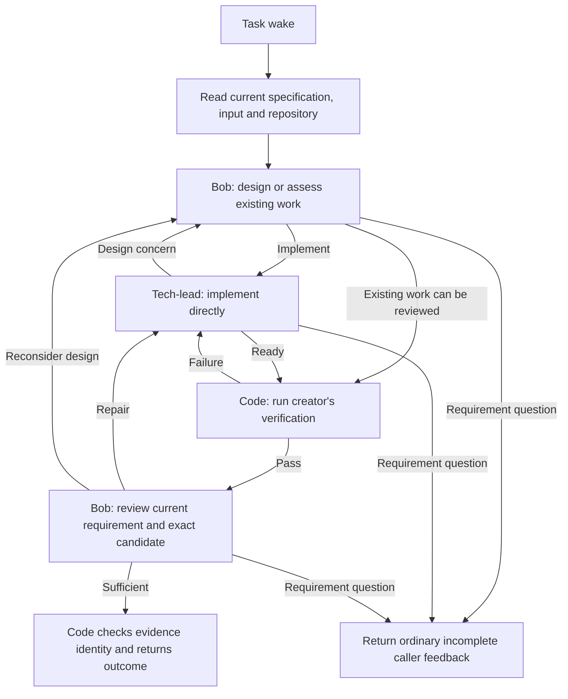

# Development workflow: judgment and execution

Status: migrated into Alex source; activation is recorded in the
[migration receipt](../migration-receipt-2026-10-04.md). The earlier local trial
is retained in the [PoC review](../../may.app/docs/development-workflow-poc.md).

**Supports:** [Useful completed work](1-principles/purpose.md).
Alex keeps design, implementation and review together so a candidate can reach
its requested outcome with fewer relayed instructions.
**Choice basis:** [Agent judgment and infra execution](1-principles/core-principles.md).
Alex chooses this procedure; its code runs and records the selected steps.

## Repository delivery boundary

Apply the contribution and review rules of the repository containing the change.
The Host at `/app/projects/may-agent` uses protected GitHub pull requests. The
Apps repository at `/app` uses its authorized local integration path and bare
backup remote. Review and focused verification still apply there; a Host PR or
Host CI requirement does not transfer to an App-only correction.

Retain the exact candidate, integrated source and activation evidence separately.
When a creator's acceptance names the wrong repository process, return the
mismatch to that creator for correction, then reconcile its obsolete Condition.
Use existing deployment authority; request a human decision only for an actual
remaining permission or unresolved tradeoff.

## Sufficient first outcome

Turn an accepted requirement into a locally committed, verified and reviewed
candidate. May retains the original human Request when she is the caller. One
ordinary Alex Task runs Alex, who selects the development workflow; Bob judges design/review,
and tech-lead implements directly. No separate coding worker is introduced.

The implemented procedure deliberately ends at local source evidence. PR
creation, remote CI, merge, deployment and long external waits are not fulfilled
by its local candidate. The [PR follow-through direction](#pr-follow-through-across-bounded-attempts)
below explains how a broader Alex assignment can use this procedure without
turning it into a permanently running workflow.

## From a standing review to a concrete incident

A standing improvement review owns problem selection, cumulative incident
allowances and the recurring deadline. Its broad outcome is not the selected
repair's specification. Before development, reuse an existing finite assignment
for that incident, or submit one ordinary Alex goal using the supported Task
request path and retain a caller request Condition on the standing Task. The
finite goal supplies the concrete outcome, acceptance, constraints, incident
identity, evidence and remaining allowance. See the
[request and Condition contract](2b-manual/task-execution-guide/SKILL.md#act-now-or-retain-a-dependency).
Alex judges the returned development evidence against the incident acceptance
and carries its disposition and cumulative counts back to the standing owner.

Keep one finite assignment per genuine incident across days and recovery, rather
than one per stage or retry. A started or exhausted incident cannot be moved to
a fresh Task to regain allowance. Existing owner disposition is required when
its allowance is exhausted. This repair adds a guard for the known standing
improvement-review policy before work starts; it does not add cross-Task incident
accounting or automatically create the finite goal. Alex must preserve those
constraints through the existing request mechanism.

The procedure continues to accept only `{ verify: [executable, ...arguments] }`.
Requirements come from its owning finite Task; extra task prose in an agent
call is not a replacement specification. The standing-review guard returns
incomplete before specialist calls, verification or round reservations.

## Responsibilities and graph



The graph is App policy. Core continues to own input admission, execution,
Task state, feedback, recovery and closure. The graph adds no core phases,
event handler, database table, timer, queue, workflow checkpoint service or
agent heartbeat. An exhausted local repair allowance returns an incomplete
attempt; the same Task remains responsible under ordinary backoff.

Bob's design/review stages, tech-lead authorship, local commit and verification
argv are this procedure's choices. Other workflows preserve the
[common execution contract](2a-design/workflows.md#shared-contract-and-changeable-procedure)
without copying this team or graph. Alex can evolve these choices as evidence
changes; the active implementation still enforces its declared gates and returns
control when it cannot satisfy them.

The process is one reconciliation loop: read the latest requirements, check
the work so far, and decide what to do next. Execute that step and save the
result. Feedback, failed checks and recovery all lead to another iteration. The
workflow reserves at most three cumulative rounds for the development Task
across invocations. Matching evidence lets later invocations skip completed
work; reentry and changed verification commands do not renew the allowance.

Agents make judgments; the workflow runs the steps and checks. Bob assesses
the design before tech-lead implements it. Code runs verification, and Bob
reviews the result before completion. The workflow reuses completed work while
it still applies to the latest requirements and code. These are the App's
development rules, implemented by the existing workflow.

An agent can iterate locally within its assigned step. Tech-lead can inspect,
edit, test and adjust until ready, or return a design concern or requirement
question through its structured result. The workflow passes that decision to
the responsible agent and continues from the result. Local iteration adds no
Task, scheduler or independent work authority. The Task creator maintains the accepted
requirement; Bob judges design and acceptance; tech-lead
judges implementation choices.

Agent calls and repository commands inherit the Host's remaining workflow
execution allowance and cancellation. Commands receive `ctx.signal`, which
aborts on caller cancellation, the run/parent deadline or run completion.
There is no additional per-step timer or operation cap in this workflow.
The initial parser PoC's three-minute/40-operation caps interrupted
substantive report authoring in the local integration trial. Removing those
overrides keeps the existing bounded execution path and ordinary recovery.
The command helper's separate two-minute cutoff is also removed: a valid
verification may take longer while remaining within the workflow allowance.

Alex, Bob and tech-lead live under `alex.app/agents/`, with names `alex`,
`bob` and `tech-lead`. Alex owns the workflow catalog and chooses
`develop-change` when useful. May requests an outcome from App Alex through
the ordinary goal contract; she does not call its private specialists.

Public inputs are ordinary `message` and `goal`. Workflow selection adds no
public schema or router branch. `develop-change` takes private procedure options
`{ verify: [executable, ...arguments] }`; outcome, acceptance and constraints
come from the owning Task. Its exported `inputSchema` validates those options
through the invocation kernel before execution. Public goals do not accept a
`verify` field; the agent selects and supplies procedure options when calling
the workflow. A retained Task input never overrides that selected check.
The retired `development` envelope is no longer a workflow input or fallback.
Historical direct workflow bindings must finish under their old source, or be
explicitly converted or retired before activation. Existing Task records and
evidence are not rewritten by this source change.

Alex reads the workflow result and proposes the owning Task result, retaining
`result.development` evidence references. Host acceptance still owns settlement.
New Task input keeps previous reports visible while prompting fresh judgment.
Matching verification receipts may be reused for the same candidate and checks;
changed requirements reset validity, not access to the evidence.

An explicitly Task-addressed `message` is follow-up input for that Task, even
though an unaddressed message normally enters May's Conversation. During a
workflow call, the active specialist receives the shared Host hint. It judges
the correction within its step; Alex judges the overall result when the call
returns. Input not incorporated by accepted settlement remains for the next
Task attempt. This uses common Host admission and feedback, with no team-specific
message route or workflow resume service.

Bob uses GPT-6 Astra and tech-lead uses GPT-5.6 Sol. Both receive the normal
coding tools (read, shell/search, edit and write) plus structured finish. The
workflow preserves configured tools instead of adding a review-specific filter.
Bob's design/review assignment requires preserving the candidate; a separately
assigned repair can authorize edits. The standard loader also supplies scoped
`tasks` reads, fact publication and creator-authorized updates. Available tools
do not expand the assignment or bypass these authority checks.

The shared [Task entry convention](2a-design/workflows.md#task-entry-and-discovery)
provides full context and discovery references to every participant. It is
navigation, not a team-specific evidence ledger. The workflow still checks the
actual candidate and retained verification/review evidence before proposing
completion. Shell tools are trusted execution; role instructions are not a sandbox.

## Decision contracts and enforcement

| Step           | Agent decision                       | Code action                                                                                     |
| -------------- | ------------------------------------ | ----------------------------------------------------------------------------------------------- |
| Design         | implement / review / clarify         | Invoke implementation, verify existing work, or return the creator question                     |
| Implementation | ready / redesign / clarify           | Inspect the committed candidate and run checks, request design judgment, or return the question |
| Verification   | Process exit and repository readback | Failure evidence goes to tech-lead; success permits review                                      |
| Review         | pass / revise / redesign / clarify   | Admit sufficient evidence, request repair, revisit design, or return the question               |

Use the SDK's structured result schema for each call. The workflow validates
the returned decision and invokes fixed profile names; agents do not construct
routes, events or timers. A fresh design judgment supersedes the earlier request for repair: when Bob
chooses review of existing clean work, stale feedback must not force another
implementation. Existing exact-candidate verification remains reusable.
The explicit review decision governs acceptance. A pass may retain optional
findings, which remain in the evidence snapshot and report. Unmet acceptance
requires revise, redesign or clarify; the reviewer explains why. Code does not
infer severity from the presence of prose. Exact-candidate verification and
review fences still apply, including when reusing a previous pass.

Verification argv is supplied in the creator's specification. Code executes it
as a subprocess without shell interpolation. The workflow signal bounds its
duration; the helper limits captured output to 2 MiB per stdout/stderr stream.
There is no separate command timeout. Cancellation stops the direct subprocess
through `execFile`; this does not establish process-tree termination for tools
that start detached children. The implementing agent cannot substitute a
different command in its finish result. Bob must still judge whether the
tests prove the requirement and whether changing a test was appropriate.

The workflow requests a Runtime-owned task worktree based on `main`. It rejects
a shared primary checkout, keeps unfinished edits, and checks clean committed
source before verification and review. Passing checks and review are bound to
the exact commit and merge-base. A changed or dirty candidate cannot reuse
those receipts. Workflow code does not allocate, merge, push or clean worktrees.
The Host must preserve a clean unmerged deliverable when accepting this local
outcome. Integration is an App requirement only when the assignment asks for
it; workspace cleanup cannot impose a merge or remove the report's checkout.
The local report trial exposed that older Host cleanup incorrectly rejected
such results. It requires the accompanying workspace finalization correction.
Evidence reuse assumes the local toolchain and ignored dependencies remain
unchanged. It does not fingerprint the environment or certify external systems;
a new input requests fresh verification when those assumptions change.

For this Apps repository's linked worktrees, the procedure checks its file-based
SDK dependency and prepares `node_modules` and `projects/may-agent` links to
existing machine paths in the primary checkout. Both required markers and Git
ignore rules are checked before either link is created. Existing valid paths
are reused; broken paths are preserved and reported. There are no package
installs, downloads, source edits or Host repository changes. Other repositories
are left to their own setup. Missing prerequisites return incomplete before a
development round is reserved, and do not justify weakening the verification
command or making unrelated source changes. The links restore the existing
local environment; they do not prove compatibility or reproducibility.

## Reconciliation and updates

The accepted Task result stores a small versioned `development` record with
checksummed references to a full evidence snapshot and a readable report index.
The snapshot retains requirement/input fingerprints, design judgment,
implementation identity, verification identity, review judgment and unresolved
feedback. Each specialist call also retains its actual execution ID, summary,
structured output, facts and any SDK-provided CLI receipts. Code records these
before judging whether the returned decision is valid. Verification records its
actual argv, directory, timestamps, exit status, stdout/stderr and before/after
candidate identities on both success and failure. A timeout or output-limit
error remains a failed check; captured output is not claimed to be exhaustive.

Files live beneath the Task output's `.state/alex-development/` directory. The
repository must already ignore that directory, as this App does; the workflow
checks this before work and never changes ignore rules to hide source edits.
The shared `shared/tools/task-evidence.ts` helper publishes complete
content-addressed files and never replaces an existing artifact. Its common
recovery rule is described in the [workflow contract](2a-design/execution-contributions.md#evidence-retention-and-autonomous-recovery). Alex supplies
the Git/requirement validity checks and team policy. Raw JSON preserves exact values; readable Markdown supports paginated
inspection of long text. These are local deliverables retained with the Task
worktree, not a permanent archive independent of worktree retention.

The full reports are outside the Host's 16 KiB Task result field. Code bounds
summary previews, retains full explanations, and validates the aggregate return
against the SDK contract before delivery. Agents do not have to guess how many
characters remain across all reports. Failure to save evidence cannot produce
convergence. The reviewer always receives the latest report for each evidence kind, without
a history-length cutoff, and execution identities,
including actual successful check output, instead of being asked to trust an
implementation claim or request repeated receipts from tech-lead.

Each invocation reads the exact Task and repository. Current specification is
authoritative. Matching accepted verification/review evidence can produce a
quiet result without model calls. When Runtime supplies a rejected previous
attempt, the workflow can also inspect that attempt's evidence, only in the
same generation and workspace. It validates the snapshot and referenced files,
requirement/input fingerprints, and current clean commit and merge-base before
reusing a completion. Missing or damaged evidence requires fresh assessment.
Rejected settlement is never treated as accepted work or permission to replay
effects. New input causes fresh judgment; this PoC accepts extra review instead
of classifying every event type.

The files have no latest pointer, executable phase, pending-work list, timer or
scheduler. Runtime's accepted result or explicit previous-attempt reference is
the only way reconciliation selects them. Interruption before a workflow returns
may leave useful files without a selectable snapshot; ordinary source inspection
and repeat verification still apply. This does not promise exact step replay.

The readable delivery index records local evidence, not Task settlement,
Request closure, merge or deployment. Alex reads the returned report and current
Task/Request state before describing those effects as completed. Arbitrary prose
written before settlement is not an authoritative closeout receipt.

Events prompt reconciliation; the current specification and evidence determine
the next step. An input event alone does not authorize a new requirement. May
interprets the human request and uses its creator authority to update the
specification. The accepted write is independent of the worker's execution.

A changed specification makes the saved evidence outdated, so the next
invocation obtains Bob's design judgment before implementation resumes. Bob
can retain a suitable approach. Failed verification under an unchanged
specification leaves the design valid, so code returns directly to tech-lead.
Both follow from the current work and requirements; neither needs a separate
event handler. The PoC conservatively resets saved evidence for any newly
delivered input, so asynchronous notifications can cause extra assessment.
More selective reuse is an optional optimization; external-operation
continuation is outside this trial.

At a checkpoint, code compares the requirement used for the work with the
current Task requirement. The existing generation and requirement checksum
provide that check; ordinary progress updates do not change the requirement.
Tech-lead does not need to receive a notification, poll through a tool or ask
another model whether something changed. If the requirement is unchanged,
execution continues. If it changed, the execution preserves work and returns
incomplete. The same Task's next iteration reads the latest state, and the
workflow selects the next step under the App's rules.

The current checkpoints are before and after the whole agent call, and around
verification. Tech-lead can keep coding and testing within its call; it may
continue using old instructions until the call returns or execution ends.
Preserving work means retaining files and available progress. It does not
require committing unfinished code or capturing every internal step.

Checkpoint placement is a responsiveness choice within the same reconciliation
model. Keep the current boundaries as the simple default. Checking between
coding iterations could detect updates sooner, at the cost of more execution
integration. Measure call duration and work spent on superseded requirements
before adding finer checkpoints. Faster notification can be an optimization;
reading the current requirement remains the basis for deciding whether to yield.

Runtime settlement fences remain responsible for concurrent acceptance. These
checks do not lock files, provider calls or specification updates, or prevent
the creator's write.

An interrupted attempt may leave a commit or dirty edit without a Runtime-referenced
workflow record. The next invocation inspects the same worktree and asks
tech-lead to retain/repair that work. Cheap design and verification may repeat.
We do not require exact step replay or create an external-action ledger.

Requirement questions return `incomplete` with `report: true`, through the
Task's existing caller feedback. The workflow does not invent a human Condition
with no return route or directly send messages. The experiment does not claim
exact suppression of repeated questions during retry.

## PR follow-through across bounded attempts

**Accepted Task use case; watcher source implemented, not activated by this
change.** This is the ordinary [Task + Watcher model](2a-design/task-resource-engine.md#solid-use-case-a-pr-through-ci-and-review),
not an Alex-specific delivery lifecycle. `develop-change` remains the bounded
local design/implementation/verification/review procedure. One Alex-owned Task
carries the broader authorized outcome through publication, CI, review feedback
and any separately authorized integration. Alex judges and acts; the GitHub
watcher supplies facts; Host retains work, delivers events and schedules
eligible attempts. No new Host phases or permanently running PR workflow are
needed. Publication still uses separately authorized tools.

Follow the [standalone-to-Host pilot plan](2b-manual/standalone-to-host-pr-pilot.md)
to manually tune bounded passes and their feedback before automating coordination.
Its checklist records experiment progress, not another delivery lifecycle.

For example:

```text
Alex Task: deliver the agreed change through an acceptable PR
  → attempt calls develop-change and obtains a reviewed local candidate
  → authorized bounded action pushes the branch and creates/reuses the PR
  → retain PR identity and outstanding CI/review requirements; end invocation

Watcher observes a CI or review/comment change for that PR
  → Host admits the fact to the same Task and schedules an eligible attempt
  → Alex rereads current PR/head/checks/comments and judges what remains
  → bounded development/verification repairs justified issues
  → push the new candidate to the same PR; retain outstanding requirements

Required delivery evidence is complete
  → Alex reports the exact outcome under the original acceptance
  → creator/App closure policy decides whether the Task should close
```

A local `develop-change` result can converge as a contribution while the broader
Task remains unfinished. Alex must not forward local convergence as proof of PR
creation, remote CI success, approval, merge or deployment. Those are separate
facts and permissions; an assignment may stop at an acceptable unmerged PR.

### Publication and retained context

Start with Alex's available tools for bounded Git/GitHub actions. Factor a
repeatable publisher or feedback-assessment procedure only when it earns its
place; neither is a prerequisite for this design. Preserve the existing
`develop-change` input/result contract rather than adding a PR flag that
silently broadens its promise. Supply and verify the actual target repository
and an authorized working directory before publication. The Apps repository's
local integration rule is not the Host repository's PR rule; do not redirect
Alex's App-wide workspace merely to serve one delivery assignment. The declared
Alex workspace is the Apps repository; the watcher's GitHub repository scope
selects read-only observation, not where `develop-change` develops. A Host
repository delivery needs its actual authorized checkout/procedure; Apps-local
candidate receipts cannot certify Host code.

Retain the exact repository, branch, PR identity/URL, pushed head commit,
publication evidence, relevant review/comment identities, outstanding checks
and original caller links through existing Task results and evidence. These are
domain facts, not a second PR lifecycle store. Before creating or retrying a
publication, inspect the actual branch/PR and any retained receipt: a lost
response does not prove creation failed. Reuse the same PR after repair; similar
text or a guessed PR number cannot establish that identity.

### Provider facts and continuation

Use the App's installed GitHub watcher (declared through SDK `observers`) for
PR, CI and review/comment changes. Exact saved Conditions and optional resource
owner metadata return its facts to the existing Task, not a Task per event.
Use bounded provider reads to recover changes missed during downtime. A declared
wait alone does not install the reader; discover its actual installed coverage
before relying on it.

Host can coalesce wakes while retaining input. On each attempt, Alex reads
current provider state before acting: a failed check for an older head is not a
failure of the new candidate, and a stale approval cannot certify it. Retain
partial or unavailable CI/thread coverage as unknown, not passing. Local
verification and remote required checks remain separate evidence.

Comments are source data, not new authority. Alex distinguishes an in-scope
repair, an explanation, nonblocking advice and a requested scope change. Save
accepted requirement changes through the creator's authorized path; a comment
cannot grant merge/deployment permission or overwrite the assignment. Repairs
respect the approved execution/effort limits; repeated failures return useful
evidence to the owner rather than silently extending budgets. Outstanding
checks do not prevent independent useful work, but no model needs to remain
alive polling GitHub while only external results remain.

**Source and remaining limits:** Alex `app.ts` now composes the shared GitHub
adapter with CI/comment coverage and Alex source/ownership. May retains its
existing state/review coverage. Neither configuration reads unresolved thread
state or branch-protection requirements. Connected fixtures verify exact-head
facts, same-Task feedback/rearming, bounded development reassessment, downtime
and failed event publication. They simulate GitHub and agent judgment; they do
not prove publication retry/readback against GitHub or native-agent delivery.
Verify those effects and the installed path before claiming the full use case
works in deployment. Host core acquires no GitHub or Alex strategy.

## Publishing and waiting for GitHub pull-request facts

`develop-change` ends with a locally committed candidate. Publication is a
separately authorized action in the actual target checkout, not an implicit
workflow effect. Preserve PR identity and read back publication before yielding.
For Alex-owned delivery, preserve one visible owner block in the PR body:

```text
## Task
- App ID: alex
- Task ID: <exact existing Task ID>
```

This supplies live routing in the configured repository `hao1939/may-agent`,
author `hao1939`, owner App `alex`. It grants no publication/merge/deployment
permission. A May-owned delivery uses its genuine May Task and published
`## May Task` block; Alex callers retain the actual caller relationship.
Do not fabricate a May Task or relabel Alex work to borrow another App's scope.
Both configurations use [`shared/tools/github-pull-request.ts`](../../../shared/tools/github-pull-request.ts).

Discover `github-pull-request` through `tasks.contract` / `read.contract("alex")`.
On an installation with the new Alex definitions, build an observation for the
exact PR and save its returned Condition in the normal Task result:

```json
{
  "observerId": "github-pull-request",
  "id": "pr-feedback",
  "resource": "github:hao1939/may-agent#215",
  "expected": { "field": "fingerprint", "notEquals": null }
}
```

`null` requests an initial snapshot. After judgment, rearm against the observed
fingerprint while further feedback matters; preserve unrelated Conditions.
A wait for only `state: closed` will not wake on CI failure or a comment.
Construction saves nothing. While delivery remains incomplete and only external
results remain, return `waiting` with the saved Condition and a scoped progress
report—not the local workflow's `converged` result as whole-Task completion.
Exact checks serve active interests; idle work with an old Condition alone does
not request them. The installed helper binds the resource and exact
source `app:alex:observer:github-pull-request`. Saved interests also recover
missed changes; they need no owner block for shared/read-only PRs in this
repository. Without an interest, live discovery remains best effort.

Alex facts include PR state, head and merge fields; commit-bound reviews with
body digests/previews; and `feedback` containing head-bound check runs, combined
commit statuses, issue comments and inline review comments. Each feedback set
has its own `*Complete` and `errors` evidence. Empty checks are not proof that
required CI passed. Truncated previews carry a body digest and item identity;
read full provider content when material. Unresolved thread state and required
branch-protection checks remain separate reads/judgment, not implied coverage.

The reader pins CI URLs and returned SHAs to the PR head, then confirms head
and live ownership again. A changing head fails explicitly for a later retry;
old approvals/comments remain commit-labelled source data. Provider reads are
not atomic; recheck current state before a consequential effect. Fingerprints
include CI and comment bodies/revisions but exclude fetch time, so these changes
wake even when PR `updated_at` does not change, while unchanged polls stay quiet.

Live scans run every fifteen minutes. They share at most sixteen HTTP requests,
reserve one worst-case complete feedback read per pass, and retain the existing
bounded discovery/fair traversal. Exact interests use Host's four-resource
batches, hourly fallback and prompt checks after accepted Task results. A full
exact read makes at most fourteen requests: PR, up to four review pages, up to
two 25-item pages per feedback set, and PR confirmation. Requests have 15-second
deadlines; the overall exact deadline is 210 seconds and supports cancellation.
Partial pagination/failures are explicit gaps, not complete empty success.
Shared credentials, rate-limit deferral and fixed-origin/endpoint validation
remain those of the [GitHub adapter contract](../../may.app/design/github-pull-request-observation.md#provider-facts-and-bounded-execution).
May's state-only bounds and legacy wait migration remain in that contract.

Read failures keep the interest intact and are visible in observer health/events.
An agent-selected `reviewAt` can request diagnosis when it could change a decision;
it is not a CI polling timer. No fact automatically approves, merges, deploys,
closes work or retires independent waits.

Run the maintained provider/Host composition against an explicit Host checkout:

```sh
HOST_CANDIDATE=/app/projects/may-agent \
  bun projects/alex.app/scripts/task-pr-watcher-composition.ts \
  /tmp/task-pr-watcher-composition.json
```

This uses the production Alex detector and Host Task/event path with fixture
provider/publication/judgment. It verifies same-Task feedback, restart, failed
publication, new-head rearming and independent requirements—not installed
activation, live GitHub publication retries or native-agent understanding.
The [November 16 source trial](archive/reviews/task-pr-watcher-use-case-20261116.md)
records the connected checks and remaining proof obligations.

## Input and installation boundary

```json
{
  "kind": "goal",
  "data": {
    "outcome": "Correct the duration parser",
    "acceptance": [
      "Whole-number hours convert to minutes",
      "Malformed values are rejected"
    ],
    "constraints": ["No added dependency"]
  }
}
```

May retains the same Request/Task link for follow-up and uses the existing
creator update capability for corrections. Ordinary Alex `goal` input selects Alex,
who chooses the method. When the team procedure fits, Alex uses the scoped
`agents` call to `develop-change` with `input: { verify: ["node", "verify.cjs"] }`.
The separate model-facing `workflow` tool is retired. Development
can produce a locally committed design/audit document as well as code. Its
verification must be executable argv, not English instructions. Bob still judges
the substance: checking a document exists does not certify its conclusions.
General research without a repository deliverable continues to use `goal`; this
repair does not add a second research controller.

Source needs the bounded workflow SDK, including `ctx.signal`, exact Task
reads, structured agent calls and task workspaces. The local integration trial
used a v4-based image with companion changes for GPT-6 registration, App-local
helper loading and preservation of clean local deliverables. See the PoC
review for the tested versions and remaining limits. Definitions, SDK and Host
must be validated together before activation; their source names do not prove
an installed or functioning model route.

May explicitly declares its existing App directory as a Git workspace on `main`;
the Host requires this declaration before allocating a Task worktree. The
App workspace determines the source repository for Task
worktrees. Arbitrary repository selection is outside this trial. A temporary
fixture supplies its repository explicitly to the real workflow runner. A
future actual-project trial must confirm the App workspace and Task worktree
before executing; changing the App's workspace can affect its other Tasks.

## Proof and reproduction

### Cumulative development allowance

`develop-change` reserves at most three rounds for the existing development Task
in its Task-local `.state/alex-development/<task-digest>/` archive. Each
`round-N.reserved.json` is an atomic link to a complete immutable receipt,
written before specialist or verification work. Live workflow reentry,
cancellation, concurrent calls, changed verification argv, new feedback,
generation changes and candidate commits do not replenish that allowance.
The allowance remains consumed when an owner has not yet returned a Task result.

Candidate acceptance remains separate: changed verification argv invalidates
the old passing receipt, and an unchanged verified/reviewed candidate may still
replay after round three without new work. Readable prior Task evidence seeds
the consumed count when migrating or recovering an archive. Unknown prior usage
leaves no provable remaining rounds; unavailable verification receipts cannot
certify a candidate. Exhaustion returns incomplete with evidence for the owner
to disposition; it does not claim the original acceptance is met or recommend
calling the same loop again.

These are local allowance receipts, not a second Task lifecycle or a general
run/cost budget. Retain the Task archive. This source repair has deterministic
coverage; live activation and Host restart/workspace-replacement behavior have
not been demonstrated. See the [repair record](comparison/alex-review-rounds-repair-20261116.md).

Run these checks from the Apps repository root:

```sh
bun test ./projects/alex.app/agents/alex/workflows/develop-change.test.ts ./shared/tools/task-evidence.test.ts --timeout 45000
bun run check:may-design
```

The workflow tests use
actual temporary Git repositories, isolated worktrees, subprocess verification,
SDK result admission and scripted agent decisions. They test process mechanics,
not model quality or full daemon recovery.

### November 13 command-duration correction

Apps source `0862215c6d` removes only the command helper's `120_000` ms timer;
the fixed stages, three-round repair bound, exact-candidate checks, evidence
reuse and independent review remain. The focused suite passed all 36 tests.
`bun run check:may-design` passed with only the existing root-layout warning
about the `reports` directory.
Its new cancellation regression waits until a real verification subprocess is
running, cancels the workflow, observes its connection close, and checks that
review and completion did not occur. Removing only signal forwarding from
`execFile` makes that test fail against the fixture's ten-second self-guard.

A separate real-duration comparison used the same Node command and a
150-second caller signal with the old and revised helpers:

| Helper | Elapsed | Receipt |
| --- | --- | --- |
| Baseline Apps `edc932194e` | 120,016 ms | SIGTERM, error, no successful exit |
| Revised Apps `0862215c6d` | 121,158 ms | Exit 0, stdout `verified` |

To repeat the revised-helper probe from the Apps root (takes about two minutes):

```sh
bun -e '
import { commandReceipt } from "./projects/alex.app/command.ts";
const receipt = await commandReceipt(process.cwd(), ["node", "-e", "setTimeout(() => console.log(\"verified\"), 121_000)"], AbortSignal.timeout(150_000));
console.log(receipt);
if (receipt.error || receipt.exitCode !== 0 || receipt.stdout !== "verified\n") process.exit(1);
'
```

This establishes removal of the helper cutoff and preservation of cooperative
cancellation. It does not certify a full Host check, model judgment, daemon
recovery or live activation. No model calls or deployment ran for this correction.
Repeated specialist context was inspected but left unchanged; no safe reduction
was established that preserves current requirements and usable evidence.

### One verification command runner

`develop-change` and `verified-coder` now use the same App-local
[`commandReceipt`](../command.ts) helper. Both take verification as
`verify: [executable, ...arguments]`, execute in the allocated workspace and
inherit workflow cancellation and deadlines. The helper keeps its existing
two-MiB limit per output stream and records process errors; it adds no timer,
shell parser or execution lifecycle. The two procedures retain their own gates
and result contracts.

`verified-coder` retires its synchronous shell runner, separate 60-second
cutoff and `verifyCommand` string input/output field. Arguments are passed
literally. Use a check script or an explicitly selected shell executable for
compound checks. Explicit shells and tools can create descendants; Host worker
cleanup still owns those processes. The helper forwards cancellation to the
direct executable and does not add another process-tree manager.

The focused regressions exercise actual repair, exact argument passing,
nonzero exit evidence and cancellation of a running direct verification
process. Gym uses the same typed input. The changed workflows and tests also
type-check against the current SDK; the development fixture supplies its
required starting Task and accepted-evidence navigation fields.

A separate actual-workflow probe used a Node check that prints success after
61 seconds, one scripted implementation result and a 90-second workflow allowance:

| Runner | Elapsed | Workflow contribution |
| --- | --- | --- |
| Baseline Apps `2d4e7906d1` synchronous shell runner | 61,447 ms | Blocked; no successful check output |
| Shared executable/arguments runner | 62,485 ms | Done; `verified after 61 seconds` |

The focused suite passed 49 tests across the two procedures and Gym adapter.
These source checks establish neither live activation nor full process-tree
cleanup for arbitrary verification tools. No model calls or deployment ran.

### One development procedure input

`develop-change` uses its exported schema as the only input validation point.
The private parser and retired Task-envelope fallback are removed. A regression
demonstrates why the latter matters: with a failing check supplied in the current
procedure options and a different passing check in retained Task input, the old
workflow returned convergence. The workflow now runs the selected failing check,
retains the failure and returns incomplete without review. Requirements and
constraints still come from the Task, and the existing candidate/evidence reuse
checks remain.

A read-only local control-socket observation at `2026-11-13T12:24:14.980Z`
listed all 66 open Alex Tasks (`pending`, `running`, `waiting`, `attention`,
`idle`) and read each exact Task without failures. None used input kind
`development` or a direct `develop-change` binding. This is a bounded,
non-atomic local observation, not a census of other installations or closed
history. No Task was edited. Other installations must check their retained
bindings before adopting the retired-input boundary above.

All five new boundary/regression cases failed against pre-change Apps
`a560069ca8`. After the cleanup, 57 focused tests across development,
`verified-coder`, Gym and evidence retention pass. Strict type-checking and the
design checks pass as well. These are source checks, not live activation.

The historical `may.app/poc/run.ts --live` harness predates the move and is not
a current Alex activation check. It was a temporary opt-in branch harness. Set `MAY_HOST_SOURCE`
to the reviewed Host checkout and `MODEL_BASE_URL` / `MODEL_API_KEY` to an
authorized endpoint. It creates an isolated duration-parser fixture and uses
the actual workflow runner, agent profiles, models and tools. It persists
fixture Task data across invocations and independently checks the produced
parser. It does not connect to the live daemon or claim to exercise actual
Task event admission, scheduling, creator authority or notification delivery.
Remove the harness after recording its results if it gains no recurring use.

Results and remaining gaps are recorded in the [PoC review](../../may.app/docs/development-workflow-poc.md). The
acceptance question is whether useful decisions produce a correct candidate
with manageable cost and understandable recovery, not how many stages run.
