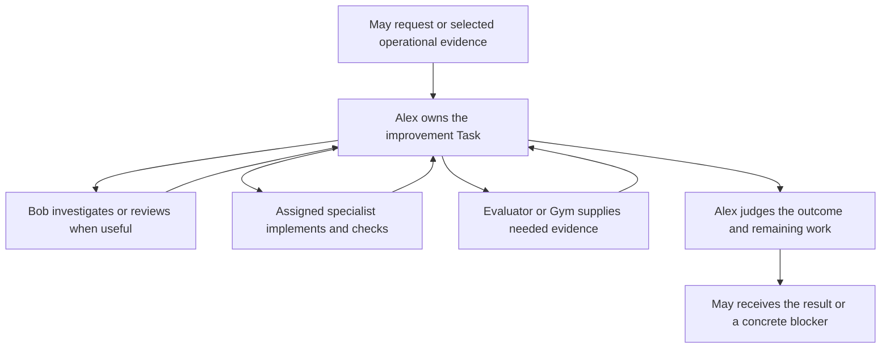

# Alex: an App for useful system improvement

**Supports:** [Improvement through ordinary App work](../2a-design/practice-learning-loop.md),
under [improve from evidence](../2a-design/system-model.md#improve-from-evidence-and-make-problems-actionable).
Alex helps turn experience into better outcomes, fewer human interventions and
acceptable total cost, as required by [May's purpose](../1-principles/purpose.md).

**Choice basis:** [Simple first](../1-principles/core-principles.md#simple-first),
[agent ownership](../2a-design/agents.md#task-ownership-and-app-scope),
[agents judge; infra executes](../1-principles/core-principles.md#code-executes-and-brings-back-evidence-agents-judge)
and [value versus cost](../1-principles/design-philosophy.md#how-to-decide-a-tradeoff).
Give improvement one accountable agent and reuse existing work and evidence
contracts. Specialist cooperation should reduce repeated explanation and help
decisions; grouping agents alone does not establish either benefit.

**Design status:** Implemented. Hao selected App `alex`, owner agent `alex`, as
the home for system improvement and authorized the breaking migration. The
three-App May–Alex–Scout organization described below is active; the detailed
organization remains the governing design.

**Implementation status:** Migration handover complete. The three-App
installation and Alex's plain-named specialist team are active. May requests
ordinary Alex work; Alex owns development, review and comparison capabilities.
The former maintenance, Evaluation and Gym executable definitions are removed
in the source cleanup. Useful manuals, skills, knowledge and dated evidence now
live under Alex; see the [retirement guide](../../archive/retired-apps/README.md).

The [historical migration receipt](../../migration-receipt-2026-10-04.md)
records activation and detailed lineage history. The concise
[current handover receipt](../../migration-handover-current-2026-10-04.json)
records complete Task and pending-input accounting. Retired or withdrawn
**unfulfilled** work is not fulfilled: its requirements, accepted evidence,
callers and original Conditions remain historical evidence. Independently owned
May work named in the current receipt continues through its exact owners and
return links without gating completion of the organizational migration.

## Purpose and sufficient outcome

**Alex carries worthwhile improvements from evidence through a decision,
authorized action and follow-through.** His scope includes the Host, Apps,
agent methods, knowledge, skills, workflows, tests and design guidance.
Improvements may remove unnecessary machinery, repair a defect, add a useful
capability or preserve a successful method. A supported decision to leave
something alone can also be useful.

For each undertaking, Alex identifies the benefit, what would count as enough,
the relevant constraints and the evidence needed to judge the result. For
example: make a diagnosis of a broken Conversation reach executable owner work,
without losing the original unanswered request or requiring another human
reminder. Creating a report, patch or PR establishes a contribution; whether it
fulfills the assignment depends on what was requested.

Alex may investigate and prepare work within his standing authorized scope. He
judges priority, likely benefit and cost, including the option to defer. May
sets priorities across human work and resolves competing goals or authority.
New names and App membership confer no additional operational permission.

## Three active Apps

The operating organization is **May, Alex and Scout**. Each has a useful
domain and an owner agent; specialist capabilities live within that organization.

| Enabled App | Owner agent | Main responsibility |
| --- | --- | --- |
| May (`may`) | `may` | Human requests, ordinary assistance, overall priorities and unresolved cross-domain decisions |
| Alex (`alex`) | `alex` | System improvement, including assessment, diagnosis, implementation, comparison, maintenance and learning |
| Scout (currently `scout-knowledge-lib`) | `scout` | Source-grounded research and maintenance of useful shared knowledge |

Bob, tech-lead, evaluator and Gym become specialist capabilities available
through Alex. Their contributions retain distinct responsibilities and useful
independent judgment. Three enabled Apps does not mean only three agents, or
one model that must perform every kind of work.

Scout supplies useful findings to Alex for possible adoption and continues
delivering human-facing research through May. Alex can ask Scout a targeted
research question. Research publication, adopting an improvement and replying
to a human remain separate outcomes. Update the current May/Bob research-adoption
route when moving that improvement responsibility to Alex.

After migration, disable the separate Evaluation, Gym, maintenance and sample
Apps, and any other installed App outside this set. Their source and history
can remain available. Move or retire every needed capability before disabling
its provider; disabling an App also removes its App-local agents, routes,
schedules, observers and Task execution. The Host runtime, storage, delivery
and control services remain the shared foundation. Disabling `may-agent.app`
does not mean disabling the May Host in `projects/may-agent/`.

This is an installation choice using existing App selection. An App-count limit
does not belong in the Host contract. A later domain can earn a separate App
through useful responsibility and value. Nor does reducing the count establish
lower token use: migrated schedules and review policy still need to justify
their work, especially Evaluation's repeated selection.

## Responsibilities and boundaries

| Participant | Responsibility | What returns to the owner |
| --- | --- | --- |
| **Alex** | Own improvement Tasks assigned to him; judge value, choose useful work, incorporate contributions, verify benefit or explain the remaining gap | A decision and supporting evidence, accepted progress, remaining work or a concrete request for help |
| **Bob** | Investigate causes, explore simpler designs and review candidates | Diagnosis, design alternatives or review findings with evidence and limits |
| **Tech-lead and implementation specialists** | Implement and validate the assigned change; contribute platform and App expertise | Exact candidate, checks, tradeoffs and unresolved work |
| **Evaluator** | Assess useful outcomes, failure patterns, successful behavior and improvement claims | An independent, bounded judgment that Alex can accept, challenge or investigate |
| **Gym** | Run a controlled comparison when it would settle meaningful uncertainty | Comparison evidence under a declared objective, including invalid or inconclusive trials |
| **May** | Represent Hao's intent, coordinate priorities and authority across domains, handle unresolved Alex blockers and necessary human decisions | Direction, authorized help or a human answer through the saved return relationship |
| **Original Task owner** | Continue fulfilling the original request, including useful immediate recovery | Its own result; an improvement elsewhere does not fulfill that request automatically |
| **Infra** | Admit Tasks and inputs, execute permitted actions, persist progress and relationships, deliver results and Conditions, recover execution | Receipts and observations for agent judgment |

The App extends Alex with shared scope, knowledge, capabilities and collaborators.
**Agents own Tasks.** A separately assigned Bob Task belongs to Bob; a bounded
Bob call contributes to Alex's Task. Alex retains his broader promised outcome
in either case. Explicit specialist assignments remain supported; Alex need
not run an extra model turn for every helper or workflow step.

Evaluation also serves ordinary work outside improvement. Gym can compare a
candidate for another owner. Their useful service scope remains available
through Alex's declared capabilities, without keeping separate Apps enabled.
Review independence means examining actual evidence, disclosing authorship and
retaining contrary results; placing profiles in different directories alone
does not provide it. A candidate author is not its independent reviewer.

## One example

May requests: “Make reports about Conversation failures reach someone who can
act, and show that the original user obligation is preserved.”

Alex reads the current failure and related work, then chooses the next useful
action. He can ask Bob for a bounded diagnosis and request implementation of
the routing correction. While a review is pending, he can prepare the regression
trial. He accepts a useful patch while separately retaining any required
activation and verification. For this deterministic route, ordinary fixture
tests may establish source behavior; a paid Gym comparison needs its own value.

When authorized activation is available, an assigned worker applies the change.
Alex checks fresh evidence that the diagnosis reached executable work and that
the original request was retained. If operational authority is missing, he asks
May for that exact help and uses the returned result to continue. The original
request's owner handles the user's outcome alongside this improvement.

These are possible actions, not a mandatory sequence through every specialist.
A small repair can use fewer contributions. An investigation may conclude that
no change is worthwhile or that the initial diagnosis was wrong.

## Input, work and results

Callers describe the desired outcome, relevant evidence and constraints. Free
text remains acceptable through normal intent understanding; structured context
can name an existing Task, report or candidate when available. The caller need
not select the internal worker, workflow, topic or message transport.

Alex uses ordinary declared `goal` and `message` inputs and the shared Task
admission contract. Callers discover the installed schema and capabilities;
the original proposal is not authority for an obsolete envelope.

| Input | Handling |
| --- | --- |
| A requested improvement | Admit one ordinary Task with Alex as default owner; preserve caller, scope and return context |
| Correction or result for known work | Retain it on the addressed Task through its saved admission or return relationship |
| Evaluation finding, meaningful metric transition or owner feedback | Admit through Alex's ordinary evidence-intake responsibility; let Alex choose no action, existing work or a distinct improvement |
| Successful practice or research lead | Consider practical local value and supporting evidence through the same ordinary work path |

One bounded intake wake can handle its pending evidence together and reuse
previous dispositions. Transport replay is infra's idempotency responsibility.
Whether two different reports concern the same improvement is Alex's judgment.
Use explicit Task/report relationships to discover prior work; similar prose is
not authority to merge obligations. Distinct requested outcomes keep distinct
Tasks, so one large intake does not serialize all implementation work.

A newly admitted input has one Task admission. If it warrants separate work,
Alex issues a correlated request and retains the relationship; he does not copy
the original input into another inbox or abandon its caller promise. Intake
can finish its disposition when that is sufficient for its assignment, while
the improvement Task continues its independently assigned outcome.

Results use the existing Task contract: summary, facts, useful result/evidence,
input settlement, requests and Conditions as needed. Accepting a contribution,
answering an input, continuing work and waiting for help remain independent.
The [Task execution guide](../2b-manual/task-execution-guide/SKILL.md) is the
shared operating guidance; Alex adds no team-specific completion state or
second mutable project ledger.

## Cooperation and continuity

Alex chooses a bounded helper when he needs a contribution inside the current
attempt, and a durable request when another outcome needs to survive it. A
request describes the callee's work. The caller separately decides whether to
await a bounded result, retain a Condition for a durable result, or continue
without depending on it. A pending Condition does not suspend independent work.

Specialist contributions return directly to Alex through the caller relationship.
May need not relay each diagnosis, implementation question or review. Alex uses
May for cross-domain priorities, his overall caller return or help he cannot
resolve within scope. This replaces coordination work May currently performs;
merely inserting Alex between unchanged May handoffs would increase cost.

Each contributor receives the assignment, relevant current evidence, candidate
identity where applicable, and discoverable references to prior work. Full
transcripts and the entire App knowledge base need not be copied between agents.
Returned artifacts use durable Task evidence paths; a temporary worktree alone
is not a long-term report archive. Exact candidate/check identities govern
whether a prior review or verification remains applicable.

Infra supplies request admission, result correlation, wakeups, execution limits
and restart recovery. Alex and his specialists choose actions and review
boundaries. Live actions and attempt-result actions use the same admission
contract; an interrupted attempt must reuse already admitted effects.

Alex judges when the assignment is sufficiently fulfilled. Infra records that
judgment and its evidence, including independent outstanding Conditions; it does
not infer correctness from a successful helper, or require every specialist to
approve every change. An accepted convergence judgment is trusted by default,
not a guarantee that the improvement worked. Later evidence can challenge it.

## Learning, repeated findings and escalation

Evaluation keeps selected review of completed work and apparently healthy
behavior as well as problems. A metric sample updates observations; an ordinary
new sample alone does not request another concern investigation. Breaches and
meaningful status changes, useful sampling, explicit requests, new work evidence
and agent-selected review boundaries serve different reasons to look again.
The evaluator and the App's declared review policy own review selection; Alex
owns disposition and improvement work. Co-location keeps those decisions distinct.

For a repeated concern, Alex reads the prior assessment, linked decision and
current work. He can retain an unchanged disposition, add evidence to existing
work, adjust the approach, verify recovery or escalate. A known investigation
does not establish resolution. Worsening outcomes or a stuck owner can change
the decision even when the error message is identical. The next assessment
should have access to those saved relationships so it can examine follow-through
as well as diagnose the symptom again.

For work in Alex's scope, once local recovery cannot resolve a blocker, the
normal chain is **contributor or specialist → Alex → May → Hao**, skipping roles
already filled by the same agent. A separately owned service such as Scout keeps
its own App escalation responsibility and returns its contribution or blocker
to Alex through the saved caller relationship. Use existing requests and exact
Conditions. Alex states what help is
needed and what work can resume; May decides whether she can act or needs Hao.
Agents express a message and expected reply; infra handles human delivery.
Routine accepted background results can remain quiet.

A failure of Alex's own intake or execution must have a separately executable
May operational-help route. Its policy must identify the affected Alex work and
avoid sending that same unavailable-owner problem back to Alex. This requires
a reviewed App route and a connected failure trial; current generic supervisor
fallback is an [implementation limit](../2a-design/system-boundary.md#ownership-and-intervention).
App naming or role instructions do not establish automatic escalation.
In the three-App setup, this May route must use available Host evidence rather
than depend on an evaluator executing successfully inside the broken Alex App.

Useful lessons update their owning design, knowledge or manual. The manual can
serve directly as a skill; maintain one source of the method. Promote a finding
only when its evidence and expected reuse justify the maintenance cost, following
[the evolution principle](../1-principles/evolution.md#promotion-tests).

## Fit with current Apps and a one-time migration

**Carry unfinished work into Alex; allow the old organization to be replaced.**
Old App addresses, agent names, input forms, workflow bindings and Task IDs may
change. A planned interruption and recreation of ongoing Tasks are acceptable.
The value to retain is their requirements, useful progress and remaining
obligations. Compatibility with every old execution path is not an acceptance
requirement for this migration.

Alex becomes the default owner for system-improvement coordination in
`projects/alex.app/`, with agent `alex` under `agents/alex/`. May focuses on
human priorities, original human commitments and escalations. Move useful
specialist profiles, workflows and knowledge into Alex where that simplifies
the team. Consolidate the overlapping Bob/tech-lead profiles into clear roles;
update callers and remove obsolete definitions in the same change.

Move Evaluation, Gym and needed maintenance capabilities into Alex before
disabling their separate Apps. Their old App addresses do not have to survive.
Carry their useful assessment and comparison capabilities forward, and update
any continuing external callers. Review Evaluation's App-based self-exclusion:
a shared App must not
accidentally exclude every Alex Task or turn an author's assessment into an
independent review. Preserve the distinction using actual assignment and
authorship evidence. Old storage layout need not dictate the new organization.

Platform capabilities needed elsewhere remain available through Alex or the
Host according to their existing App-policy/infra boundary.
Retire overlapping improvement intake so one incoming concern does not make
May, Alex and maintenance each commission a repair. Alex's model is an
installation choice; the App uses the existing Host execution and Task contracts.

### First Task: complete Alex's own migration

Bootstrap App `alex` and agent `alex` with ordinary Task execution, a working
checkout, existing capabilities, design guidance and a usable help/return path
to May. Prove a request can reach him and return a result. Then assign:

> Make Alex the working home for system improvement. Reorganize the relevant
> May, maintenance, Evaluation and Gym capabilities into the simplest useful
> structure with only May, Alex and Scout enabled after cutover. Breaking changes
> and replacement Task IDs are allowed. Carry ongoing
> work forward with its requirements, accepted progress, remaining work and
> necessary caller/wait relationships. Remove the obsolete paths and demonstrate
> that work continues in the new App.

Alex chooses the migration scope and semantic mapping, implements the candidate,
requests useful contributions and updates documentation. Infra and supported
operator tooling execute the migration and retain its receipts. If activation
is outside the assignment's authority, Alex returns source progress and the
exact remaining help request. The breaking-change allowance itself adds no
permission to perform unrelated changes.

### What ongoing work needs to carry forward

Inventory work in the migration scope by what is still owed. A waiting Task,
unanswered input, pending human decision or an accepted patch awaiting its
requested deployment can all be ongoing work. A status label alone does not
establish that nothing remains.

For each such obligation, keep a compact continuation record:

- The requested outcome, latest corrections and relevant constraints.
- Accepted work and reachable evidence, including unfinished source changes.
- What remains, its responsible agent and a useful next step.
- Any caller still expecting a result, human reply still owed, and dependency or
  Condition needed to continue.

Prefer ordinary Task admission for replacements, with a bounded migration tool
for relationship updates it cannot express. Any needed import support is
implementation work, not an assumed existing API. Save the old-to-new mapping
as a one-time migration receipt, and update affected live callers and waits to
their replacement targets. Rebuild task-bound approval
correlations through the supported path; an old approval is evidence only for
its authorized action, candidate and scope. Moving work does not broaden it.
Keep completed history available as evidence without replaying its actions or
reconstructing every old attempt in the new runtime.

Alex judges how work should be grouped. Several old Tasks may become one coherent
Task, or one overloaded Task may become several, provided every carried obligation
is accounted for. Old work is recorded as replaced and retired from execution;
migration must not falsely claim its requested outcome was delivered. The receipt
is a cutover artifact, not a permanent compatibility router or second work ledger.

### Cut over and continue

1. Prepare the new App and a migration inventory. Bootstrap execution can use the
   existing services while Alex develops their replacements.
2. At cutover, stop the affected old execution and automatic intake, capture the
   final unfinished work and retain inputs arriving during the transition.
3. With affected execution paused, admit replacement work, move needed artifacts
   and update continuing callers, waits and selected event routes. Record mappings
   as work is admitted so a resumed migration reuses replacements rather than
   creating duplicates.
4. Retire the replaced old execution paths, activate Alex's new definition and
   disable the other Apps, then resume the replacement work.
   Run a real continuation and verify a contribution/result and a needed wakeup
   reach the new Task. Check that the old and new owners are not executing the
   same unfinished action concurrently.
5. Finish cleanup after checking the migrated inventory against the original
   obligations. Record what is active, what continued and any unresolved gap.

Disable each retired App with one empty local file:
`projects/<name>.app/.disabled`. Leave May, Alex and Scout without that marker.
Reuse the existing [App selection mechanism](../2b-manual/app-operations-recovery.md#disable-an-app);
no new enablement configuration or Host feature is needed. Keep the marker out
of Git. Restart applies the selection; a successful reload can also apply it,
but may reject removal when unfinished work remains. Saved Tasks and history
stay available for migration. Verify that only the intended three Apps load.
The original proposal was documentation only. The linked migration receipts
now record the implemented source retirement and active installation selection.

Alex may restart or replace his own migration Task. Save the candidate, migration
receipt and next step outside disposable execution state before the cutover;
the bootstrap operator/May can resume the assignment if Alex cannot start.
Neither uninterrupted execution nor preservation of his original Task ID is
required. A partial cutover can be retried or restored from the saved snapshot;
the supported operating procedure must account for any work already performed.

Normal operation after migration still uses durable Task identity, idempotent
admission and correlated results. This one-time replacement is an explicit
migration decision, not permission to silently lose work during ordinary retries.
Existing authorized work gains no extra approval requirement merely because
Alex coordinates it. Required operational or human decisions keep their actual
scope and authority.

## Evidence, costs and review trials

The 2026-10-04 retained-run investigation found repeated Evaluation reports
entering the broken Conversation they diagnosed, and unnecessary review selection
from unread artifact byte counts and rolling statistics. The
[existing improvement design](../../../may.app/design/evaluation-improvement-loop.md)
already describes ordinary owner work, candidate preparation and verification;
the [development workflow](../../../may.app/docs/development-workflow.md) already
composes Bob and tech-lead contributions. Alex specializes the ownership of that
work. He does not by himself fix the selector or prove delivery and follow-through.

The expected benefit is fewer coordination steps through May, less repeated
context reconstruction and clearer responsibility for verified improvement.
The costs are another agent/App configuration, intake migration and the risk of
Alex becoming a bottleneck or repeating reviews already performed by specialists.
Use bounded dispositions, independent improvement Tasks and selective helpers.
Compare against the simpler alternative of leaving coordination with May;
organization earns its cost only through observed work.

| Trial | Evidence sought |
| --- | --- |
| Alex's own migration | Minimal bootstrap executes the assignment; Alex can restart under the new organization with saved progress and a working return/help path |
| One useful improvement | Trace one assignment through decision, contribution, authorized application when required, and evidence of the requested outcome |
| Broken Conversation | Its diagnosis reaches executable Alex work while the original human obligation remains retained |
| Three-App installation | Only May, Alex and Scout are loaded; moved specialists and needed maintenance/assessment capabilities work, with no old App scheduling or workers |
| Scout handoff | Research reaches the selected Alex adoption work or May human-reply work without a call to a disabled provider |
| Repeated findings | Explicit relationships lead Alex to reuse or revise the right work; a stuck owner or worsening outcome still receives attention |
| Burst of corrections and reports | A wake handles its pending inputs, keeps earlier requirements, accepts useful partial work and makes progress |
| Review pending | Alex continues an independent useful step and later incorporates the correlated review |
| Publication or attempt interrupted | Retry preserves accepted progress and request identity, with no duplicate consequential effect or human reply |
| Inconclusive experiment or successful existing behavior | Alex can reject/defer a change, or preserve a useful method, with an honest evidence limit |
| Alex blocked or unavailable | Supported escalation reaches ordinary May work and, when needed, the human; the exact source obligation can resume |
| Breaking migration | Ongoing obligations continue under replacement Tasks; callers and waits reach new targets, and old paths no longer execute duplicate work |
| Interrupted cutover | The saved inventory and receipt allow continuation without duplicate replacements, lost arrivals or replay of completed actions |

Report useful outcomes, human corrections, repeated work, elapsed time, model
usage and handoffs with comparable scope. Fewer messages alone can conceal lost
review or missing verification. Start with deterministic routing/restart trials;
use a bounded real-agent trial to assess judgment and collaboration when
authorized. The linked receipts record activation and actual continuation
evidence. A comparative live token saving has not been established.

After adoption, put enduring Alex responsibilities and operating guidance in the
Alex App's documentation, update the shared improvement contract and affected
manuals, and archive this proposal's migration and trial record. Keep the shared
Task and capability contracts at their existing owners.
