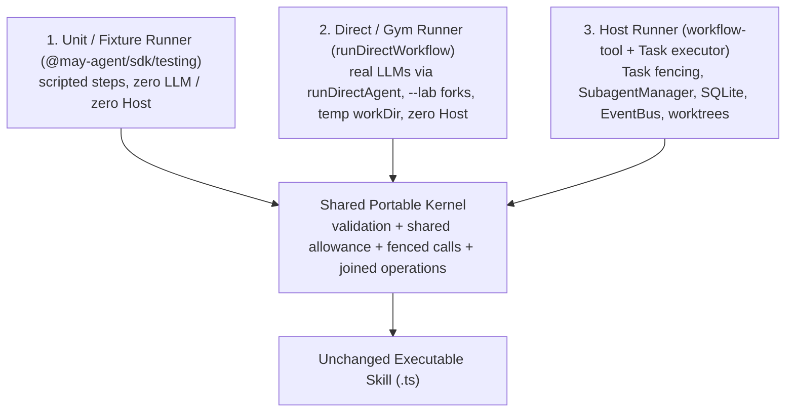

# Workflow as an executable skill

**Supports:** [Workflow Discovery And Execution](../2a-design/workflows.md).
Makes workflows **readable** as executable skills, **testable** with
fast unit fixtures and Host-free Gym evaluations, **debuggable** with
plain TypeScript stack traces and step-level run reports, and **robust**
through one small shared invocation kernel.

**Choice basis:** [Simple first](../1-principles/core-principles.md#simple-first)
and [composition preserves execution rules](../1-principles/code-vs-data.md#composition-preserves-execution-rules).
Stick with May's plain TypeScript `async execute(ctx)` contract on
`@may-agent/sdk`, extract a small Host-free invocation kernel, and bind
fixtures, Gym (`runDirectAgent`) or the full Host at the entry point. Keep
the existing authoring surface and Task runtime as the integration boundary.

**Design status:** Accepted direction; shared invocation kernel, SDK test runner,
Host-free Direct/Gym runner, confirmed process-group cleanup, and dead
guard-injection removal are merged.
**Implementation status:** Implemented across Host [#455](https://github.com/hao1939/may-agent/pull/455)
(`52ff184177`: `packages/sdk/src/workflow-kernel.ts`, `packages/sdk/src/testing.ts`,
`src/lib/workflow-catalog.ts`, `src/lib/workflow-tool.ts`, `src/app/direct-workflow.ts`,
`src/app/direct-agent.ts`) and Gym
(`projects/gym/src/workflow-adapter.ts`, `projects/gym/src/cli.ts`,
`projects/gym/test/workflow-adapter.test.ts`). Broader per-workflow migration to
`inputSchema` / `runWorkflowTest` proceeds incrementally as workflows are touched.

## 1. Decision: plain TypeScript executable skills, no workflow framework

**A workflow is an executable skill written in plain TypeScript.**

**The workflow provides business value; the Host provides management capabilities.**

Just as an [instruction skill](../2a-design/skills.md#skill-and-workflow-boundary)
expresses a judgment-heavy method for one turn in readable Markdown, a workflow
expresses a repeatable multi-step method in readable TypeScript:

| Method | Author supplies | Controller | Best when |
| --- | --- | --- | --- |
| Instruction skill (`SKILL.md`) | Guidance and domain heuristics | Agent judgment inside one turn | Steps vary with context |
| Executable workflow (`<name>.ts`) | Typed input/output + `async execute(ctx)` | Explicit TypeScript (`if`, `for`, `try`) calling agents where judgment helps | Sequence, verification and bounded repair must be repeatable and testable |

### Why extract a small kernel for the current requirements

After Host PR #449, cross-attempt durability, scheduling, `Condition` waits,
retries and crash recovery belong exclusively to the
[Task resource engine](../2a-design/task-resource-engine.md)
(`Task -> attempt -> workflow invocation -> helper calls`). Inside one attempt,
a workflow is a bounded in-process procedure, not a suspended durable state
machine.

The [framework investigation](../archive/reviews/workflow-framework-comparison-20261112.md)
identifies useful alternatives. For this bounded extraction, retain the current
plain-function model because existing requirements do not demonstrate enough
benefit from adopting an additional engine:

- **Temporal / Restate:** Useful durable execution would require an explicit
  decision about recovery ownership and service infrastructure. Current Task
  recovery already covers this proposal's cross-attempt responsibility. Temporal's
  Node-specific worker requirements also need evaluation for May's Bun runtime.
- **Mastra / LlamaIndex:** Typed steps and runner separation are useful patterns.
  Mastra would add a different authoring/embedding surface; its observational
  finish hooks cannot alone carry required May persistence. The reviewed
  TypeScript LlamaIndex workflow package is deprecated.
- **LangGraph Functional API:** Supports ordinary async control flow, optional
  checkpointing, retries and streaming. It remains a credible future integration.
  May would still supply Task fencing, shared admission, process cleanup and
  captured definitions. A comparison is not a prerequisite for extracting existing
  code; revisit adoption when its orchestration features solve a concrete need.

This is a scope decision, not a measured framework winner. A kernel near 200
lines is a rough sizing target; maintainable responsibilities and preserved
contracts determine the actual implementation size.

### Why also avoid building an internal mini-framework

Simplicity applies equally to our own extraction:

- **Keep `@may-agent/sdk` and `@may-agent/sdk/testing` as the single authoring
  and testing surface.** Do not introduce a separate `@may-agent/workflow`
  package or split workflows into two context dialects.
- **Do not add a third `ctx.emit(...)` channel or ring-buffer subsystem.**
  `WorkflowContext` already distinguishes optional diagnostics (`ctx.log`) from
  acknowledged domain effects (`ctx.events.emit`, `ctx.metrics.record`), and
  step traces can be recorded automatically by the runner around bound calls.
- **Keep business repair explicit and retire dead `run_step` guard injection.**
  Auditing `shared/guards/` and `projects/` confirmed zero active guards emit
  `run_step` or `repair` (historical `run_step` experiments were disabled after
  `EXP-216` measured `56%+` recovery-session overhead). Workflows express
  verification and bounded repair explicitly in TypeScript, while guards retain
  observational and blocking demands (`observe`, `warn`, `block`).

## 2. Three execution modes over one Host-free kernel (unblocking Gym)

Today [workflow-tool.ts](../../../may-agent/src/lib/workflow-tool.ts)
couples workflow execution to `SubagentManager`, SQLite `workflow_runs`
and `EventBus`. Because of that coupling, [Gym's CLI](../../../gym/src/cli.ts)
currently hard-denies `workflow` (`"the direct Gym adapter does not provide
hosted workflow dispatch"`), even though Gym already runs real isolated agents
through [`runDirectAgent`](../../../may-agent/src/app/direct-agent.ts) without
SQLite, `EventBus`, `SubagentManager` or a daemon.

Extracting one Host-free `runWorkflowInvocation(module, input, bindings)`
kernel removes that coupling and supports **three execution modes** against the
exact same workflow file:



| Mode | Entry point & bindings | What it unlocks |
| --- | --- | --- |
| **1. Unit / Fixture** | `runWorkflowTest(module, options)` in `@may-agent/sdk/testing` with scripted `agents` / `workflows` responses | Fast deterministic tests of branching, repair caps, schema mismatches, cancellation and partial-output handling in `bun test` |
| **2. Direct / Gym** | `runDirectWorkflow(options)` in `src/app/direct-workflow.ts`, binding `ctx.agents.call` to `runDirectAgent` and `ctx.workflows.run` recursively in an isolated `workRoot` | **Unblocks Gym** without booting Host/SQLite/daemon: (a) Gym scenarios can invoke a workflow directly against a sandboxed repo + `--lab` prompt forks, and (b) `direct-agent.ts` can expose the `workflow` tool to agents in opted-in Gym scenarios |
| **3. Hosted** | `createWorkflowTool` and `createTaskWorkflowRunner` | Full production admission, Task generation fencing, captured `DefinitionSourceRelease`, SQLite `workflow_runs`, `EventBus` and `ExecutionUsage` accounting |

### Handling Task-scoped reads in Unit and Gym modes

Most workflow logic depends only on `ctx.input`, `ctx.workspace`, `ctx.agents`
and `ctx.workflows`. Workflows that also read their owning Task assignment
(for example `develop-change.ts` reading `outcome`, `acceptance` and
`generation` via `ctx.read.tasks.get`) receive an explicit local `task`
snapshot in Unit and Gym modes—never an invented silent empty object and never a
requirement to boot SQLite. Workflows that require live cross-App event queues
or Host Task mutations (`ctx.closeTask`, `ctx.reviseTask`) either bind explicit
scenario fakes in Unit/Gym or fail fast with a clear unsupported-capability
diagnostic when unconfigured.

### Shared execution allowance

Each root invocation receives one finite deadline and its runner's concurrency
policy. Reuse the existing
[execution scope](../../../may-agent/src/lib/execution-scope.ts): nested workflows
and agent calls inherit the absolute deadline and remaining allowance. A child
cannot extend its parent's deadline by starting a fresh timeout.

Direct/Gym execution uses one finite root-scoped limit on active agent calls,
shared across nesting. A saturated call returns an explicit non-start diagnostic;
it must not wait indefinitely for capacity held by its own waiting caller. Host
execution retains existing shared admission and accounting. Record effective
limits in the run report. Deadline expiry fences new calls and starts cancellation;
it cannot preempt arbitrary synchronous JavaScript or undo committed effects.

## 3. Readable authoring contract ("reads like a recipe")

A workflow file stays a small `@may-agent/sdk` module whose top declares its
contract and whose `execute(ctx)` reads top-to-bottom as business logic:

```ts
// review-change.ts — readable executable skill on @may-agent/sdk
import { Type, type Static, type WorkflowContext } from "@may-agent/sdk";

export const name = "review-change";
export const description =
  "Review one exact source reference and return findings; does not approve or merge.";

export const inputSchema = Type.Object(
  { subjectRef: Type.String({ minLength: 1 }) },
  { additionalProperties: false },
);

const ReviewSchema = Type.Object(
  {
    subjectRef: Type.String({ minLength: 1 }),
    verdict: Type.Optional(Type.Union([Type.Literal("pass"), Type.Literal("changes-needed")])),
    summary: Type.String({ minLength: 1 }),
    findings: Type.Optional(Type.Array(Type.String({ minLength: 1 }), { maxItems: 16 })),
  },
  { additionalProperties: false },
);

export async function execute(ctx: WorkflowContext<Static<typeof inputSchema>>) {
  const review = await ctx.agents.call(
    "reviewer",
    `Review ${ctx.input.subjectRef} and return structured findings without modifying files.`,
    { schema: ReviewSchema },
  );

  if (!review.output || review.output.subjectRef !== ctx.input.subjectRef) {
    return ctx.blocked("Reviewer did not return a valid report for the requested subject", {
      review,
    });
  }

  return ctx.done("Review report collected; caller judgment remains", {
    reviewExecutionId: review.id,
    review: review.output,
    helperStatus: review.status,
  });
}
```

A report may omit findings or a verdict that the reviewer cannot supply. Its
summary explains the gap; useful output and the helper's status remain available
for caller judgment. Schema validity does not establish a completed review.

Authoring rules that keep workflows readable:

- **Push boundary checks into declarations:** When `inputSchema` or
  `outputSchema` is exported, the kernel validates them automatically so
  `execute(ctx)` starts with clean typed data instead of repetitive parsing
  boilerplate. Existing modules without `inputSchema` remain valid.
- **No duplicate `requires` string lists or new SDK subpaths:** Missing agents
  or nested workflows fail explicitly when called (recording a failed step trace
  with `id: null`), avoiding triplicate capability-registry maintenance across
  Unit, Direct/Gym and Host. Keep the kernel internal to `packages/sdk/src/`
  and re-exported through existing `@may-agent/sdk/testing`.
- **Explicit domain checkpoints instead of VM replay:** Multi-stage workflows
  that want to skip already-verified work on a fresh Task attempt check explicit
  workspace/evidence state at the top of `execute(ctx)` (as `develop-change.ts`
  does with git commit SHAs and `EvidenceStore`), keeping control flow visible.

## 4. First-class testability and debuggability

The target is fast business tests and failures inspectable from a local report.
Behavior involving filesystem changes or external effects additionally needs
explicit scenario state and effect evidence.

### Fast unit testing (`@may-agent/sdk/testing`)

Upgrade `@may-agent/sdk/testing` alongside existing
`createTestAppWorkflowContext` with `runWorkflowTest(module, options)` backed
by the real portable kernel:

```ts
import { expect, test } from "bun:test";
import { runWorkflowTest } from "@may-agent/sdk/testing";
import * as reviewChange from "./review-change.js";

test("preserves reviewer findings and validates schemas end to end", async () => {
  const run = await runWorkflowTest(reviewChange, {
    input: { subjectRef: "HEAD~1..HEAD" },
    agents: {
      reviewer: [
        {
          status: "done",
          summary: "Reviewed diff",
          output: {
            subjectRef: "HEAD~1..HEAD",
            verdict: "pass",
            summary: "Clean boundary split",
            findings: [],
          },
        },
      ],
    },
  });

  expect(run.result.status).toBe("done");
  expect(run.steps).toHaveLength(1);
  expect(run.unconsumedFixtures).toEqual([]);
});
```

Why this catches real bugs that passive mocks miss:

1. **Symmetric schema enforcement:** `runWorkflowTest` runs the exact same
   `inputSchema`, per-call `options.schema` (rejecting invalid mock outputs!),
   and `outputSchema` checks as hosted workflow invocation. Task-shaped proposals
   additionally pass `admitTaskReconcileResult` in the Task adapter and its tests;
   an ordinary workflow contribution does not require Task settlement fields.
2. **Scripted sequence & consumption checks:** Agent mocks can supply a queue of
   turn responses (for example round 1 `revise`, round 2 `pass`) and assert no
   unused fixture turns remain (`assertAllFixturesConsumed: true` by default).
   Unexpected calls or exhausted fixtures fail explicitly. The existing passive
   context helper stays compatible; the new runner exercises the strict contract.

Existing Task-reconciler modules returning `TaskReconcileResult` retain their
hosted calling contract. Their Task-specific normalization and admission stay in
the adapter; the portable kernel does not reinterpret ordinary business output
as a Task proposal.

### End-to-end prompt & workflow evaluation in Gym (`runDirectWorkflow`)

With `runDirectWorkflow` wired into Gym:

- **Direct workflow scenarios (`meta.workflow_entry`):** Gym sets up the
  scenario's temp git/file fixture, applies `--lab` or `--common-sense` prompt
  forks to the participating agents, runs the workflow via `runDirectWorkflow`,
  and feeds both the terminal `WorkflowRunReport` and concatenated child-step
  `session.jsonl` transcripts into Gym's deterministic checks and semantic judge.
- **Agent-dispatched workflow scenarios:** When a scenario opts in (`allow_workflow:
  true`), `direct-agent.ts` constructs a sandboxed `workflow` tool backed by
  `runDirectWorkflow` instead of denying `workflow`, letting Gym test whether an
  agent chooses and invokes its workflows properly.
- **Single-command local CLI debug (`bun run workflow`):** Developers can run one
  workflow from the terminal with either a JSON fixture file or live models via
  `runDirectWorkflow` and inspect its trace directory directly.

### Built-in debuggability: automatic reports and offline fixtures

Without adding any logging boilerplate inside `execute(ctx)`, every kernel
invocation returns (and in Gym/CLI optionally writes to `<traceDir>/run.json`) a
structured `WorkflowRunReport`:

| Field | Contents | Debugging use |
| --- | --- | --- |
| `workflow`, `executionId`, `sourceRevision`, `status`, `durationMs` | Captured source, identity, terminal status (`done` / `blocked` / `error` / `interrupted`) and wall time | Immediate pass/block/crash triage |
| `input`, `result`, `error` | Validated input, terminal contribution or uncaught error stack, with artifact references for large payloads | Inspect entry/exit evidence and prepare fixtures |
| `steps[]` | Automatic record per `ctx.agents.call` / `ctx.workflows.run`: `index`, `kind`, `target`, `prompt`, `status`, `summary`, `output`, `durationMs`, `sessionId`, `transcriptPath` | Pinpoint which step diverged, how long it took, and open its exact `session.jsonl` |
| `logs[]` | Structured `ctx.log` entries with step correlation | Inspect domain decision notes without stdout noise |
| `limits`, `cleanup`, `observerErrors` | Effective allowance, confirmed or unconfirmed cleanup, bounded observer diagnostics | Identify resource limits and unresolved cleanup |

Reports use finite in-memory entry/payload limits, artifact links and explicit
truncation/loss counts. Retain the complete selected fixture payload separately
when reproduction requires it; a truncated summary is insufficient.

**Use recorded responses as offline test fixtures.** Start `execute(ctx)` again
with the intended source/input and scripted capability responses. Match the
expected call target/input and assert fixture consumption. This reproduces a
branch when earlier operations only supplied values.

For `implement -> verify`, stubbing the implementation report does not recreate
edited files or commits. The test must also supply an explicit matching workspace
fixture or snapshot, relevant Task snapshot and effect receipts. Missing state
is a reproduction limitation, not evidence that verification passed. The first
delivery provides reports and fixture guidance; it adds no automatic checkpoint
restoration or mixed recorded-prefix/live execution mode. Production recovery
continues to use fresh attempts and retained receipts.

## 5. Four mechanical robustness invariants in the kernel

The kernel coordinates four invariants. Bindings supply the actual execution,
effect and cleanup guarantees; the kernel cannot infer them from settled promises.

1. **Symmetric boundary validation:** Validate `module.inputSchema` before
   calling `execute(ctx)`, validate `callOptions.schema` on every
   `ctx.agents.call` result, and validate `module.outputSchema` before exposing
   typed output. Preserve schema-valid partial output independently of status.
   Invalid output remains raw diagnostic evidence rather than a typed successful
   response. Task admission remains in the Task adapter.
2. **Structured concurrency ("join before return"):** Track every active child
   `ctx.agents.call` and `ctx.workflows.run` in an invocation-scoped set with a
   child `AbortController` linked to `ctx.signal`. When `execute(ctx)` returns,
   throws or aborts (for example after a `Promise.race` branch), immediately
   abort remaining live children and `await Promise.allSettled(...)` before the
   kernel resolves. Each binding must settle its operation promise after confirmed
   cleanup or a bounded cleanup failure. Its awaited stop/join must confirm session
   and descendant process cleanup, with bounded escalation through the existing
   execution mechanisms. Promise settlement or sending `SIGTERM` alone is not
   cleanup evidence. Unconfirmed cleanup produces an explicit failure, preserving
   useful output and diagnostics; Host ownership/capacity and Gym workspaces remain
   retained for their existing recovery/operator owner until cleanup is confirmed.
3. **Post-completion context fence:** Mark `ctx` closed as soon as `execute(ctx)`
   exits or cancellation begins. Every supplied effect capability, including
   agent/nested calls, publication, metric writes and Task changes, rejects new
   calls after closure. Track already-started required effects through their
   acknowledgment; the fence cannot undo an effect already committed externally.
4. **Awaited domain effects vs. isolated trace observers:** Bound capabilities
   (`ctx.agents.call`, `ctx.workflows.run`, `ctx.events.emit`,
   `ctx.metrics.record`) and required Host start/terminal persistence are
   awaited and expose failure to their caller. Finalization drains already-started
   required effects and retains their outcomes. Required lifecycle writes use a
   separate awaited runner boundary; failed terminal persistence cannot establish
   accepted execution. Optional hooks (`ctx.log`, `onStep`) are synchronous,
   recording bounded `report.observerErrors` without blocking completion or
   replaying business work.

Current [direct-run cleanup](../../../may-agent/src/app/direct-agent.ts) drains
persisted bash process groups (`drainPersistedSessionBashProcessGroups` in
`src/lib/tools/bash.ts`); `src/lib/background-exec.ts` was retired in
[Host PR 489](https://github.com/hao1939/may-agent/pull/489).
If descendant cleanup remains unconfirmed after the cleanup bound, preserve ownership and report
that exact boundary; do not hang forever or silently release the resource.

| Boundary failure | Mechanical behavior |
| --- | --- |
| Invalid input | Reject before `execute(ctx)` runs; start no child work. An unavailable capability fails explicitly when called and records a failed step trace (`id: null`) |
| Child agent returns invalid structured `output` for `options.schema` | Return an explicit step validation failure and retain raw evidence separately from typed output in Unit, Gym and Host alike |
| Parent abort or inherited deadline expires | Fence new calls, abort active children and confirm cleanup before releasing resources; return `interrupted` when cleanup succeeds |
| Unhandled throw inside `execute(ctx)` | Abort active sibling children, wait for settlement, preserve `steps[]` trace up to the throw, surface `error` |
| Host capacity unavailable before start | Existing `ExecutionDeferredError` / Task deferral; no started child |
| Direct/Gym shared concurrency allowance exhausted | Explicit non-start diagnostic; no child identity, fresh budget or indefinite wait on caller-held capacity |
| Descendant cleanup is unconfirmed | Surface `error` with retained contribution/evidence; existing Host recovery owner or Direct/Gym caller retains affected resources and the cleanup obligation |
| Required start/terminal persistence fails | Start failure runs no business code; terminal failure stays unaccepted with evidence discoverable to the Host recovery owner |

Preserve the originating failure alongside cleanup diagnostics. Optional observer
failure cannot replace the business result; unconfirmed cleanup remains a resource
ownership failure even when useful business output was returned.

Recovery remains the existing
[fresh-attempt contract](../2a-design/workflows.md#crash-recovery): confirm
descendant cleanup, retain evidence, and start a fresh attempt.

## 6. Incremental delivery plan

Source baseline: Host `e9e88da22f` (November 12, 2026). Deliver inside the
existing Host, SDK and Gym packages—no new package publish or migration flag:

| Step | Scope | Verification |
| --- | --- | --- |
| **1. Portable kernel + Unit runner** | Place `runWorkflowInvocation` with portable SDK code shared by Host and `@may-agent/sdk/testing`, with zero SQLite/manager/bus imports. Preserve `createTestAppWorkflowContext` compatibility. | Validation and partial-output cases, inherited deadline, shared allowance, bounded join/failure, all-effect fencing, observer rejection and fixture consumption. Ordinary contributions require no Task result fields. |
| **2. Route Host entry points through kernel** | Wire `runWorkflowDirect`, `createWorkflowTool`, and `createTaskWorkflowRunner` ([workflow.ts](../../../may-agent/src/app/adapters/executors/workflow.ts)) as Host bindings. Preserve current guards, exact source capture, admission and result settlement. | Existing owning suites plus contrasts for required-write failure, pre-start denial, adapter cleanup confirmation and retention after unconfirmed cleanup. |
| **3. Direct / Gym workflow runner** | Add `runDirectWorkflow` composing the kernel with `runDirectAgent`, shared root limits and optional `<traceDir>/run.json`. Fix direct adapter cleanup confirmation before claiming safe workspace disposal. Wire Gym to run workflow scenarios without Host services. | Multi-step Gym scenario with `--lab` overlay and trace output; verify a slow or TERM-resistant descendant and failed cleanup keep the workspace retained. Use explicit workspace/evidence fixtures for a development slice. |
| **4. Authoring manual & exemplar** | Update [workflow-authoring.md](../2b-manual/workflow-authoring.md) and [review-change.ts](../examples/review-change.ts) with declarations, strict fixture testing and offline debugging guidance. | Documentation/example checks and Gym type/scenario checks; a stateful reproduction requires its declared workspace fixture. |

## 7. Acceptance criteria

| Quality | Required proof |
| --- | --- |
| **Readable** | Exemplar and adopted slice use `@may-agent/sdk`, declarative schemas and explicit business repair; existing guard behavior stays preserved during extraction |
| **Testable (Unit)** | Strict fixtures run through the shared kernel without SQLite/daemon imports; catch an intentional step-schema mismatch, unexpected call and unconsumed fixture |
| **Testable (Gym without Host)** | Gym executes a real workflow scenario via `runDirectWorkflow` + `runDirectAgent` in an isolated temp workspace (including `--lab` prompt fork) with zero Host DB, `EventBus` or `SubagentManager` |
| **Debuggable** | A bounded report exposes exact source, step outcomes, artifact references and cleanup status; offline response fixtures reproduce a branch with matching input and any required workspace state |
| **Simple & robust** | One kernel coordinates all modes; deadlines/allowances are inherited, late effects are fenced, adapters confirm cleanup and unresolved cleanup retains resource ownership. Required persistence and Task admission stay at their owning boundaries |

Measure the representative deterministic matrix against a named baseline on the
same machine, distinguishing process startup from test execution. Under 50 ms is
a local tuning target, not a universal correctness threshold. Record kernel and
adapter size rather than enforcing a 200-line limit. Validate actual test-speed
gains and retained contract coverage before claiming progress toward the project's
50% reduction goal; the design itself establishes no additional speedup.
