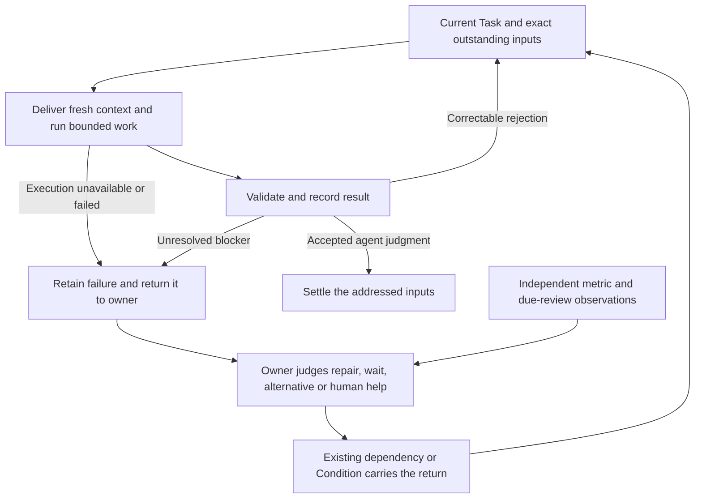

# Make failed work recoverable and accountable

**Supports:** [Recovery and intervention ownership](../2a-design/system-boundary.md#ownership-and-intervention). Helps accepted work reach a useful outcome with fewer manual rescues.

**Choice basis:** [Agent decisions and mechanical execution](../1-principles/code-vs-data.md); [safe retry and recovery ownership](../2a-design/system-boundary.md#retry-and-recovery-ownership); [evidence before expansion](../1-principles/evidence-first.md).

**Design status:** Proposed remaining recovery and oversight work; dated trial record.
**Implementation status (2026-10-03):** [PR #284](https://github.com/hao1939/may-agent/pull/284) is merged as `0317016b`. Fresh-context, backlog and executor-policy source repairs are integrated. Independent oversight and connected original-input recovery still need their own evidence; this review neither deploys nor proves live recovery.

The October 2 narrative below preserves the candidate revisions and results as
recorded then. Statements about candidates being undeployed are historical,
not a fresh installation audit. Recheck the installed revision before acting.
**Outcome:** A failed assignment either makes useful progress, waits for a real prerequisite, or reaches someone who can decide the next action. Repeated execution must remain observable and accountable without abandoning the assignment.

## Review refinement

The October 2 source review and disposable trials support fixing the existing context, settlement and oversight paths. They do not yet establish autonomous recovery in the installed system.

- Repair fresh-context delivery and backlog handling first. Both defects were reproduced against the deployed Host revision; candidate tests demonstrate correction without settling unanswered inputs.
- Cover persisted active goals, not only idle thread resume. A further installed-CLI trial reproduced automatic execution during resume with the old packet, before context injection. Preparing the stored goal as paused before resume, then injecting current context and explicitly activating it, prevented that stale request in a disposable trial and preserved the configured token budget. The sequence is integrated in PR #284 and passed source review plus the installed-CLI protocol trial. Live adoption remains unproved.
- Verify CLI execution when installing or changing its environment, using the actual runtime identity and permission profile. Do not repeat a synthetic preflight before every Task attempt. Recovery of a later unknown failure still requires preserved evidence, a usable owner return path and an agent's judgment.
- Reuse exact caller and dependency links. Keep generic installation-wide supervisor fallback deferred until a connected trial shows a missing delivery primitive. The immediate independent coverage change is May's explicit review of Evaluation operations.
- Measure recurrence before waking a reviewer, using existing metric samples and alert episodes. Sending every failed attempt to a model to count failures would add cost and noise. First-failure caller feedback remains a separate existing responsibility.
- Separate historical lost input from current delivery defects. The initial bulk orphan-input recovery candidate needs revision: its SQL and mutation checks disagree about null input events, and correlated JSON scans become expensive on healthy backlog. Prefer bounded recovery through the existing exact dependency path, with one authoritative eligibility check.

Implementation candidates, source checks and live adoption must remain separately reported. The final proof is useful owner action and preservation or fulfillment of the original work, not merely a passing preflight, a saved repair request or an accepted report.

The candidate uses the existing Task, input waits, executor binding and caller-return path. Installed-CLI trials verify active-goal restart ordering and actual outgoing context. Five connected runtime trials passed across normal delivery, lost notification, restart and cancellation; their scripted workers and environment restoration do not establish unscripted diagnosis or live recovery. Follow-up review reproduced explicit-owner-retry event replay; `5971a166` corrects it while retaining the original requirement. That revision passed 3,391 local tests (three installation-dependent skips) and both hosted checks.

Subsequent user review moves CLI verification to installation and makes the adapter inherit the installation's sandbox policy. May implemented the current Host candidate `709e3ed3`, with common-design/App candidate `f441530083`. The actual installation execution check now passes under the container runtime user in the Evaluation workspace. An independent native-tool trial uses the same installed CLI and local scripted provider: the old client fails before launch, the corrected client reads and writes synthetic files on both start and resume, and an old-client thread succeeds after resuming with the corrected client. An explicitly restricted configuration still fails without permission escalation. Final local CI passed 3,390 tests with three installation-dependent skips and no failures; both hosted checks passed on `709e3ed3`. The earlier owner-retry regression passed 13 assertions. Neither candidate is deployed, and the original live input's recovery remains unverified.

## Recommendation

Complete the existing recovery loop. Keep the original Task and its outstanding requirements. Give each attempt current facts and usable capabilities; return failures through the exact caller link; let the owning agent choose repair, a supported alternative, a Condition, or help. Independently observe the worker and the attempted repair, including Evaluation's own work.

The agent decides. Infrastructure executes, retains evidence, observes Conditions, and delivers feedback. A retry count can request review; it does not select a repair, declare success, or cancel work.

Use the merged Host repairs as the source baseline, then verify and close the remaining owner-delivery and independent-review paths. Adopt the complete behavior only after a connected trial proves the original outcome resumes or the required human request is delivered.

## Why this is needed

The October 2 investigation found a chain of failures in Evaluation's Codex owner task:

| Observation | Missing guarantee |
| --- | --- |
| Every retained command failed before launch because the inner sandbox could not create a namespace. | The selected executor must be usable for its declared capabilities before model work starts. |
| Passing new developer instructions on resume did not put them into the next model request. | Current assignment and rejection feedback must actually reach the worker. |
| With 35 queued events, the same first 32 were repeatedly claimed and an incomplete report rejected as stale. No new event was needed. | Backlog must not invalidate an honest failure report or prevent later input being considered. |
| The worker returned an inbox ID as an input key and a wait without a Condition. | Exact result scope and supported waits must be discoverable; invalid results must remain correctable. |
| A repair request existed, but its recipient could not execute it. | Delegation needs follow-through; admission is not repair. |
| Independent metrics excluded Evaluation or its owner-review inputs. | Self-review exclusions must have an explicit independent owner. |

Evidence includes two isolated reproductions: the actual installed CLI against a local scripted HTTP endpoint, and the production Task APIs against an in-memory database. The former also verified that explicitly inserting a fresh context item reaches the next request. Neither used a real model.

The local audit at `.state/codex-owner-review-root-cause-20261002/REPORT.md` retains exact identities, source revisions, traces and reproduction commands. It is ignored operational evidence, not a dependency for portable tests. The recent three-hour window contained 86 model requests and 9.16 million tokens for the affected thread, mostly cached input. Lower usage alone will not prove recovery.

This extends [recovery from execution evidence](recovery-from-execution-evidence-20260922.md) and [caller feedback](caller-feedback-and-waiting.md). The September recovery proposal deferred a new fallback until a missed route was demonstrated; this incident supplies that evidence. Automatic supervisor fallback is still explicitly deferred in the [current boundary](../2a-design/system-boundary.md#ownership-and-intervention).

The separate [token-efficiency proposal](../../../may.app/design/token-efficiency-proposal-20261002.md) owns finish-loop termination, overdue review scheduling and optional context budgets. This proposal supplies the recovery and oversight behavior around that work.

These findings describe the dated audit baseline. Recheck each slice against current source and installed revisions before implementing or claiming a live defect; later fixes may already cover part of the work. The [Host responsiveness proposal](responsive-host-recovery-20261002.md) owns keeping ordinary reads and controls usable during recovery. Reuse that work rather than adding expensive recovery scans here.

## Contract and ownership

| Responsibility | Owner and existing mechanism |
| --- | --- |
| Preserve requirements, exact caller identity, attempts, results and rejection evidence | Host Task/input/attempt storage and settlement |
| Deliver current context; execute under declared permissions; expose provider failures and usage | Executor adapter through the common Task attempt boundary |
| Interpret failure and choose the next useful authorized action | Worker under App policy |
| Coordinate help, judge the repair and retain the original acceptance obligation | Assigning owner through caller feedback and typed dependencies |
| Interpret recurrence and cost; decide when to seek human judgment | Owning App; May coordinates cross-App work in this installation |
| Independently assess ordinary App work | Evaluation within its supported scope |
| Independently oversee Evaluation's operational work | May, using an execution path that does not require Evaluation's broken executor |
| Sample metrics, execute observer reads, schedule checkpoints and recover missed delivery | Existing Host metric, observer, Condition and admission machinery |
| Repair an unavailable Host or authoritative store | Installation operator/process supervisor |

Preserve these invariants:

- One Task owns the original outcome; several inputs can refine it. Input delivery, an accepted report, fulfilled requirements and Task closure are separate facts.
- An unsuccessful attempt or request for help leaves unanswered inputs open. The worker may judge addressed inputs fulfilled; infra trusts an admitted decision by default. A delivery receipt, retry, or guessed input alias cannot substitute for that decision.
- Later requirements can be considered while earlier work remains unresolved. Late observations do not reopen a closed Task; explicit authorized continuation uses the existing reopen operation.
- Useful retries remain allowed. Each execution is bounded, but there is no lifetime retry cap introduced here.
- A Condition observes a return path. It does not send a repair request or prove that somebody accepted responsibility.
- Native executor goal state is execution evidence. May's accepted Task state remains authoritative.

## The intended flow

These boxes are steps in existing execution and feedback. Installation checks
run when installing or changing the environment; they are not a new per-attempt
preflight. Accepted completion records the agent's judgment, not a correctness guarantee.

## 1. Make the next attempt capable of correction

### Deliver current facts explicitly

Keep stable role instructions separate from the changing Task packet. Before activating an attempt, deliver its exact identity, generation, assigned input keys, pending-input coverage, current acceptance, relevant waits, and previous settlement error through a model-visible protocol operation.

For the installed Codex version, `thread/inject_items` is a demonstrated candidate. Treat it as an adapter implementation choice that requires a pinned protocol test; passing `developerInstructions` on resume alone is insufficient. Ensure the packet is inserted before goal activation, including after restart. Resume itself can reactivate a persisted active goal, so inserting context immediately after resume does not establish this ordering. The isolated CLI trial supports preparing that stored goal as paused before resume, then injecting context and activating the current assignment. This temporary native execution status does not pause the authoritative May Task or settle its inputs. An unexpectedly active old turn must remain fenced before new work starts.

Use compact current facts and readable evidence references. Identify which snapshot supersedes earlier snapshots; avoid repeating full role instructions and transcripts each attempt. Preserve the distinction between trusted execution instructions and quoted Task/input data. Required omitted evidence must have a working read path. Expose canonical input keys directly; a worker must not derive them from request IDs.

Live steering remains feedback until incorporated through the existing exact-input contract. Delivery acknowledgement must not settle an input. A later attempt receives the refreshed canonical assignment even if steering was missed.

Preserve rejection details in the existing attempt/`previousAttempt` evidence. Share validation rules where possible; final current-state fencing stays at settlement. Schema correction and later scope/Condition rejection must both reach the next actual model request. No separate correction loop gets a fresh execution budget indefinitely.

### Verify the installed execution environment

At installation, upgrade, or an execution-environment change, run a bounded real command and read a synthetic file through the installed CLI under the same sandbox policy and runtime identity used for work. Keep this in the existing compatibility/installation checks, outside the Task execution path. A successful outer shell, CLI version check, or accepted protocol request is insufficient. A sandbox denial fails execution acceptance even if protocol compatibility passes.

Installation owns the execution permission policy; the persistent adapter inherits it on both start and resume instead of imposing its own read-only default. Explicit restrictions remain restrictions, with no automatic retry under broader permissions. The App owns whether an assignment asks for review or implementation; that intent is distinct from an OS-enforced sandbox. The Task packet must not claim read-only isolation when the selected installation policy does not provide it.

The user approved this correction after a disposable trial under the container's runtime user: forced read-only execution failed before launch, whereas the existing installation's container-level policy allowed the synthetic file read. A previously read-only thread also inherited the configured policy on restart/resume without an override. No Docker privileges, live configuration or Task state were changed. The installation acceptance check must use the actual invocation environment and working directory; the separate scripted protocol fixture keeps its temporary credential-free configuration.

An installation check establishes readiness at that time, not perpetual health. During work, retain actual command failures in execution evidence and return execution failures through existing Task/caller handling. The agent interprets tool results; a command's nonzero exit alone need not invalidate an entire Task attempt. Existing bounded execution, retry pacing and independent recurrence metrics handle later failures without a new preflight state machine or health registry. A specific repair may use an existing Condition when it has a useful observable prerequisite; no dedicated readiness observer is required for this fix.

## 2. Retain honest results without starving later input

Keep bounded event batches. Distinguish old unclaimed backlog from a requirement or state change that actually invalidates an action.

An `incomplete` report does not fulfill an input or authorize proposed Task actions. It still updates current status and may notify a caller, so its exact input scope, generation and mutation fences matter. It should retain failure evidence and unresolved input, schedule normal backoff, and preserve pending facts. The presence of unclaimed events alone must not turn it into an immediate stale retry. Genuine supersession, cancellation and action fences remain enforced.

Input delivery must not be used as a substitute for input fulfillment. Use existing input waits and retained evidence to carry previously considered but unanswered requirements. Avoid endlessly restoring the same notifications to the front of the 32-event batch. A later repair request or updated requirement must become available for a decision without dropping earlier obligations or inventing a second queue.

Acceptance includes a repair request behind a backlog: it is considered in bounded subsequent passes while earlier inputs remain visibly unresolved. Increasing the batch limit or marking those inputs answered is not an acceptable workaround.

For waiting results, reuse the current Condition/dependency builder and contract discovery. Validate supported sources and exact result scope. If no usable return path exists, record an honest incomplete report and request owner help. Do not manufacture a Condition or translate the word “blocked” into successful Task settlement.

## 3. Complete owner feedback and independent review

Reuse the existing first-failure report, `report: true`, admission report revision and typed caller link. The outer execution boundary must retain and return a prerequisite failure, thrown error or rejected result even when worker output is invalid. It reports the Host-observed failure against trusted assigned inputs; it does not accept the worker's proposed effects or its invented caller identity.

Unchanged retries should not notify a human every time. The first report establishes the problem; an explicit meaningful worker update, a recurrence breach or a due owner checkpoint prompts reconsideration on the existing linked work. Reporting revisions and admission identity provide delivery deduplication, including after restart.

The owner judges the next action and records, in its ordinary Task result:

- the blocker and evidence considered;
- useful action taken, or the specific decision/help requested;
- the existing repair/dependency reference, if any;
- what fact or result should cause reconsideration, and the review checkpoint.

These are evidence requirements, not a new mandatory “recovery plan” schema. When the owner delegates a repair, retain a typed dependency for that repair's result. A general metric wait cannot replace it. Before treating the problem as already covered, read the linked repair's current accepted result, latest failures and next return path. An old investigation ID alone is insufficient.

### Routing when the normal path cannot carry the problem

First prove and repair the installed caller-report and explicit operational-review routes. The fallback rows below describe a possible later extension, not a prerequisite for the first implementation or an already implemented guarantee. Add a generic fallback only if a connected trial demonstrates that existing durable admission and owner routes cannot carry the failure.

| Situation | Proposed route |
| --- | --- |
| A trusted input caller exists | Existing exact caller-report path; preserve the original input scope. |
| Operational work has no input caller | Its App's declared operational review route. Do not infer a structural parent or broadcast. |
| The App cannot accept that feedback | One installation-selected fallback through existing App input admission; in this installation, May. |
| Evaluation's own operational owner is failing | Explicit independent May review; do not require Evaluation to review or certify the failure. |
| May/fallback cannot accept or act within its review boundary | Expose the unresolved need through the configured human-attention surface; stop fallback traversal. |
| Host/store is unavailable | Existing external operator path; no in-process agent guarantee is claimed. |

The fallback is a proposed installation capability, not an automatic global authority attached to the name “May.” It receives the original evidence and a request to judge; it does not inherit control of the source Task. Use the current durable admission/delivery records and recovery scan. Missing or failed delivery remains visible, with its original work reference. Avoid recursive supervisor chains and duplicate normal/fallback responsibility.

A human ask uses an exact human Condition or an ordinary May Conversation request. It states the needed action, why the owner cannot do it, and what work resumes afterward. Record actual presentation/delivery evidence separately from the saved ask. A transport failure remains pending; do not claim human notification, acknowledgement or repair from a created event. This proposal sends no notifications itself.

## 4. Observe recurrence and the attempted repair independently

Start with existing attempt and input records. Attribute native executor usage to the same App/Task/attempt scope used by other executors; preserve provider cache categories and mark missing usage/pricing unknown. Add only missing objective observations to existing execution records. No transcript-scanning service or semantic “progress score” is required.

Use a small initial attention policy:

| Signal | Initial rule and response |
| --- | --- |
| Required executor capability unavailable | First failed prerequisite returns a factual owner report. The owner can choose an observed readiness wait immediately. |
| Recurring unsuccessful execution | At least three failed, rejected, stale-interrupted or accepted-incomplete attempts for the same Task/generation within six hours requests owner review; sample through the existing five-minute metric cadence. Exclude explicit user stops/cancellation. |
| An unresolved repair/help commitment reaches its chosen checkpoint | Existing Condition review wakes the accountable owner, who must inspect that exact commitment rather than only the aggregate metric. |

The recurrence threshold is a proposed initial App policy, not a Host rule or evidence that three attempts are inherently wasteful. It covers both fast loops and hourly retries. Tune it with representative workload before adoption; healthy transient recovery and legitimate concurrency are required controls. Combine states as a union of distinct attempt IDs, not a sum of overlapping labels.

Scope recurrence by Task and generation before aggregation so busy healthy Apps cannot hide one stuck task. Retain counts, window, denominator, freshness, coverage and bounded exact examples. Include the last accepted fulfillment for the relevant inputs, current unresolved requirements, repeated execution errors, costs when known and linked repair state. New timestamps, resource versions and rewritten summaries do not by themselves prove useful progress.

Use existing indexed attempt reads and bounded observation batches. Measure query and review cost on a representative retained cohort; neither sampling nor fallback delivery may block ordinary Host requests. A partial page or unavailable source must expose its coverage limit instead of claiming no other failures exist.

Independent reviewer selection must match metric coverage. Keep the existing external-App failure metric's definition stable; add explicit Evaluation operational coverage routed to May. Cover owner-review inputs, native executors, rejected results, accepted-incomplete attempts and stale interruption storms. Ordinary Evaluation may assess other Apps; it must not assess itself. Review costs and coverage limits remain visible.

Reuse existing alert episodes and linked investigations. A continuing breach updates the current concern; it does not commission another repair on every sample. The reviewing agent chooses whether the pattern is justified, which evidence is missing, or what intervention is needed. Recovery of an aggregate metric does not prove that the original blocked input is fulfilled.

If the relevant observer or reviewer becomes unavailable, its existing review checkpoint and independent owner route must still expose the gap. Monitoring must not require the failing worker to return valid JSON first. Availability of a fallback is checked by actual receipt and useful execution, not by a configured agent name.

## What the agent experiences

For the motivating case, the owner receives: “Command execution failed before launch under the selected sandbox. These inputs remain unanswered. This attempt cannot inspect the required evidence.” The report includes the exact attempt and supported capability facts.

The agent can choose an authorized diagnostic or alternative, ask the responsible owner to repair the environment, or wait for the declared readiness observation while useful independent work continues. The typed dependency or Condition automatically carries the return. The agent does not register polling jobs or manage delivery revisions.

If that repair also stalls, the independent owner receives its current failure and due-review evidence. If human action is necessary, the owner makes one concrete ask through the supported interface. Once the prerequisite changes, the original Task runs with fresh facts and handles every still-outstanding requirement. A passed readiness check starts that verification; it does not complete the assignment.

## Implementation slices

| Order | Reviewable change | Owning source and decisive evidence |
| --- | --- | --- |
| A | Fresh context and settlement feedback | Host Codex packet/client/executor; installed-CLI fixture captures the new attempt, input keys and rejection in the actual outgoing request after resume/restart. |
| B | Backlog-safe failure settlement and input consideration | Common Host Task reconciler; 35+ event fixture accepts the failure report with backoff, preserves every requirement, and lets later input reach a decision. |
| C | Usable installed executor | Installation acceptance runs a real command/file read under the runtime user and intended permission profile; no per-attempt preflight or implicit permission widening. |
| D | Reliable owner return and explicit independent fallback | Existing Host caller-report/admission boundary, May policy and Evaluation operational routes; invalid worker result, unavailable recipient and lost notification all retain one accountable return path. |
| E | Recurrence coverage and repair follow-through | Existing metric reads, May definitions and Evaluation selection/evidence; task-scoped breach reaches an independent owner, reuses its investigation and inspects the repair at its checkpoint. |
| F | Connected behavior trial and adoption | Real controller, admission, observer and return path; demonstrate correction, safe owner/human escalation, and completion of the original input after recovery. |

A and B can be developed independently. C's usable capability and D/E's accountable response are required for the complete trial. Merge paired SDK/Host/App changes in compatibility order and declare dependencies in each PR. Do not describe A–C alone as systemic recovery.

## Verification that proves the whole behavior

Portable deterministic tests must invoke production entry and return paths, with temporary storage and a local scripted provider where needed. Promote the useful audit reproductions into the owning suites; do not publish operational transcripts or depend on an installation path.

| Scenario | Required proof |
| --- | --- |
| Correctable schema or settlement error | Next actual model request contains the precise error and current selectable inputs; correction settles only what was handled. |
| Resume, restart and compaction | Same Task/requirements survive; new context reaches execution before consequential actions; stale output remains fenced. |
| 35+ old events, plus a later repair requirement | No repeated stale loop from unchanged backlog; unanswered inputs remain; the later requirement is considered. |
| Genuine new requirement during an attempt | Preserve the requirement and reject only effects whose prerequisites became stale. |
| Command sandbox unavailable at installation | Execution acceptance fails with the actual diagnostic; protocol compatibility cannot conceal it. |
| Execution environment fails after installation | Existing attempt evidence, caller feedback and independent recurrence review retain the failure and original obligation, including when worker result construction is unavailable. |
| Quiet readiness/dependency wait | No model polling for unchanged observations; readiness, fresh relevant input and due checkpoint each reach the right Task. |
| Invalid wait or dependency attachment failure | Original failure and request remain visible; no invented Condition, lost input or accepted success. |
| Lost/duplicate feedback and restart | Existing delivery recovery returns the selected report once; no duplicate repair or human ask. |
| Repair recipient also fails | Parent receives/observes the exact repair failure and reconsiders at its boundary; an investigation ID cannot suppress it. |
| Evaluation owner or observation source fails | Independent May route remains usable; self-review is not required. |
| Human help is required | Saved ask, actual delivery and correlated reply are distinguishable; unanswered help stays open. |
| Aggregate metric improves while an input stays blocked | No false closure of that input or its repair. |
| Healthy expensive work, transient recovery and a valid long wait | Evidence can justify continued work/wait; no automatic cancellation or noisy duplicate escalation. |
| Closed Task receives late evidence | History is retained without reopening; authorized new requirements use the normal reopen contract. |

Then run bounded agent trials with discoverable evidence, not a supplied diagnosis or repair script. Admit the original work once; let the normal controller, feedback and observers drive later work. Manual wakes, direct database edits and operator-performed recovery are disclosed intervention, not proof of autonomous recovery.

Require three outcomes separately: an authorized self-correction, a delivered owner/human request for an unrepairable prerequisite, and successful original-input completion after the prerequisite is restored. A simulated human/environment response must be labelled as such. Record failed trials, actual model calls/tokens, time to owner receipt and consideration, time to required human delivery, unchanged retries, duplicate effects, and preservation of every input. Set trial budgets before running; a passing scripted test does not prove agent judgment.

## Adoption and limits

No live Task mutation, sandbox policy change or deployment is authorized by this proposal. Source review, portable checks, bounded trials and installation adoption are separate evidence.

After adoption is separately authorized, recover the existing affected Tasks through normal fenced controls. Preserve their IDs, caller links, pending requirements and historical results. Refresh their execution context; let the owner reconcile invalid or obsolete waits. Do not rewrite historical failures, reopen closed work from observations, or declare outstanding requests answered to clear the queue.

Compare the same task/trigger cohorts over a full configured review interval. Require fewer unchanged retries together with timely input handling, useful owner decisions and preserved fulfillment. Retain unknown usage as a coverage gap. Rollback restores code/policy while keeping accepted results and pending inputs readable; any added evidence fields need backward-compatible readers.

This proposal does not guarantee that every problem is repairable, that a human responds, or that an unavailable Host can report through itself. It requires truthful unresolved state and a tested installed return path when those prerequisites are available. It adds no recovery App, incident registry, alternate scheduler, recursive supervisor hierarchy or universal error taxonomy.

## Decisions for review

Recommended: accept the existing responsibility split and pursue slices A–F as a verification plan, with focused implementation changes. Repair existing paths first; a generic fallback capability needs its own demonstrated gap before implementation.

1. Require actual fresh-context delivery and exact rejection feedback for every executor continuation.
2. Preserve unlimited useful retry while making repeated unsuccessful execution and stalled repair independently reviewable.
3. Install May as the explicit independent owner for Evaluation operations. Use the existing human-attention contract when May needs a decision; verify actual delivery. Leave generic installation-wide fallback deferred.
4. Use the proposed three-attempt/six-hour recurrence trigger as an initial review policy, subject to workload validation; it is never a stop rule.
5. Define success by useful correction or delivered help and preservation/resumption of the original work, not by an alert, completed invocation or newly created repair Task.
