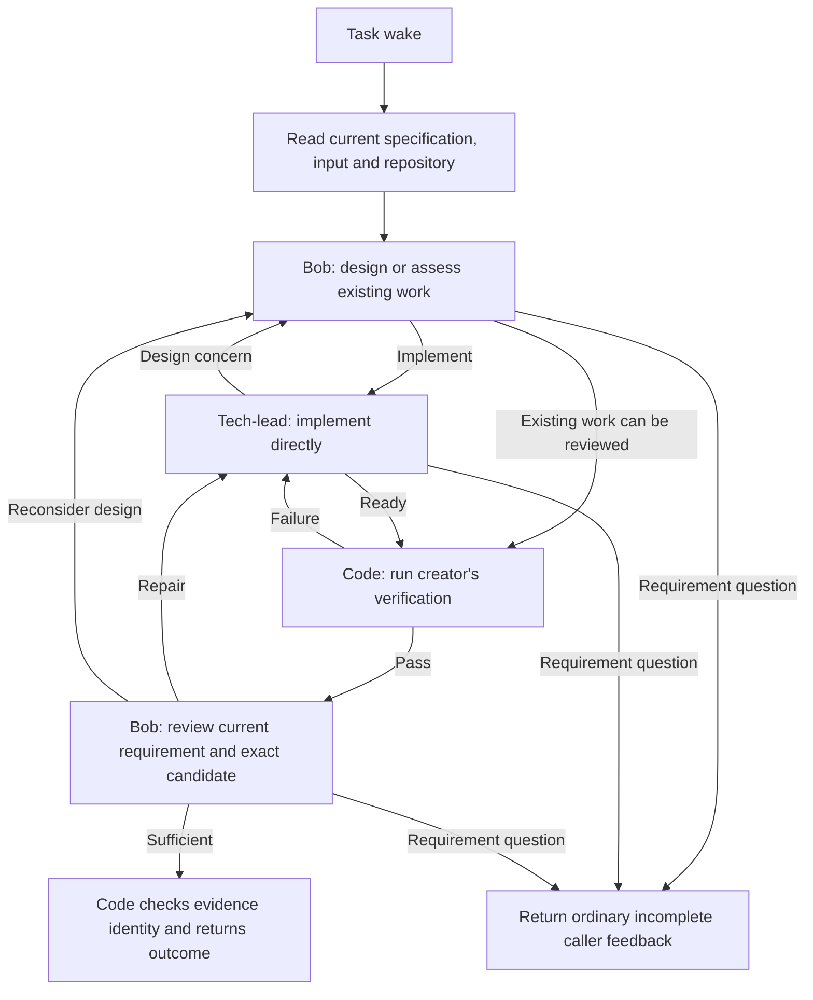

# Development workflow: judgment and execution

Status: opt-in PoC with a completed local integration trial, recorded in the
[PoC review](development-workflow-poc.md). This document does not authorize a
default rollout or certify the current live installation.

## Sufficient first outcome

Turn an accepted requirement into a locally committed, verified and reviewed
candidate. May understands the human and retains the accepted Request. One
ordinary May Task selects the development workflow; Bob judges design/review,
and tech-lead implements directly. No separate coding worker is introduced.

This trial deliberately ends at local source evidence. PR creation, remote CI,
merge, deployment and long external waits are later slices. Do not assign those
outcomes to this workflow and interpret a local candidate as their fulfillment.

## Responsibilities and graph



The graph is App policy. Core continues to own input admission, execution,
Task state, feedback, recovery and closure. The graph adds no core phases,
event handler, database table, timer, queue, workflow checkpoint service or
agent heartbeat. An exhausted local repair allowance returns an incomplete
attempt; the same Task remains responsible under ordinary backoff.

The process is one reconciliation loop: read the latest requirements, check
the work so far, and decide what to do next. Execute that step and save the
result. Feedback, failed checks and recovery all lead to another iteration. The
current workflow allows three rounds in one execution; that bounds the
invocation, not the number of iterations available to the Task. Matching
evidence lets later invocations skip completed work.

Agents make judgments; the workflow runs the steps and checks. Bob assesses
the design before tech-lead implements it. Code runs verification, and Bob
reviews the result before completion. The workflow reuses completed work while
it still applies to the latest requirements and code. These are the App's
development rules, implemented by the existing workflow.

An agent can iterate locally within its assigned step. Tech-lead can inspect,
edit, test and adjust until ready, or return a design concern or requirement
question through its structured result. The workflow passes that decision to
the responsible agent and continues from the result. Local iteration adds no
Task, scheduler or independent work authority. May maintains the accepted
requirement as the Task creator; Bob judges design and acceptance; tech-lead
judges implementation choices.

Agent calls inherit the Host's remaining workflow execution allowance and
cancellation. There is no additional per-step timer or operation cap in this
workflow. The initial parser PoC's three-minute/40-operation caps interrupted
substantive report authoring in the local integration trial. Removing those
overrides keeps the existing bounded execution path and ordinary recovery.

Profiles use internal names `may-bob` and `may-tech-lead` to avoid collisions
with the existing Host Operations profiles. They live under `may.app`. The
workflow selects them through its bounded SDK calls. May can submit an ordinary
development input through its App, so this PoC needs no global May relocation,
cross-App helper exception, or Host Operations activation.

Bob uses GPT-6 Astra with read-only tools plus the structured finish capability.
Tech-lead uses GPT-5.6 Sol with file/shell tools plus finish. Neither profile
has agent delegation, CLI-worker, message, workflow-recursion or cron tools.
The standard loader also supplies its scoped `tasks` capability. That tool
includes reads, fact publication and creator-authorized updates; its name in
the current read-only allowlist does not make every action read-only. These
profiles are instructed to return judgments without using Task mutations.
Tech-lead's shell remains trusted code execution, not a filesystem/network
sandbox. The workflow mechanically checks candidate acceptance and removes
Bob's file/shell write tools. Shared Task effects still rely on their ordinary
authority checks and the assignment; prompts restricting effects are not a sandbox.

## Decision contracts and enforcement

| Step           | Agent decision                       | Code action                                                                                     |
| -------------- | ------------------------------------ | ----------------------------------------------------------------------------------------------- |
| Design         | implement / review / clarify         | Invoke implementation, verify existing work, or return the creator question                     |
| Implementation | ready / redesign / clarify           | Inspect the committed candidate and run checks, request design judgment, or return the question |
| Verification   | Process exit and repository readback | Failure evidence goes to tech-lead; success permits review                                      |
| Review         | pass / revise / redesign / clarify   | Admit sufficient evidence, request repair, revisit design, or return the question               |

Use the SDK's structured result schema for each call. The workflow validates
the returned decision and invokes fixed profile names; agents do not construct
routes, events or timers. A fresh design judgment supersedes the earlier request for repair: when Bob
chooses review of existing clean work, stale feedback must not force another
implementation. Existing exact-candidate verification remains reusable.
Findings in a pass result must be empty. This small
contract treats all returned findings as unresolved work; optional ideas belong
in the explanation and do not require a new finding taxonomy.

Verification argv is supplied in the creator's specification. Code executes it
as a subprocess without shell interpolation, with bounded duration/output and
the workflow cancellation signal. The implementing agent cannot substitute a
different command in its finish result. Bob must still judge whether the
tests prove the requirement and whether changing a test was appropriate.

The workflow requests a Runtime-owned task worktree based on `main`. It rejects
a shared primary checkout, keeps unfinished edits, and checks clean committed
source before verification and review. Passing checks and review are bound to
the exact commit and merge-base. A changed or dirty candidate cannot reuse
those receipts. Workflow code does not allocate, merge, push or clean worktrees.
The Host must preserve a clean unmerged deliverable when accepting this local
outcome. Integration is an App requirement only when the assignment asks for
it; workspace cleanup cannot impose a merge or remove the report's checkout.
The local report trial exposed that older Host cleanup incorrectly rejected
such results. It requires the accompanying workspace finalization correction.
Evidence reuse assumes the local toolchain and ignored dependencies remain
unchanged. It does not fingerprint the environment or certify external systems;
a new input requests fresh verification when those assumptions change.

## Reconciliation and updates

The accepted Task result stores a small versioned `development` record with
checksummed references to a full evidence snapshot and a readable report index.
The snapshot retains requirement/input fingerprints, design judgment,
implementation identity, verification identity, review judgment and unresolved
feedback. Each specialist call also retains its actual execution ID, summary,
structured output, facts and any SDK-provided CLI receipts. Code records these
before judging whether the returned decision is valid. Verification records its
actual argv, directory, timestamps, exit status, stdout/stderr and before/after
candidate identities on both success and failure. A timeout or output-limit
error remains a failed check; captured output is not claimed to be exhaustive.

Files live beneath the Task output's `.state/may-development/` directory. The
repository must already ignore that directory, as this App does; the workflow
checks this before work and never changes ignore rules to hide source edits.
The shared `shared/tools/task-evidence.ts` helper publishes complete
content-addressed files and never replaces an existing artifact. Its common
recovery rule is described in the [workflow contract](../../may-agent.app/docs/2a-design/workflows.md#evidence-retention-and-autonomous-recovery). May supplies
the Git/requirement validity checks and team policy. Raw JSON preserves exact values; readable Markdown supports paginated
inspection of long text. These are local deliverables retained with the Task
worktree, not a permanent archive independent of worktree retention.

The full reports are outside the Host's 16 KiB Task result field. Code bounds
summary previews, retains full explanations, and validates the aggregate return
against the SDK contract before delivery. Agents do not have to guess how many
characters remain across all reports. Failure to save evidence cannot produce
convergence. The reviewer always receives the latest report for each evidence kind, without
a history-length cutoff, and execution identities,
including actual successful check output, instead of being asked to trust an
implementation claim or request repeated receipts from tech-lead.

Each invocation reads the exact Task and repository. Current specification is
authoritative. Matching accepted verification/review evidence can produce a
quiet result without model calls. When Runtime supplies a rejected previous
attempt, the workflow can also inspect that attempt's evidence, only in the
same generation and workspace. It validates the snapshot and referenced files,
requirement/input fingerprints, and current clean commit and merge-base before
reusing a completion. Missing or damaged evidence requires fresh assessment.
Rejected settlement is never treated as accepted work or permission to replay
effects. New input causes fresh judgment; this PoC accepts extra review instead
of classifying every event type.

The files have no latest pointer, executable phase, pending-work list, timer or
scheduler. Runtime's accepted result or explicit previous-attempt reference is
the only way reconciliation selects them. Interruption before a workflow returns
may leave useful files without a selectable snapshot; ordinary source inspection
and repeat verification still apply. This does not promise exact step replay.

The readable delivery index records local evidence, not Task settlement,
Request closure, merge or deployment. May reads the returned report and current
Task/Request state before describing those effects as completed. Arbitrary prose
written before settlement is not an authoritative closeout receipt.

Events prompt reconciliation; the current specification and evidence determine
the next step. An input event alone does not authorize a new requirement. May
interprets the human request and uses its creator authority to update the
specification. The accepted write is independent of the worker's execution.

A changed specification makes the saved evidence outdated, so the next
invocation obtains Bob's design judgment before implementation resumes. Bob
can retain a suitable approach. Failed verification under an unchanged
specification leaves the design valid, so code returns directly to tech-lead.
Both follow from the current work and requirements; neither needs a separate
event handler. The PoC conservatively resets saved evidence for any newly
delivered input, so asynchronous notifications can cause extra assessment.
More selective reuse is an optional optimization; external-operation
continuation is outside this trial.

At a checkpoint, code compares the requirement used for the work with the
current Task requirement. The existing generation and requirement checksum
provide that check; ordinary progress updates do not change the requirement.
Tech-lead does not need to receive a notification, poll through a tool or ask
another model whether something changed. If the requirement is unchanged,
execution continues. If it changed, the execution preserves work and returns
incomplete. The same Task's next iteration reads the latest state, and the
workflow selects the next step under the App's rules.

The current checkpoints are before and after the whole agent call, and around
verification. Tech-lead can keep coding and testing within its call; it may
continue using old instructions until the call returns or execution ends.
Preserving work means retaining files and available progress. It does not
require committing unfinished code or capturing every internal step.

Checkpoint placement is a responsiveness choice within the same reconciliation
model. Keep the current boundaries as the simple default. Checking between
coding iterations could detect updates sooner, at the cost of more execution
integration. Measure call duration and work spent on superseded requirements
before adding finer checkpoints. Faster notification can be an optimization;
reading the current requirement remains the basis for deciding whether to yield.

Runtime settlement fences remain responsible for concurrent acceptance. These
checks do not lock files, provider calls or specification updates, or prevent
the creator's write.

An interrupted attempt may leave a commit or dirty edit without a Runtime-referenced
workflow record. The next invocation inspects the same worktree and asks
tech-lead to retain/repair that work. Cheap design and verification may repeat.
We do not require exact step replay or create an external-action ledger.

Requirement questions return `incomplete` with `report: true`, through the
Task's existing caller feedback. The workflow does not invent a human Condition
with no return route or directly send messages. The experiment does not claim
exact suppression of repeated questions during retry.

## Input and installation boundary

```json
{
  "kind": "development",
  "data": {
    "outcome": "Correct the duration parser",
    "acceptance": [
      "Whole-number hours convert to minutes",
      "Malformed values are rejected"
    ],
    "constraints": ["No added dependency"],
    "verify": ["node", "verify.cjs"]
  }
}
```

May retains the same Request/Task link for follow-up and uses the existing
creator update capability for corrections. Ordinary `goal` input still selects
May; only explicit `development` input selects `develop-change`. Development
can produce a locally committed design/audit document as well as code. Its
verification must be executable argv, not English instructions. Bob still judges
the substance: checking a document exists does not certify its conclusions.
General research without a repository deliverable continues to use `goal`; this
repair does not add a second research controller.

Source needs the bounded workflow SDK, including `ctx.signal`, exact Task
reads, structured agent calls and task workspaces. The local integration trial
used a v4-based image with companion changes for GPT-6 registration, App-local
helper loading and preservation of clean local deliverables. See the PoC
review for the tested versions and remaining limits. Definitions, SDK and Host
must be validated together before activation; their source names do not prove
an installed or functioning model route.

May explicitly declares its existing App directory as a Git workspace on `main`;
the Host requires this declaration before allocating a Task worktree. The
App workspace determines the source repository for Task
worktrees. Arbitrary repository selection is outside this trial. A temporary
fixture supplies its repository explicitly to the real workflow runner. A
future actual-project trial must confirm the App workspace and Task worktree
before executing; changing the App's workspace can affect its other Tasks.

## Proof and reproduction

Portable checks run with `bun run check` in this App. The workflow tests use
actual temporary Git repositories, isolated worktrees, subprocess verification,
SDK result admission and scripted agent decisions. They test process mechanics,
not model quality or full daemon recovery.

`poc/run.ts --live` is a temporary opt-in branch harness. Set `MAY_HOST_SOURCE`
to the reviewed Host checkout and `MODEL_BASE_URL` / `MODEL_API_KEY` to an
authorized endpoint. It creates an isolated duration-parser fixture and uses
the actual workflow runner, agent profiles, models and tools. It persists
fixture Task data across invocations and independently checks the produced
parser. It does not connect to the live daemon or claim to exercise actual
Task event admission, scheduling, creator authority or notification delivery.
Remove the harness after recording its results if it gains no recurring use.

Results and remaining gaps are recorded in the [PoC review](development-workflow-poc.md). The
acceptance question is whether useful decisions produce a correct candidate
with manageable cost and understandable recovery, not how many stages run.
