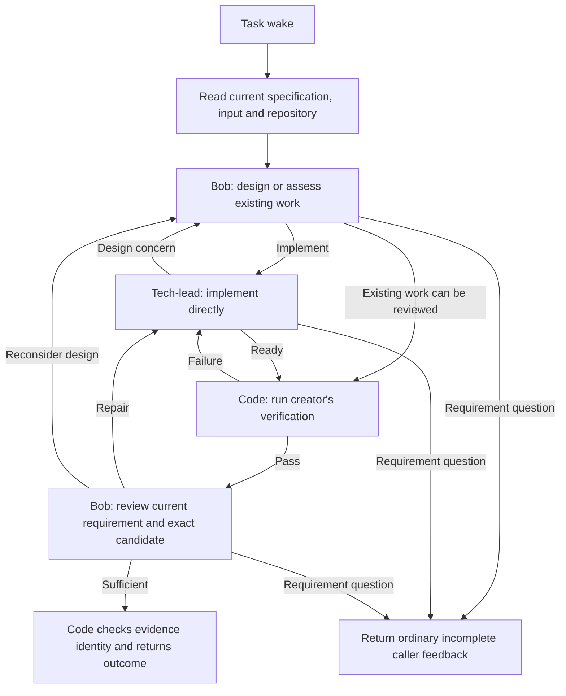

# Development workflow: judgment and execution

Status: opt-in source PoC. No live App activation or deployment is implied.

## Sufficient first outcome

Turn an accepted requirement into a locally committed, verified and reviewed
candidate. May understands the human and retains the accepted Request. One
ordinary May Task selects the development workflow; Bob judges design/review,
and tech-lead implements directly. No separate coding worker is introduced.

This trial deliberately ends at local source evidence. PR creation, remote CI,
merge, deployment and long external waits are later slices. Do not assign those
outcomes to this workflow and interpret a local candidate as their fulfillment.

## Responsibilities and graph



The graph is App policy. Core continues to own input admission, execution,
Task state, feedback, recovery and closure. The graph adds no core phases,
event handler, database table, timer, queue, workflow checkpoint service or
agent heartbeat. An exhausted local repair allowance returns an incomplete
attempt; the same Task remains responsible under ordinary backoff.

Profiles use internal names `may-bob` and `may-tech-lead` to avoid collisions
with the existing Host Operations profiles. They live under `may.app`. The
workflow selects them through its bounded SDK calls. May can submit an ordinary
development input through its App, so this PoC needs no global May relocation,
cross-App helper exception, or Host Operations activation.

Bob uses GPT-6 Astra with read-only tools plus the structured finish capability.
Tech-lead uses GPT-5.6 Sol with file/shell tools plus finish. Neither profile
has agent delegation, CLI-worker, message, workflow-recursion or cron tools.
The standard loader also supplies its existing scoped, read-only Task tool;
this does not allow either profile to assign Tasks or change requirements.
Tech-lead's shell remains trusted code execution, not a filesystem/network
sandbox. The workflow's acceptance checks and Bob's read-only tool policy are
mechanical guarantees; prompts restricting arbitrary shell effects are not.

## Decision contracts and enforcement

| Step           | Agent decision                       | Code action                                                                                     |
| -------------- | ------------------------------------ | ----------------------------------------------------------------------------------------------- |
| Design         | implement / review / clarify         | Invoke implementation, verify existing work, or return the creator question                     |
| Implementation | ready / redesign / clarify           | Inspect the committed candidate and run checks, request design judgment, or return the question |
| Verification   | Process exit and repository readback | Failure evidence goes to tech-lead; success permits review                                      |
| Review         | pass / revise / redesign / clarify   | Admit sufficient evidence, request repair, revisit design, or return the question               |

Use the SDK's structured result schema for each call. The workflow validates
the returned decision and invokes fixed profile names; agents do not construct
routes, events or timers. Findings in a pass result must be empty. This small
contract treats all returned findings as unresolved work; optional ideas belong
in the explanation and do not require a new finding taxonomy.

Verification argv is supplied in the creator's specification. Code executes it
as a subprocess without shell interpolation, with bounded duration/output and
the workflow cancellation signal. The implementing agent cannot substitute a
different command in its finish result. Bob must still judge whether the
tests prove the requirement and whether changing a test was appropriate.

The workflow requests a Runtime-owned task worktree based on `main`. It rejects
a shared primary checkout, keeps unfinished edits, and checks clean committed
source before verification and review. Passing checks and review are bound to
the exact commit and merge-base. A changed or dirty candidate cannot reuse
those receipts. Workflow code does not allocate, merge, push or clean worktrees.
Evidence reuse assumes the local toolchain and ignored dependencies remain
unchanged. It does not fingerprint the environment or certify external systems;
a new input requests fresh verification when those assumptions change.

## Reconciliation and updates

The accepted Task result stores a small `development` record: requirement/input
fingerprints, design judgment, implementation identity, verification identity,
review judgment and any unresolved feedback. This is evidence inside existing
Task status, not a second work authority or an instruction pointer.

Each invocation reads the exact Task and repository. Current specification is
authoritative. Matching accepted verification/review evidence can produce a
quiet result without model calls. New input causes fresh judgment; this PoC
accepts inexpensive extra review instead of classifying every event type.

Creator changes remain independent of execution. Before and after agent calls,
and before verification, the workflow checks the current specification. If it
changed, the attempt preserves work and returns incomplete; the next invocation
reconciles the new specification. This does not block or intercept the creator's
write. Runtime settlement fences remain responsible for concurrent acceptance.
The reads do not form a lock over files, provider calls or specification updates.

An interrupted attempt may leave a commit or dirty edit without an accepted
workflow record. The next invocation inspects the same worktree and asks
tech-lead to retain/repair that work. Cheap design and verification may repeat.
We do not require exact step replay or create an external-action ledger.

Requirement questions return `incomplete` with `report: true`, through the
Task's existing caller feedback. The workflow does not invent a human Condition
with no return route or directly send messages. The experiment does not claim
exact suppression of repeated questions during retry.

## Input and installation boundary

```json
{
  "kind": "development",
  "data": {
    "outcome": "Correct the duration parser",
    "acceptance": [
      "Whole-number hours convert to minutes",
      "Malformed values are rejected"
    ],
    "constraints": ["No added dependency"],
    "verify": ["node", "verify.cjs"]
  }
}
```

May retains the same Request/Task link for follow-up and uses the existing
creator update capability for corrections. Ordinary `goal` input still selects
May; only explicit `development` input selects `develop-change`.

Source needs the current bounded workflow SDK, including `ctx.signal`, exact
Task reads, structured agent calls and task workspaces. The running v4 image
is older than the reviewed SDK source used by this PoC. GPT-6 is advertised by
the configured endpoint, but the current installed Host registry lacks that
entry; the small companion Host change registers the exact model. Definitions,
SDK and Host must be validated together before activation. Their source names
do not prove an installed or functioning model route.

May's App workspace currently determines the source repository for Task
worktrees. Arbitrary repository selection is outside this trial. A temporary
fixture supplies its repository explicitly to the real workflow runner. A
future actual-project trial must confirm the App workspace and Task worktree
before executing; changing the App's workspace can affect its other Tasks.

## Proof and reproduction

Portable checks run with `bun run check` in this App. The workflow tests use
actual temporary Git repositories, isolated worktrees, subprocess verification,
SDK result admission and scripted agent decisions. They test process mechanics,
not model quality or full daemon recovery.

`poc/run.ts --live` is a temporary opt-in branch harness. Set `MAY_HOST_SOURCE`
to the reviewed Host checkout and `MODEL_BASE_URL` / `MODEL_API_KEY` to an
authorized endpoint. It creates an isolated duration-parser fixture and uses
the actual workflow runner, agent profiles, models and tools. It persists
fixture Task data across invocations and independently checks the produced
parser. It does not connect to the live daemon or claim to exercise actual
Task event admission, scheduling, creator authority or notification delivery.
Remove the harness after recording its results if it gains no recurring use.

Results and remaining gaps are recorded in the [PoC review](development-workflow-poc.md). The
acceptance question is whether useful decisions produce a correct candidate
with manageable cost and understandable recovery, not how many stages run.
