# Workflow Dependency Graph

## Mermaid Diagram

```mermaid
graph TD
    index.ts --> incremental-checkpoint.ts
    index.ts --> provider-retry.ts
    index.ts --> output-validator.ts
    index.ts --> complexity-estimator.ts
    index.ts --> iteration-timer.ts
    index.ts --> iteration-budget.ts
    index.ts --> health-check.ts
    master-worker-migration-adapter.ts --> master-worker-unified.ts
    master-worker-migration-adapter.ts --> master-worker-resilient.ts

    %% Standalone files (no local imports)
    class budget-checkpoint.ts,circuit-breaker.ts,dispatch-validator.ts standalone
    class fewshot-inject-helpers.ts,heartbeat-data.ts,implement-and-verify.ts standalone
    class master-worker.ts,master-worker-cached.ts,master-worker-with-health-check.ts standalone
    class metrics-collector.ts,project-cache.ts,project-helpers.ts,project.ts standalone
    class retry-wrapper.ts,verify-wrap.ts,worker-retry.ts,workflow-runner.ts standalone
```

## File Import/Export Table

| File | Local Imports | Key Exports |
|------|--------------|-------------|
| `index.ts` | `incremental-checkpoint`, `provider-retry`, `output-validator`, `complexity-estimator`, `iteration-timer`, `iteration-budget`, `health-check` | Re-exports all public APIs from imported modules |
| `master-worker-migration-adapter.ts` | `master-worker-unified`, `master-worker-resilient` | `resilientConfigToUnified`, `runResilientViaUnified` |
| `budget-checkpoint.ts` | — | `estimateTurnsUsed`, `shouldBudgetCheckpoint`, `buildBudgetCheckpointEntry`, `resetBudgetState` |
| `circuit-breaker.ts` | — | `checkCircuitBreaker`, `recordOutcome`, `resetCircuitBreaker` |
| `complexity-estimator.ts` | — | `ComplexityScore`, `ComplexityEstimate`, `estimateComplexity` |
| `dispatch-validator.ts` | — | `ValidationResult`, `parseProjectDir`, `validateDispatch`, `isDispatchable` |
| `fewshot-inject-helpers.ts` | — | `selectExamples`, `loadExample`, `injectFewShot` |
| `health-check.ts` | — | `MetricInfo`, `ProjectHealth`, `HealthReport`, `parseMetrics`, `isAtTarget` |
| `heartbeat-data.ts` | — | `loadMetrics`, `loadProjects`, `loadAlerts`, `loadHeartbeatMd`, `loadInbox` |
| `implement-and-verify.ts` | — | `name`, `description`, `execute` (workflow) |
| `incremental-checkpoint.ts` | — | `CheckpointData`, `saveIncrementalCheckpoint`, `detectIncompleteCheckpoint`, `markCheckpointComplete`, `cleanupCheckpoints` |
| `iteration-budget.ts` | — | `BudgetConfig`, `BudgetStatus`, `Budget`, `createBudget`, `getBudgetConfig` |
| `iteration-timer.ts` | — | `IterationTimer`, `TimerStats`, `formatDuration` |
| `master-worker.ts` | — | `name`, `description`, `extractDecision`, `orchestratorSystemPrompt`, `workerSystemPrompt` |
| `master-worker-cached.ts` | — | `CachedProjectContext`, `createCachedContext`, `readProjectFile`, `readJournalFile` |
| `master-worker-resilient.ts` | — | `ResilientConfig`, `LLMProvider`, `IterationResult`, `RunResult`, `getCircuitLabel` |
| `master-worker-unified.ts` | — | `CacheConfig`, `ResilienceConfig`, `HealthCheckConfig`, `MasterWorkerConfig`, `RunResult` |
| `master-worker-with-health-check.ts` | — | `DispatchConfig`, `PreFlightResult`, `IterationResult`, `WorkflowResult`, `runPreFlight` |
| `metrics-collector.ts` | — | `MetricsEntry`, `MetricsSummary`, `MetricsStats`, `TrendableMetric`, `TrendPoint` |
| `output-validator.ts` | — | `ValidationResult`, `ValidatorOptions`, `validateOutput`, `findDuplicate`, `validateContentType` |
| `project-cache.ts` | — | `CacheEntry`, `ProjectCache`, `parseSections`, `extractSectionContent` |
| `project-helpers.ts` | — | `extractField`, `extractSection`, `MilestoneState`, `extractMilestones`, `checkOffMilestones` |
| `project.ts` | — | `name`, `description`, `flushProjectCache`, `execute` (workflow) |
| `provider-retry.ts` | — | `RetryOptions`, `RetryResult`, `ErrorCategory`, `classifyError`, `isRetryableError` |
| `retry-wrapper.ts` | — | `RetryConfig`, `CircuitState`, `RetryResult`, `mergeConfig`, `createInitialCircuitState` |
| `verify-wrap.ts` | — | `name`, `description`, `execute` (workflow) |
| `worker-retry.ts` | — | `WorkerRetryOptions`, `WorkerRetryResult`, `calculateDelay`, `isWorkerRetryable`, `withWorkerRetry` |
| `workflow-runner.ts` | — | `WorkflowStage`, `WorkflowConfig`, `StageResult`, `WorkflowResult`, `mergeWorkflowConfig` |

## Fan-In Analysis (Most Depended-Upon Files)

| File | Fan-In | Depended On By |
|------|--------|----------------|
| `incremental-checkpoint.ts` | 1 | `index.ts` |
| `provider-retry.ts` | 1 | `index.ts` |
| `output-validator.ts` | 1 | `index.ts` |
| `complexity-estimator.ts` | 1 | `index.ts` |
| `iteration-timer.ts` | 1 | `index.ts` |
| `iteration-budget.ts` | 1 | `index.ts` |
| `health-check.ts` | 1 | `index.ts` |
| `master-worker-unified.ts` | 1 | `master-worker-migration-adapter.ts` |
| `master-worker-resilient.ts` | 1 | `master-worker-migration-adapter.ts` |

### Notes

- **`index.ts`** is the barrel/re-export hub with 7 local imports — it serves as the public API surface for the workflows package.
- **`master-worker-migration-adapter.ts`** is the only other file with local imports, bridging the resilient and unified master-worker implementations.
- The architecture is remarkably **flat**: 26 of 28 files have zero local imports, meaning most modules are self-contained utilities consumed by external code (agents, other packages) rather than by each other.
- The 7 files re-exported through `index.ts` represent the **canonical public API**: `incremental-checkpoint`, `provider-retry`, `output-validator`, `complexity-estimator`, `iteration-timer`, `iteration-budget`, and `health-check`.
- Files like `master-worker.ts`, `project.ts`, `implement-and-verify.ts`, and `verify-wrap.ts` are **workflow definitions** (they export `name`, `description`, `execute`) loaded dynamically by the workflow runner rather than statically imported.
